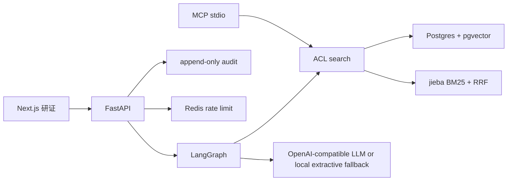

# 研证 YanZheng

研证是清衡实验室的知识助手。它只根据当前用户有权阅读的文档回答，引用具体小节，证据不够就拒绝，并留下不含原文的审计记录。

这是一次从零开始的重写，面向检索、权限和可复现评测。旧系统里的业务 CRUD 没有搬过来。

## 中文说明

研证回答实验室已经写下来的事实：集群约定、组会、项目笔记、论文笔记。上传的 Markdown 按 `##` 标题切成块，检索在数据库里就带上访问控制，模型只有在余弦相似度（或显式开启的重排分数）超过开发集上调好的阈值时才会被调用。

本地演示账号只用于这套合成数据：

| 姓名 | 邮箱 | 角色 | 密码 |
| --- | --- | --- | --- |
| 沈昭 | admin@lab.local | 管理员 | `YanZheng-Demo-2026-Admin` |
| 林可 | member@lab.local | 成员，可读项目赫利俄斯 | `YanZheng-Demo-2026-Member` |
| 周宁 | member@lab.local | 成员，可读采购笔记，不能读赫利俄斯 | `YanZheng-Demo-2026-Zhou` |
| 王敏 | viewer@lab.local | 查看者，不能上传 | `YanZheng-Demo-2026-Viewer` |

界面默认中文，右上角可以切到英文。

### 本地运行

需要 Docker。在仓库根目录：

```bash
./scripts/init-env.sh
docker compose up --build
```

浏览器打开 [http://127.0.0.1:43123](http://127.0.0.1:43123)。API 在 `43124`，Postgres 在 `55432`，Redis 在 `56379`。

不使用 Docker 时，先起 Postgres（带 pgvector）和 Redis，再：

```bash
cd backend && uv sync && uv run alembic upgrade head && uv run python -m app.seed
uv run uvicorn app.main:app --host 127.0.0.1 --port 43124
```

另一个终端：

```bash
cd frontend && npm ci && API_INTERNAL_URL=http://127.0.0.1:43124 npm run dev -- --port 43123
```

默认嵌入器是本地哈希嵌入，不下载模型。换成 `BAAI/bge-small-zh-v1.5` 时设置 `EMBEDDER=bge` 并安装 `uv sync --extra bge`。默认回答器是抽取式本地回退。设置 `LLM_PROVIDER=deepseek`（或 `openai` / `ollama` / `vllm`）以及相应的 `LLM_API_KEY`、`LLM_BASE_URL` 后，拒绝门槛仍然在模型调用之前。

评测：

```bash
cd backend && uv run python -m evals.run_eval --tune    # 只在开发集上调阈值
uv run python -m evals.run_eval --check                  # 对照已提交的基线
```

## Architecture



登录后的浏览器只拿一个 httpOnly cookie。Next.js 路由把 cookie 换成 Authorization 再转给 API。检索、文档读取和 MCP 工具共用同一条 ACL。审计与对话正文分开存放。

## What the baseline actually measured

The committed file `evals/baseline_results.json` is the **hashing embedder**, not bge. Thresholds, citation margin, and RRF `k` were chosen on the dev split only (51 questions). The test split (27 questions) was scored once. Refusal uses cosine similarity. Fusion is reciprocal rank fusion, not a weighted sum of min-max scores.

| Mode | Split | Recall@5 | MRR | Citation F1 | Refusal | False refusal | False answer |
| --- | --- | ---: | ---: | ---: | ---: | ---: | ---: |
| dense (selected) | dev | 0.949 | 0.926 | 0.795 | 0.804 | 0.103 | 0.500 |
| dense (selected) | test | 0.952 | 0.888 | 0.667 | 0.704 | 0.191 | 0.667 |
| hybrid RRF | dev | 0.949 | 0.926 | 0.795 | 0.804 | 0.103 | 0.500 |
| hybrid RRF | test | 1.000 | 0.921 | 0.667 | 0.704 | 0.191 | 0.667 |
| lexical rerank, pool 40 | test | 1.000 | 0.917 | 0.571 | 0.630 | 0.333 | 0.500 |
| lexical rerank, pool 15 | test | 1.000 | 0.917 | 0.571 | 0.630 | 0.333 | 0.500 |

Mode choice is the best dev Recall@5, then MRR, so dense stays selected when hybrid ties it on dev. Hybrid RRF does not show the collapse that a naive BM25-weighted fusion produced on an earlier paraphrase set. The lexical reranker is not a cross-encoder. Multi-chunk Recall@5 is 1.0 on this set; citation F1 is lower because the tuned policy cites a single section. The hashing embedder still answers two thirds of the unanswerable test questions that share vocabulary with the corpus. That gap is why a calibrated neural embedder is the next measurement, not a claim this table already makes.

Query latency for this embedder is about 2 ms on CPU inside the eval harness. That number is not comparable to a cross-encoder.

## Layout

- `backend/app` — API, ACL, audit, retrieval, agent, MCP
- `evals/data/v1` — synthetic Chinese corpus and questions
- `frontend` — login, streaming chat, documents, audit
- `docs/adr` — why the stack and the refusal rule look like this
- `SECURITY.md` — secrets, retention, redaction

## Tests

```bash
cd backend && uv run pytest && uv run ruff check app evals tests && uv run mypy app evals
cd frontend && npm run lint && npx tsc --noEmit
```

Pytest uses the compose database `yanzheng_test` on port 55432 unless `TEST_DATABASE_URL` is set.
