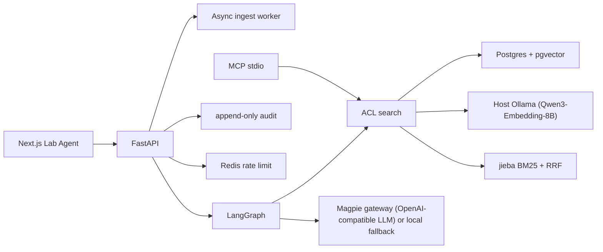

# Lab Agent

Lab Agent 是清衡实验室的知识助手。它只根据当前用户有权阅读的文档回答，引用具体小节，证据不够就拒绝，并留下不含原文的审计记录。

这是一次从零开始的重写，面向检索、权限和可复现评测。旧系统里的业务 CRUD 没有搬过来。

## 中文说明

Lab Agent 回答实验室已经写下来的事实：集群约定、组会、项目笔记、论文笔记。上传的 Markdown 按 `##` 标题切成块，检索在数据库里就带上访问控制，模型只有在余弦相似度（或显式开启的重排分数）超过开发集上调好的阈值时才会被调用。

下面的账号和密码只属于本地合成演示。`APP_ENV=prod` 时种子脚本会直接退出，不会写入这些账号。登录框只有在 `NEXT_PUBLIC_DEMO_HINTS=true` 时才预填密码；镜像构建默认是关闭的，`docker compose` 的本地演示才会打开。

| 姓名 | 邮箱 | 角色 | 密码 |
| --- | --- | --- | --- |
| 沈昭 | admin@lab.local | 管理员 | `LabAgent-Demo-2026-Admin` |
| 林可 | member@lab.local | 成员，可读项目赫利俄斯 | `LabAgent-Demo-2026-Member` |
| 周宁 | zhou@lab.local | 成员，可读采购笔记，不能读赫利俄斯 | `LabAgent-Demo-2026-Zhou` |
| 王敏 | viewer@lab.local | 查看者，不能上传 | `LabAgent-Demo-2026-Viewer` |

界面默认中文，右上角可以切到英文。

### 本地运行

推荐使用仓库自带的 `./scripts/demo.sh` 一键启动并完成端到端冒烟验证（演示操作步骤见 [`docs/demo.md`](docs/demo.md)）。支持**真实模式**与**离线模式**两种运行方式：

#### 1. 真实模式（Magpie 网关 + 宿主机 Ollama 运行 Qwen3-Embedding-8B）

**环境与资源要求**：
- Apple Silicon Mac（建议 ≥16 GB 统一内存；预留至少 6 GB 可用磁盘空间用于存放 8B 嵌入模型权重与校准产物）；
- Docker（Compose v2）；
- 本机运行 Magpie 网关（OpenAI 兼容）；
- 宿主机通过 Homebrew 安装并运行 `ollama`。

**步骤 1：创建独立的 Magpie 密钥文件**
每个客户端应使用独立的 Magpie 网关密钥，以便在 Magpie 中单独统计用量并在需要时独立吊销。将 Lab Agent 专用密钥写入 `~/.config/lab-agent/magpie.key`（权限设为 `600`，**不要**写进 `.env` 或命令行参数）：

```bash
mkdir -p ~/.config/lab-agent && chmod 700 ~/.config/lab-agent
pbpaste > ~/.config/lab-agent/magpie.key && chmod 600 ~/.config/lab-agent/magpie.key
```

**步骤 2：启动宿主机 Ollama 并拉取 `qwen3-embedding:8b`**

```bash
brew services start ollama          # 或者在前台运行 `ollama serve`
ollama pull qwen3-embedding:8b      # Q4_K_M 量化约 5 GB，首次拉取需联网
```

- **为什么 Ollama 不放进 Docker 容器**：macOS 上的 Docker 容器无法调用 Apple Silicon 的 Metal GPU；若将 8B 嵌入模型放进容器内只能退回 CPU 推理，吞吐会慢一个数量级。
- **安全要求**：Ollama 本身没有鉴权机制，必须保持默认仅监听本机回环地址 `127.0.0.1:11434`（容器通过 `host.docker.internal:11434` 访问），**不要**设置 `OLLAMA_HOST=0.0.0.0` 或将其暴露到局域网。

**步骤 3：一键启动与自动冒烟**

```bash
export LLM_MODEL=claude-sonnet-5-5  # 任选一个 Magpie 上可用的对话模型
./scripts/demo.sh
```

- 容器内默认通过 `http://host.docker.internal:3425/v1` 访问本机 Magpie 网关（宿主机直连为 `http://127.0.0.1:3425/v1`）。如果容器连不上默认地址，请在本地 `.env` 里设置 `LLM_BASE_URL`，改成你的网关所在主机的地址。
- `demo.sh` 会依次预检 Magpie 与 Ollama、构建并启动容器、执行 `python -m app.llm_check` 与 `python -m app.embed_check`、在当前嵌入指纹未校准时自动在 dev 集上完成阈值校准，最后跑通 `python -m app.smoke` 端到端冒烟检查。

#### 2. 离线模式（无需密钥与模型权重，CI 默认模式）

只需要 Docker，不依赖 Magpie 或 Ollama：

```bash
./scripts/demo.sh --offline
```

离线模式使用 `EMBEDDER=hashing`（512 维特征哈希）+ `LLM_PROVIDER=fake`（抽取式回退）跑通同一套迁移、种子、阈值检查与端到端冒烟流程，CI 每次 PR 均执行该模式。

> **升级提示（命名统一后的破坏性变化）**：
> - 数据库用户名和库名已改为 `labagent`，旧的本地数据卷与 `.env` 不能继续使用。请执行 `docker compose down -v`，删除旧的 `.env`（或执行 `./scripts/init-env.sh --force`）后再重新启动。
> - 会话与语言 Cookie 已改名为 `la_session`、`la_locale`，已登录的用户需要重新登录一次。

浏览器打开 [http://127.0.0.1:43123](http://127.0.0.1:43123)。API 在 `43124`，Postgres 在 `55432`，Redis 在 `56379`。所有容器端口默认只绑定宿主机回环地址 `127.0.0.1`；需要局域网访问时，自行修改 `docker-compose.yml` 中 `web` 服务的 `ports` 映射（例如改为 `"43123:3000"`）。

不使用 `demo.sh` 或 Docker 时，先起 Postgres（带 pgvector）和 Redis，再：

```bash
cd backend && uv sync && uv run alembic upgrade head && uv run python -m app.reindex --apply --if-needed && uv run python -m app.seed
uv run uvicorn app.main:app --host 127.0.0.1 --port 43124
```

另一个终端：

```bash
cd frontend && npm ci && API_INTERNAL_URL=http://127.0.0.1:43124 npm run dev -- --port 43123
```

默认嵌入器是本地哈希嵌入（`EMBEDDER=hashing`），不下载模型，API 镜像也不打包 `torch` 或本地模型权重。真实模式下使用宿主机 Ollama 提供 OpenAI 兼容嵌入接口（`EMBEDDER=openai_compatible`，运行 `qwen3-embedding:8b`，4096 维 `halfvec` 精确余弦检索）。
- 如果要在宿主机上直接运行 API（不经过 Docker）并使用 Hugging Face `sentence-transformers` 加载本地 BGE 模型（如 `BAAI/bge-small-zh-v1.5`），需要先执行 `cd backend && uv sync --extra bge`，再设置 `EMBEDDER=bge`（可通过 `EMBEDDING_MODEL_VERSION` 固定 HF commit revision，通过 `EMBEDDING_QUERY_TEMPLATE` / `EMBEDDING_QUERY_INSTRUCTION` 和 `EMBEDDING_DOCUMENT_PREFIX` 配置查询指令模板与文档前缀）。
- 用 Ollama 运行 bge 类模型（例如 `bge-m3`）**不需要**启用 `EMBEDDER=bge` 或安装 `bge` 额外依赖，直接设置 `EMBEDDER=openai_compatible` 并指向 Ollama 的 `/v1` 端点即可。

默认回答器是抽取式本地回退。真实模式设置 `LLM_PROVIDER=openai_compatible`、通过 `LLM_API_KEY_FILE`（或 `LLM_API_KEY`）提供网关密钥并指定 `LLM_BASE_URL` 与 `LLM_MODEL` 后，拒绝门槛仍然在模型调用之前。

评测与阈值校准（按嵌入指纹 `embedding_fingerprint` 绑定）：

```bash
# 在开发集 (dev) 上拟合阈值，写入运行时目录 ${CALIBRATION_DIR}/<slug>.json
cd backend && uv run python -m evals.run_eval --tune

# 容器内校准当前嵌入模型（只调用嵌入服务，不调用 LLM），校准后重启 api 生效
docker compose exec api python -m evals.run_eval --tune && docker compose restart api

# 将校准文件与评测报告写入仓库 evals/calibrations/<slug>.json 与 evals/results/v1/<slug>.json（供提交）
cd backend && uv run python -m evals.run_eval --tune --commit

# 对照仓库内当前指纹对应的已提交基线（无基线时退出码为 3）
cd backend && uv run python -m evals.run_eval --check
```

若当前嵌入指纹尚未校准（`${CALIBRATION_DIR}/<slug>.json` 与 `evals/calibrations/<slug>.json` 均不存在或指纹不匹配，且未显式设置 `EVIDENCE_SCORE_MIN`），系统会失败关闭（拒答阈值回退为 `0.99`），`/api/v1/health` 返回 `calibrated: false`，前端顶部显示黄色未校准提示横幅。

## Architecture



登录后的浏览器只拿一个 httpOnly cookie（`la_session`）。Next.js 路由把 cookie 换成 Authorization 并附带可信代理签名的 `X-Client-IP` 再转给 API。检索、文档读取和 MCP 工具共用同一条 ACL。审计与对话正文分开存放。

## What the baseline actually measured

**Embedder fingerprint**: `hashing|hashing-cjk-v1|512|redact=0|qp=e3b0c442|dp=e3b0c442` (slug: `hashing-hashing-cjk-v1-512-redact-0-qp-e3b0c442-dp-e3b0c442`, dataset `v1`).

The committed files `evals/calibrations/hashing-hashing-cjk-v1-512-redact-0-qp-e3b0c442-dp-e3b0c442.json` and `evals/results/v1/hashing-hashing-cjk-v1-512-redact-0-qp-e3b0c442-dp-e3b0c442.json` are for the **offline hashing embedder** (`hashing|hashing-cjk-v1|512|redact=0|qp=e3b0c442|dp=e3b0c442`), not `qwen3-embedding:8b` or `bge`. Thresholds, citation margin, and RRF `k` were chosen on the dev split only (51 questions). The test split (27 questions) was scored once. Refusal uses cosine similarity. Fusion is reciprocal rank fusion, not a weighted sum of min-max scores.

<!-- eval:begin -->
| Fingerprint | Dataset | Mode | Split | Questions | Recall@5 | MRR | Citation F1 | Refusal | False refusal | False answer | Date | Git SHA |
| --- | --- | --- | --- | ---: | ---: | ---: | ---: | ---: | ---: | ---: | --- | --- |
| `hashing\|hashing-cjk-v1\|512\|redact=0\|qp=e3b0c442\|dp=e3b0c442` | `v1` | dense (selected) | dev | 51 | 0.949 [0.872, 1.000] | 0.926 [0.853, 0.987] | 0.795 [0.684, 0.897] | 0.804 [0.686, 0.902] | 0.103 [0.026, 0.205] | 0.500 [0.248, 0.752] | 2026-11-05 | `b15d44b` |
| `hashing\|hashing-cjk-v1\|512\|redact=0\|qp=e3b0c442\|dp=e3b0c442` | `v1` | dense (selected) | test | 27 | 0.952 [0.857, 1.000] | 0.888 [0.782, 0.976] | 0.667 [0.476, 0.857] | 0.704 [0.518, 0.852] | 0.191 [0.048, 0.381] | 0.667 [0.333, 1.000] | 2026-11-05 | `b15d44b` |
| `hashing\|hashing-cjk-v1\|512\|redact=0\|qp=e3b0c442\|dp=e3b0c442` | `v1` | hybrid RRF | dev | 51 | 0.949 [0.872, 1.000] | 0.926 [0.853, 0.987] | 0.795 [0.684, 0.897] | 0.804 [0.686, 0.902] | 0.103 [0.026, 0.205] | 0.500 [0.248, 0.752] | 2026-11-05 | `b15d44b` |
| `hashing\|hashing-cjk-v1\|512\|redact=0\|qp=e3b0c442\|dp=e3b0c442` | `v1` | hybrid RRF | test | 27 | 1.000 [1.000, 1.000] | 0.921 [0.833, 1.000] | 0.667 [0.476, 0.857] | 0.704 [0.518, 0.852] | 0.191 [0.048, 0.381] | 0.667 [0.333, 1.000] | 2026-11-05 | `b15d44b` |
| `hashing\|hashing-cjk-v1\|512\|redact=0\|qp=e3b0c442\|dp=e3b0c442` | `v1` | lexical rerank, pool 40 | test | 27 | 1.000 [1.000, 1.000] | 0.917 [0.821, 1.000] | 0.571 [0.381, 0.762] | 0.630 [0.444, 0.815] | 0.333 [0.143, 0.524] | 0.500 [0.167, 0.833] | 2026-11-05 | `b15d44b` |
| `hashing\|hashing-cjk-v1\|512\|redact=0\|qp=e3b0c442\|dp=e3b0c442` | `v1` | lexical rerank, pool 15 | test | 27 | 1.000 [1.000, 1.000] | 0.917 [0.821, 1.000] | 0.571 [0.381, 0.762] | 0.630 [0.444, 0.815] | 0.333 [0.143, 0.524] | 0.500 [0.167, 0.833] | 2026-11-05 | `b15d44b` |
| `openai_compatible\|qwen3-embedding:8b@64b933495768\|1024\|redact=0\|qp=e1e90dad\|dp=e3b0c442` | `v1` | dense | dev | 51 | 0.987 [0.962, 1.000] | 0.962 [0.923, 1.000] | 0.795 [0.683, 0.897] | 0.824 [0.726, 0.922] | 0.103 [0.026, 0.205] | 0.417 [0.167, 0.667] | 2026-11-05 | `8403acc` |
| `openai_compatible\|qwen3-embedding:8b@64b933495768\|1024\|redact=0\|qp=e1e90dad\|dp=e3b0c442` | `v1` | dense | test | 27 | 1.000 [1.000, 1.000] | 0.897 [0.802, 0.976] | 0.571 [0.381, 0.762] | 0.630 [0.444, 0.815] | 0.333 [0.143, 0.524] | 0.500 [0.167, 0.833] | 2026-11-05 | `8403acc` |
| `openai_compatible\|qwen3-embedding:8b@64b933495768\|1024\|redact=0\|qp=e1e90dad\|dp=e3b0c442` | `v1` | hybrid RRF (selected) | dev | 51 | 1.000 [1.000, 1.000] | 0.957 [0.906, 1.000] | 0.795 [0.683, 0.897] | 0.824 [0.726, 0.922] | 0.103 [0.026, 0.205] | 0.417 [0.167, 0.667] | 2026-11-05 | `8403acc` |
| `openai_compatible\|qwen3-embedding:8b@64b933495768\|1024\|redact=0\|qp=e1e90dad\|dp=e3b0c442` | `v1` | hybrid RRF (selected) | test | 27 | 1.000 [1.000, 1.000] | 0.921 [0.825, 1.000] | 0.571 [0.381, 0.762] | 0.630 [0.444, 0.815] | 0.333 [0.143, 0.524] | 0.500 [0.167, 0.833] | 2026-11-05 | `8403acc` |
| `openai_compatible\|qwen3-embedding:8b@64b933495768\|1024\|redact=0\|qp=e1e90dad\|dp=e3b0c442` | `v1` | lexical rerank, pool 40 | test | 27 | 1.000 [1.000, 1.000] | 0.917 [0.821, 1.000] | 0.571 [0.381, 0.762] | 0.630 [0.444, 0.815] | 0.333 [0.143, 0.524] | 0.500 [0.167, 0.833] | 2026-11-05 | `8403acc` |
| `openai_compatible\|qwen3-embedding:8b@64b933495768\|1024\|redact=0\|qp=e1e90dad\|dp=e3b0c442` | `v1` | lexical rerank, pool 15 | test | 27 | 1.000 [1.000, 1.000] | 0.917 [0.821, 1.000] | 0.571 [0.381, 0.762] | 0.630 [0.444, 0.815] | 0.333 [0.143, 0.524] | 0.500 [0.167, 0.833] | 2026-11-05 | `8403acc` |
| `openai_compatible\|qwen3-embedding:8b@64b933495768\|2048h\|redact=0\|qp=e1e90dad\|dp=e3b0c442` | `v1` | dense | dev | 51 | 0.987 [0.962, 1.000] | 0.962 [0.923, 1.000] | 0.889 [0.803, 0.957] | 0.843 [0.745, 0.941] | 0.026 [0.000, 0.077] | 0.583 [0.333, 0.833] | 2026-11-05 | `8403acc` |
| `openai_compatible\|qwen3-embedding:8b@64b933495768\|2048h\|redact=0\|qp=e1e90dad\|dp=e3b0c442` | `v1` | dense | test | 27 | 1.000 [1.000, 1.000] | 0.921 [0.825, 1.000] | 0.762 [0.603, 0.921] | 0.704 [0.518, 0.889] | 0.143 [0.000, 0.286] | 0.833 [0.500, 1.000] | 2026-11-05 | `8403acc` |
| `openai_compatible\|qwen3-embedding:8b@64b933495768\|2048h\|redact=0\|qp=e1e90dad\|dp=e3b0c442` | `v1` | hybrid RRF (selected) | dev | 51 | 1.000 [1.000, 1.000] | 0.957 [0.906, 1.000] | 0.889 [0.803, 0.957] | 0.843 [0.745, 0.941] | 0.026 [0.000, 0.077] | 0.583 [0.333, 0.833] | 2026-11-05 | `8403acc` |
| `openai_compatible\|qwen3-embedding:8b@64b933495768\|2048h\|redact=0\|qp=e1e90dad\|dp=e3b0c442` | `v1` | hybrid RRF (selected) | test | 27 | 1.000 [1.000, 1.000] | 0.921 [0.825, 1.000] | 0.762 [0.603, 0.921] | 0.741 [0.556, 0.889] | 0.143 [0.000, 0.286] | 0.667 [0.333, 1.000] | 2026-11-05 | `8403acc` |
| `openai_compatible\|qwen3-embedding:8b@64b933495768\|2048h\|redact=0\|qp=e1e90dad\|dp=e3b0c442` | `v1` | lexical rerank, pool 40 | test | 27 | 1.000 [1.000, 1.000] | 0.917 [0.821, 1.000] | 0.571 [0.381, 0.762] | 0.630 [0.444, 0.815] | 0.333 [0.143, 0.524] | 0.500 [0.167, 0.833] | 2026-11-05 | `8403acc` |
| `openai_compatible\|qwen3-embedding:8b@64b933495768\|2048h\|redact=0\|qp=e1e90dad\|dp=e3b0c442` | `v1` | lexical rerank, pool 15 | test | 27 | 1.000 [1.000, 1.000] | 0.917 [0.821, 1.000] | 0.571 [0.381, 0.762] | 0.630 [0.444, 0.815] | 0.333 [0.143, 0.524] | 0.500 [0.167, 0.833] | 2026-11-05 | `8403acc` |
| `openai_compatible\|qwen3-embedding:8b@64b933495768\|4096\|redact=0\|qp=e1e90dad\|dp=e3b0c442` | `v1` | dense | dev | 51 | 0.987 [0.962, 1.000] | 0.962 [0.923, 1.000] | 0.914 [0.846, 0.966] | 0.863 [0.765, 0.941] | 0.000 [0.000, 0.000] | 0.583 [0.333, 0.833] | 2026-11-05 | `8403acc` |
| `openai_compatible\|qwen3-embedding:8b@64b933495768\|4096\|redact=0\|qp=e1e90dad\|dp=e3b0c442` | `v1` | dense | test | 27 | 1.000 [1.000, 1.000] | 0.952 [0.881, 1.000] | 0.762 [0.603, 0.921] | 0.667 [0.481, 0.852] | 0.143 [0.000, 0.286] | 1.000 [1.000, 1.000] | 2026-11-05 | `8403acc` |
| `openai_compatible\|qwen3-embedding:8b@64b933495768\|4096\|redact=0\|qp=e1e90dad\|dp=e3b0c442` | `v1` | hybrid RRF (selected) | dev | 51 | 1.000 [1.000, 1.000] | 0.957 [0.906, 1.000] | 0.914 [0.846, 0.966] | 0.863 [0.765, 0.941] | 0.000 [0.000, 0.000] | 0.583 [0.333, 0.833] | 2026-11-05 | `8403acc` |
| `openai_compatible\|qwen3-embedding:8b@64b933495768\|4096\|redact=0\|qp=e1e90dad\|dp=e3b0c442` | `v1` | hybrid RRF (selected) | test | 27 | 1.000 [1.000, 1.000] | 0.952 [0.881, 1.000] | 0.762 [0.603, 0.921] | 0.704 [0.518, 0.852] | 0.143 [0.000, 0.286] | 0.833 [0.500, 1.000] | 2026-11-05 | `8403acc` |
| `openai_compatible\|qwen3-embedding:8b@64b933495768\|4096\|redact=0\|qp=e1e90dad\|dp=e3b0c442` | `v1` | lexical rerank, pool 40 | test | 27 | 1.000 [1.000, 1.000] | 0.917 [0.821, 1.000] | 0.571 [0.381, 0.762] | 0.630 [0.444, 0.815] | 0.333 [0.143, 0.524] | 0.500 [0.167, 0.833] | 2026-11-05 | `8403acc` |
| `openai_compatible\|qwen3-embedding:8b@64b933495768\|4096\|redact=0\|qp=e1e90dad\|dp=e3b0c442` | `v1` | lexical rerank, pool 15 | test | 27 | 1.000 [1.000, 1.000] | 0.917 [0.821, 1.000] | 0.571 [0.381, 0.762] | 0.630 [0.444, 0.815] | 0.333 [0.143, 0.524] | 0.500 [0.167, 0.833] | 2026-11-05 | `8403acc` |
| `openai_compatible\|qwen3-embedding:8b@64b933495768\|4096h\|redact=0\|qp=9fab7feb\|dp=e3b0c442` | `v1` | dense | dev | 51 | 0.987 [0.962, 1.000] | 0.962 [0.923, 1.000] | 0.940 [0.897, 0.974] | 0.882 [0.784, 0.961] | 0.000 [0.000, 0.000] | 0.500 [0.250, 0.750] | 2026-11-05 | `8403acc` |
| `openai_compatible\|qwen3-embedding:8b@64b933495768\|4096h\|redact=0\|qp=9fab7feb\|dp=e3b0c442` | `v1` | dense | test | 27 | 1.000 [1.000, 1.000] | 0.976 [0.929, 1.000] | 0.825 [0.667, 0.953] | 0.741 [0.556, 0.889] | 0.095 [0.000, 0.238] | 0.833 [0.500, 1.000] | 2026-11-05 | `8403acc` |
| `openai_compatible\|qwen3-embedding:8b@64b933495768\|4096h\|redact=0\|qp=9fab7feb\|dp=e3b0c442` | `v1` | hybrid RRF (selected) | dev | 51 | 1.000 [1.000, 1.000] | 0.957 [0.906, 1.000] | 0.940 [0.897, 0.974] | 0.882 [0.784, 0.961] | 0.000 [0.000, 0.000] | 0.500 [0.250, 0.750] | 2026-11-05 | `8403acc` |
| `openai_compatible\|qwen3-embedding:8b@64b933495768\|4096h\|redact=0\|qp=9fab7feb\|dp=e3b0c442` | `v1` | hybrid RRF (selected) | test | 27 | 1.000 [1.000, 1.000] | 0.976 [0.929, 1.000] | 0.825 [0.667, 0.953] | 0.741 [0.556, 0.889] | 0.095 [0.000, 0.238] | 0.833 [0.500, 1.000] | 2026-11-05 | `8403acc` |
| `openai_compatible\|qwen3-embedding:8b@64b933495768\|4096h\|redact=0\|qp=9fab7feb\|dp=e3b0c442` | `v1` | lexical rerank, pool 40 | test | 27 | 1.000 [1.000, 1.000] | 0.917 [0.821, 1.000] | 0.571 [0.381, 0.762] | 0.630 [0.444, 0.815] | 0.333 [0.143, 0.524] | 0.500 [0.167, 0.833] | 2026-11-05 | `8403acc` |
| `openai_compatible\|qwen3-embedding:8b@64b933495768\|4096h\|redact=0\|qp=9fab7feb\|dp=e3b0c442` | `v1` | lexical rerank, pool 15 | test | 27 | 1.000 [1.000, 1.000] | 0.917 [0.821, 1.000] | 0.571 [0.381, 0.762] | 0.630 [0.444, 0.815] | 0.333 [0.143, 0.524] | 0.500 [0.167, 0.833] | 2026-11-05 | `8403acc` |
| `openai_compatible\|qwen3-embedding:8b@64b933495768\|4096h\|redact=0\|qp=e1e90dad\|dp=e3b0c442\|ix=prefix1024` | `v1` | dense | dev | 51 | 0.987 [0.962, 1.000] | 0.962 [0.923, 1.000] | 0.914 [0.846, 0.966] | 0.863 [0.765, 0.941] | 0.000 [0.000, 0.000] | 0.583 [0.333, 0.833] | 2026-11-05 | `0c51133` |
| `openai_compatible\|qwen3-embedding:8b@64b933495768\|4096h\|redact=0\|qp=e1e90dad\|dp=e3b0c442\|ix=prefix1024` | `v1` | dense | test | 27 | 1.000 [1.000, 1.000] | 0.952 [0.881, 1.000] | 0.762 [0.603, 0.921] | 0.667 [0.481, 0.852] | 0.143 [0.000, 0.286] | 1.000 [1.000, 1.000] | 2026-11-05 | `0c51133` |
| `openai_compatible\|qwen3-embedding:8b@64b933495768\|4096h\|redact=0\|qp=e1e90dad\|dp=e3b0c442\|ix=prefix1024` | `v1` | hybrid RRF (selected) | dev | 51 | 1.000 [1.000, 1.000] | 0.957 [0.906, 1.000] | 0.914 [0.846, 0.966] | 0.863 [0.765, 0.941] | 0.000 [0.000, 0.000] | 0.583 [0.333, 0.833] | 2026-11-05 | `0c51133` |
| `openai_compatible\|qwen3-embedding:8b@64b933495768\|4096h\|redact=0\|qp=e1e90dad\|dp=e3b0c442\|ix=prefix1024` | `v1` | hybrid RRF (selected) | test | 27 | 1.000 [1.000, 1.000] | 0.952 [0.881, 1.000] | 0.762 [0.603, 0.921] | 0.704 [0.518, 0.852] | 0.143 [0.000, 0.286] | 0.833 [0.500, 1.000] | 2026-11-05 | `0c51133` |
| `openai_compatible\|qwen3-embedding:8b@64b933495768\|4096h\|redact=0\|qp=e1e90dad\|dp=e3b0c442\|ix=prefix1024` | `v1` | lexical rerank, pool 40 | test | 27 | 1.000 [1.000, 1.000] | 0.917 [0.821, 1.000] | 0.492 [0.302, 0.698] | 0.630 [0.444, 0.815] | 0.429 [0.238, 0.619] | 0.167 [0.000, 0.500] | 2026-11-05 | `0c51133` |
| `openai_compatible\|qwen3-embedding:8b@64b933495768\|4096h\|redact=0\|qp=e1e90dad\|dp=e3b0c442\|ix=prefix1024` | `v1` | lexical rerank, pool 15 | test | 27 | 1.000 [1.000, 1.000] | 0.917 [0.821, 1.000] | 0.492 [0.302, 0.698] | 0.630 [0.444, 0.815] | 0.429 [0.238, 0.619] | 0.167 [0.000, 0.500] | 2026-11-05 | `0c51133` |
| `openai_compatible\|qwen3-embedding:8b@64b933495768\|4096h\|redact=0\|qp=e1e90dad\|dp=e3b0c442` | `v1` | dense | dev | 51 | 0.987 [0.962, 1.000] | 0.962 [0.923, 1.000] | 0.914 [0.846, 0.966] | 0.863 [0.765, 0.941] | 0.000 [0.000, 0.000] | 0.583 [0.333, 0.833] | 2026-11-05 | `8403acc` |
| `openai_compatible\|qwen3-embedding:8b@64b933495768\|4096h\|redact=0\|qp=e1e90dad\|dp=e3b0c442` | `v1` | dense | test | 27 | 1.000 [1.000, 1.000] | 0.952 [0.881, 1.000] | 0.762 [0.603, 0.921] | 0.667 [0.481, 0.852] | 0.143 [0.000, 0.286] | 1.000 [1.000, 1.000] | 2026-11-05 | `8403acc` |
| `openai_compatible\|qwen3-embedding:8b@64b933495768\|4096h\|redact=0\|qp=e1e90dad\|dp=e3b0c442` | `v1` | hybrid RRF (selected) | dev | 51 | 1.000 [1.000, 1.000] | 0.957 [0.906, 1.000] | 0.914 [0.846, 0.966] | 0.863 [0.765, 0.941] | 0.000 [0.000, 0.000] | 0.583 [0.333, 0.833] | 2026-11-05 | `8403acc` |
| `openai_compatible\|qwen3-embedding:8b@64b933495768\|4096h\|redact=0\|qp=e1e90dad\|dp=e3b0c442` | `v1` | hybrid RRF (selected) | test | 27 | 1.000 [1.000, 1.000] | 0.952 [0.881, 1.000] | 0.762 [0.603, 0.921] | 0.704 [0.518, 0.852] | 0.143 [0.000, 0.286] | 0.833 [0.500, 1.000] | 2026-11-05 | `8403acc` |
| `openai_compatible\|qwen3-embedding:8b@64b933495768\|4096h\|redact=0\|qp=e1e90dad\|dp=e3b0c442` | `v1` | lexical rerank, pool 40 | test | 27 | 1.000 [1.000, 1.000] | 0.917 [0.821, 1.000] | 0.571 [0.381, 0.762] | 0.630 [0.444, 0.815] | 0.333 [0.143, 0.524] | 0.500 [0.167, 0.833] | 2026-11-05 | `8403acc` |
| `openai_compatible\|qwen3-embedding:8b@64b933495768\|4096h\|redact=0\|qp=e1e90dad\|dp=e3b0c442` | `v1` | lexical rerank, pool 15 | test | 27 | 1.000 [1.000, 1.000] | 0.917 [0.821, 1.000] | 0.571 [0.381, 0.762] | 0.630 [0.444, 0.815] | 0.333 [0.143, 0.524] | 0.500 [0.167, 0.833] | 2026-11-05 | `8403acc` |
| `openai_compatible\|qwen3-embedding:8b@64b933495768\|4096h\|redact=0\|qp=e3b0c442\|dp=e3b0c442` | `v1` | dense | dev | 51 | 0.974 [0.936, 1.000] | 0.927 [0.867, 0.987] | 0.821 [0.718, 0.923] | 0.824 [0.706, 0.922] | 0.026 [0.000, 0.077] | 0.667 [0.417, 0.917] | 2026-11-05 | `8403acc` |
| `openai_compatible\|qwen3-embedding:8b@64b933495768\|4096h\|redact=0\|qp=e3b0c442\|dp=e3b0c442` | `v1` | dense | test | 27 | 0.952 [0.857, 1.000] | 0.888 [0.772, 0.976] | 0.651 [0.460, 0.825] | 0.667 [0.481, 0.852] | 0.143 [0.000, 0.286] | 1.000 [1.000, 1.000] | 2026-11-05 | `8403acc` |
| `openai_compatible\|qwen3-embedding:8b@64b933495768\|4096h\|redact=0\|qp=e3b0c442\|dp=e3b0c442` | `v1` | hybrid RRF (selected) | dev | 51 | 1.000 [1.000, 1.000] | 0.937 [0.874, 1.000] | 0.821 [0.718, 0.923] | 0.824 [0.706, 0.922] | 0.026 [0.000, 0.077] | 0.667 [0.417, 0.917] | 2026-11-05 | `8403acc` |
| `openai_compatible\|qwen3-embedding:8b@64b933495768\|4096h\|redact=0\|qp=e3b0c442\|dp=e3b0c442` | `v1` | hybrid RRF (selected) | test | 27 | 1.000 [1.000, 1.000] | 0.921 [0.833, 1.000] | 0.698 [0.508, 0.873] | 0.778 [0.593, 0.926] | 0.143 [0.000, 0.286] | 0.500 [0.167, 0.833] | 2026-11-05 | `8403acc` |
| `openai_compatible\|qwen3-embedding:8b@64b933495768\|4096h\|redact=0\|qp=e3b0c442\|dp=e3b0c442` | `v1` | lexical rerank, pool 40 | test | 27 | 1.000 [1.000, 1.000] | 0.917 [0.821, 1.000] | 0.571 [0.381, 0.762] | 0.630 [0.444, 0.815] | 0.333 [0.143, 0.524] | 0.500 [0.167, 0.833] | 2026-11-05 | `8403acc` |
| `openai_compatible\|qwen3-embedding:8b@64b933495768\|4096h\|redact=0\|qp=e3b0c442\|dp=e3b0c442` | `v1` | lexical rerank, pool 15 | test | 27 | 1.000 [1.000, 1.000] | 0.917 [0.821, 1.000] | 0.571 [0.381, 0.762] | 0.630 [0.444, 0.815] | 0.333 [0.143, 0.524] | 0.500 [0.167, 0.833] | 2026-11-05 | `8403acc` |
| `openai_compatible\|qwen3-embedding:8b-q8_0@9704fd987c12\|4096h\|redact=0\|qp=e1e90dad\|dp=e3b0c442` | `v1` | dense | dev | 51 | 0.987 [0.962, 1.000] | 0.962 [0.923, 1.000] | 0.829 [0.735, 0.923] | 0.863 [0.765, 0.961] | 0.077 [0.000, 0.154] | 0.333 [0.083, 0.583] | 2026-11-05 | `8403acc` |
| `openai_compatible\|qwen3-embedding:8b-q8_0@9704fd987c12\|4096h\|redact=0\|qp=e1e90dad\|dp=e3b0c442` | `v1` | dense | test | 27 | 1.000 [1.000, 1.000] | 0.929 [0.857, 1.000] | 0.587 [0.397, 0.794] | 0.630 [0.444, 0.815] | 0.333 [0.143, 0.524] | 0.500 [0.167, 0.833] | 2026-11-05 | `8403acc` |
| `openai_compatible\|qwen3-embedding:8b-q8_0@9704fd987c12\|4096h\|redact=0\|qp=e1e90dad\|dp=e3b0c442` | `v1` | hybrid RRF (selected) | dev | 51 | 1.000 [1.000, 1.000] | 0.957 [0.910, 1.000] | 0.829 [0.735, 0.923] | 0.863 [0.765, 0.961] | 0.077 [0.000, 0.154] | 0.333 [0.083, 0.583] | 2026-11-05 | `8403acc` |
| `openai_compatible\|qwen3-embedding:8b-q8_0@9704fd987c12\|4096h\|redact=0\|qp=e1e90dad\|dp=e3b0c442` | `v1` | hybrid RRF (selected) | test | 27 | 1.000 [1.000, 1.000] | 0.929 [0.857, 1.000] | 0.587 [0.397, 0.794] | 0.630 [0.444, 0.815] | 0.333 [0.143, 0.524] | 0.500 [0.167, 0.833] | 2026-11-05 | `8403acc` |
| `openai_compatible\|qwen3-embedding:8b-q8_0@9704fd987c12\|4096h\|redact=0\|qp=e1e90dad\|dp=e3b0c442` | `v1` | lexical rerank, pool 40 | test | 27 | 1.000 [1.000, 1.000] | 0.917 [0.821, 1.000] | 0.571 [0.381, 0.762] | 0.630 [0.444, 0.815] | 0.333 [0.143, 0.524] | 0.500 [0.167, 0.833] | 2026-11-05 | `8403acc` |
| `openai_compatible\|qwen3-embedding:8b-q8_0@9704fd987c12\|4096h\|redact=0\|qp=e1e90dad\|dp=e3b0c442` | `v1` | lexical rerank, pool 15 | test | 27 | 1.000 [1.000, 1.000] | 0.917 [0.821, 1.000] | 0.571 [0.381, 0.762] | 0.630 [0.444, 0.815] | 0.333 [0.143, 0.524] | 0.500 [0.167, 0.833] | 2026-11-05 | `8403acc` |
| `hashing\|hashing-cjk-v1\|512\|redact=0\|qp=e3b0c442\|dp=e3b0c442` | `v2` | dense | dev | 160 | 0.884 [0.823, 0.935] | 0.852 [0.797, 0.903] | 0.716 [0.635, 0.787] | 0.787 [0.725, 0.850] | 0.138 [0.086, 0.198] | 0.409 [0.273, 0.545] | 2026-11-05 | `4576097` |
| `hashing\|hashing-cjk-v1\|512\|redact=0\|qp=e3b0c442\|dp=e3b0c442` | `v2` | dense | test | 160 | 0.935 [0.888, 0.974] | 0.848 [0.791, 0.899] | 0.724 [0.647, 0.799] | 0.869 [0.819, 0.919] | 0.035 [0.009, 0.069] | 0.386 [0.250, 0.545] | 2026-11-05 | `4576097` |
| `hashing\|hashing-cjk-v1\|512\|redact=0\|qp=e3b0c442\|dp=e3b0c442` | `v2` | hybrid RRF | dev | 160 | 0.953 [0.914, 0.983] | 0.882 [0.834, 0.925] | 0.736 [0.658, 0.805] | 0.819 [0.756, 0.881] | 0.095 [0.051, 0.155] | 0.409 [0.273, 0.545] | 2026-11-05 | `4576097` |
| `hashing\|hashing-cjk-v1\|512\|redact=0\|qp=e3b0c442\|dp=e3b0c442` | `v2` | hybrid RRF | test | 160 | 0.940 [0.896, 0.974] | 0.873 [0.821, 0.917] | 0.747 [0.675, 0.813] | 0.863 [0.812, 0.912] | 0.035 [0.009, 0.078] | 0.409 [0.273, 0.568] | 2026-11-05 | `4576097` |
| `hashing\|hashing-cjk-v1\|512\|redact=0\|qp=e3b0c442\|dp=e3b0c442` | `v2` | lexical rerank, pool 40 | test | 160 | 0.957 [0.914, 0.991] | 0.921 [0.878, 0.958] | 0.839 [0.779, 0.888] | 0.844 [0.787, 0.900] | 0.017 [0.000, 0.043] | 0.523 [0.386, 0.682] | 2026-11-05 | `4576097` |
| `hashing\|hashing-cjk-v1\|512\|redact=0\|qp=e3b0c442\|dp=e3b0c442` | `v2` | lexical rerank, pool 15 (selected) | test | 160 | 0.957 [0.914, 0.991] | 0.922 [0.878, 0.958] | 0.835 [0.774, 0.885] | 0.844 [0.787, 0.900] | 0.017 [0.000, 0.043] | 0.523 [0.386, 0.682] | 2026-11-05 | `4576097` |
| `openai_compatible\|qwen3-embedding:8b@64b933495768\|4096h\|redact=0\|qp=e1e90dad\|dp=e3b0c442` | `v2` | dense | dev | 160 | 0.983 [0.957, 1.000] | 0.886 [0.837, 0.923] | 0.770 [0.705, 0.829] | 0.850 [0.794, 0.906] | 0.052 [0.017, 0.095] | 0.409 [0.273, 0.568] | 2026-11-05 | `4576097` |
| `openai_compatible\|qwen3-embedding:8b@64b933495768\|4096h\|redact=0\|qp=e1e90dad\|dp=e3b0c442` | `v2` | dense | test | 160 | 0.957 [0.914, 0.991] | 0.891 [0.843, 0.932] | 0.805 [0.743, 0.863] | 0.881 [0.831, 0.925] | 0.017 [0.000, 0.043] | 0.386 [0.250, 0.523] | 2026-11-05 | `4576097` |
| `openai_compatible\|qwen3-embedding:8b@64b933495768\|4096h\|redact=0\|qp=e1e90dad\|dp=e3b0c442` | `v2` | hybrid RRF (selected) | dev | 160 | 0.991 [0.974, 1.000] | 0.916 [0.874, 0.952] | 0.799 [0.737, 0.853] | 0.856 [0.800, 0.906] | 0.043 [0.009, 0.086] | 0.409 [0.273, 0.568] | 2026-11-05 | `4576097` |
| `openai_compatible\|qwen3-embedding:8b@64b933495768\|4096h\|redact=0\|qp=e1e90dad\|dp=e3b0c442` | `v2` | hybrid RRF (selected) | test | 160 | 0.974 [0.940, 1.000] | 0.895 [0.852, 0.935] | 0.802 [0.740, 0.859] | 0.881 [0.831, 0.931] | 0.017 [0.000, 0.043] | 0.386 [0.250, 0.545] | 2026-11-05 | `4576097` |
| `openai_compatible\|qwen3-embedding:8b@64b933495768\|4096h\|redact=0\|qp=e1e90dad\|dp=e3b0c442` | `v2` | lexical rerank, pool 40 | test | 160 | 0.957 [0.914, 0.991] | 0.921 [0.878, 0.958] | 0.839 [0.779, 0.888] | 0.844 [0.787, 0.900] | 0.017 [0.000, 0.043] | 0.523 [0.386, 0.682] | 2026-11-05 | `4576097` |
| `openai_compatible\|qwen3-embedding:8b@64b933495768\|4096h\|redact=0\|qp=e1e90dad\|dp=e3b0c442` | `v2` | lexical rerank, pool 15 | test | 160 | 0.957 [0.914, 0.991] | 0.922 [0.879, 0.958] | 0.842 [0.780, 0.891] | 0.844 [0.787, 0.900] | 0.017 [0.000, 0.043] | 0.523 [0.386, 0.682] | 2026-11-05 | `4576097` |

### Breakdown by Question Type (Selected Mode)

| Fingerprint | Dataset | Split | Type | Questions | Recall@5 | Refusal | Date | Git SHA |
| --- | --- | --- | --- | ---: | ---: | ---: | --- | --- |
| `hashing\|hashing-cjk-v1\|512\|redact=0\|qp=e3b0c442\|dp=e3b0c442` | `v1` | dev | `direct` | 11 | 1.000 | 1.000 | 2026-11-05 | `b15d44b` |
| `hashing\|hashing-cjk-v1\|512\|redact=0\|qp=e3b0c442\|dp=e3b0c442` | `v1` | dev | `distractor` | 9 | 1.000 | 1.000 | 2026-11-05 | `b15d44b` |
| `hashing\|hashing-cjk-v1\|512\|redact=0\|qp=e3b0c442\|dp=e3b0c442` | `v1` | dev | `multi_chunk` | 6 | 1.000 | 1.000 | 2026-11-05 | `b15d44b` |
| `hashing\|hashing-cjk-v1\|512\|redact=0\|qp=e3b0c442\|dp=e3b0c442` | `v1` | dev | `paraphrase` | 9 | 0.889 | 0.889 | 2026-11-05 | `b15d44b` |
| `hashing\|hashing-cjk-v1\|512\|redact=0\|qp=e3b0c442\|dp=e3b0c442` | `v1` | dev | `paraphrase_synonym` | 4 | 0.750 | 0.250 | 2026-11-05 | `b15d44b` |
| `hashing\|hashing-cjk-v1\|512\|redact=0\|qp=e3b0c442\|dp=e3b0c442` | `v1` | dev | `unanswerable` | 12 | — | 0.500 | 2026-11-05 | `b15d44b` |
| `hashing\|hashing-cjk-v1\|512\|redact=0\|qp=e3b0c442\|dp=e3b0c442` | `v1` | test | `direct` | 5 | 1.000 | 1.000 | 2026-11-05 | `b15d44b` |
| `hashing\|hashing-cjk-v1\|512\|redact=0\|qp=e3b0c442\|dp=e3b0c442` | `v1` | test | `distractor` | 5 | 1.000 | 1.000 | 2026-11-05 | `b15d44b` |
| `hashing\|hashing-cjk-v1\|512\|redact=0\|qp=e3b0c442\|dp=e3b0c442` | `v1` | test | `multi_chunk` | 4 | 1.000 | 0.750 | 2026-11-05 | `b15d44b` |
| `hashing\|hashing-cjk-v1\|512\|redact=0\|qp=e3b0c442\|dp=e3b0c442` | `v1` | test | `paraphrase` | 5 | 1.000 | 0.800 | 2026-11-05 | `b15d44b` |
| `hashing\|hashing-cjk-v1\|512\|redact=0\|qp=e3b0c442\|dp=e3b0c442` | `v1` | test | `paraphrase_synonym` | 2 | 0.500 | 0.000 | 2026-11-05 | `b15d44b` |
| `hashing\|hashing-cjk-v1\|512\|redact=0\|qp=e3b0c442\|dp=e3b0c442` | `v1` | test | `unanswerable` | 6 | — | 0.333 | 2026-11-05 | `b15d44b` |
| `openai_compatible\|qwen3-embedding:8b@64b933495768\|1024\|redact=0\|qp=e1e90dad\|dp=e3b0c442` | `v1` | dev | `direct` | 11 | 1.000 | 0.909 | 2026-11-05 | `8403acc` |
| `openai_compatible\|qwen3-embedding:8b@64b933495768\|1024\|redact=0\|qp=e1e90dad\|dp=e3b0c442` | `v1` | dev | `distractor` | 9 | 1.000 | 1.000 | 2026-11-05 | `8403acc` |
| `openai_compatible\|qwen3-embedding:8b@64b933495768\|1024\|redact=0\|qp=e1e90dad\|dp=e3b0c442` | `v1` | dev | `multi_chunk` | 6 | 1.000 | 1.000 | 2026-11-05 | `8403acc` |
| `openai_compatible\|qwen3-embedding:8b@64b933495768\|1024\|redact=0\|qp=e1e90dad\|dp=e3b0c442` | `v1` | dev | `paraphrase` | 9 | 1.000 | 0.778 | 2026-11-05 | `8403acc` |
| `openai_compatible\|qwen3-embedding:8b@64b933495768\|1024\|redact=0\|qp=e1e90dad\|dp=e3b0c442` | `v1` | dev | `paraphrase_synonym` | 4 | 1.000 | 0.750 | 2026-11-05 | `8403acc` |
| `openai_compatible\|qwen3-embedding:8b@64b933495768\|1024\|redact=0\|qp=e1e90dad\|dp=e3b0c442` | `v1` | dev | `unanswerable` | 12 | — | 0.583 | 2026-11-05 | `8403acc` |
| `openai_compatible\|qwen3-embedding:8b@64b933495768\|1024\|redact=0\|qp=e1e90dad\|dp=e3b0c442` | `v1` | test | `direct` | 5 | 1.000 | 0.800 | 2026-11-05 | `8403acc` |
| `openai_compatible\|qwen3-embedding:8b@64b933495768\|1024\|redact=0\|qp=e1e90dad\|dp=e3b0c442` | `v1` | test | `distractor` | 5 | 1.000 | 0.800 | 2026-11-05 | `8403acc` |
| `openai_compatible\|qwen3-embedding:8b@64b933495768\|1024\|redact=0\|qp=e1e90dad\|dp=e3b0c442` | `v1` | test | `multi_chunk` | 4 | 1.000 | 0.750 | 2026-11-05 | `8403acc` |
| `openai_compatible\|qwen3-embedding:8b@64b933495768\|1024\|redact=0\|qp=e1e90dad\|dp=e3b0c442` | `v1` | test | `paraphrase` | 5 | 1.000 | 0.600 | 2026-11-05 | `8403acc` |
| `openai_compatible\|qwen3-embedding:8b@64b933495768\|1024\|redact=0\|qp=e1e90dad\|dp=e3b0c442` | `v1` | test | `paraphrase_synonym` | 2 | 1.000 | 0.000 | 2026-11-05 | `8403acc` |
| `openai_compatible\|qwen3-embedding:8b@64b933495768\|1024\|redact=0\|qp=e1e90dad\|dp=e3b0c442` | `v1` | test | `unanswerable` | 6 | — | 0.500 | 2026-11-05 | `8403acc` |
| `openai_compatible\|qwen3-embedding:8b@64b933495768\|2048h\|redact=0\|qp=e1e90dad\|dp=e3b0c442` | `v1` | dev | `direct` | 11 | 1.000 | 1.000 | 2026-11-05 | `8403acc` |
| `openai_compatible\|qwen3-embedding:8b@64b933495768\|2048h\|redact=0\|qp=e1e90dad\|dp=e3b0c442` | `v1` | dev | `distractor` | 9 | 1.000 | 1.000 | 2026-11-05 | `8403acc` |
| `openai_compatible\|qwen3-embedding:8b@64b933495768\|2048h\|redact=0\|qp=e1e90dad\|dp=e3b0c442` | `v1` | dev | `multi_chunk` | 6 | 1.000 | 1.000 | 2026-11-05 | `8403acc` |
| `openai_compatible\|qwen3-embedding:8b@64b933495768\|2048h\|redact=0\|qp=e1e90dad\|dp=e3b0c442` | `v1` | dev | `paraphrase` | 9 | 1.000 | 0.889 | 2026-11-05 | `8403acc` |
| `openai_compatible\|qwen3-embedding:8b@64b933495768\|2048h\|redact=0\|qp=e1e90dad\|dp=e3b0c442` | `v1` | dev | `paraphrase_synonym` | 4 | 1.000 | 1.000 | 2026-11-05 | `8403acc` |
| `openai_compatible\|qwen3-embedding:8b@64b933495768\|2048h\|redact=0\|qp=e1e90dad\|dp=e3b0c442` | `v1` | dev | `unanswerable` | 12 | — | 0.417 | 2026-11-05 | `8403acc` |
| `openai_compatible\|qwen3-embedding:8b@64b933495768\|2048h\|redact=0\|qp=e1e90dad\|dp=e3b0c442` | `v1` | test | `direct` | 5 | 1.000 | 1.000 | 2026-11-05 | `8403acc` |
| `openai_compatible\|qwen3-embedding:8b@64b933495768\|2048h\|redact=0\|qp=e1e90dad\|dp=e3b0c442` | `v1` | test | `distractor` | 5 | 1.000 | 0.800 | 2026-11-05 | `8403acc` |
| `openai_compatible\|qwen3-embedding:8b@64b933495768\|2048h\|redact=0\|qp=e1e90dad\|dp=e3b0c442` | `v1` | test | `multi_chunk` | 4 | 1.000 | 1.000 | 2026-11-05 | `8403acc` |
| `openai_compatible\|qwen3-embedding:8b@64b933495768\|2048h\|redact=0\|qp=e1e90dad\|dp=e3b0c442` | `v1` | test | `paraphrase` | 5 | 1.000 | 1.000 | 2026-11-05 | `8403acc` |
| `openai_compatible\|qwen3-embedding:8b@64b933495768\|2048h\|redact=0\|qp=e1e90dad\|dp=e3b0c442` | `v1` | test | `paraphrase_synonym` | 2 | 1.000 | 0.000 | 2026-11-05 | `8403acc` |
| `openai_compatible\|qwen3-embedding:8b@64b933495768\|2048h\|redact=0\|qp=e1e90dad\|dp=e3b0c442` | `v1` | test | `unanswerable` | 6 | — | 0.333 | 2026-11-05 | `8403acc` |
| `openai_compatible\|qwen3-embedding:8b@64b933495768\|4096\|redact=0\|qp=e1e90dad\|dp=e3b0c442` | `v1` | dev | `direct` | 11 | 1.000 | 1.000 | 2026-11-05 | `8403acc` |
| `openai_compatible\|qwen3-embedding:8b@64b933495768\|4096\|redact=0\|qp=e1e90dad\|dp=e3b0c442` | `v1` | dev | `distractor` | 9 | 1.000 | 1.000 | 2026-11-05 | `8403acc` |
| `openai_compatible\|qwen3-embedding:8b@64b933495768\|4096\|redact=0\|qp=e1e90dad\|dp=e3b0c442` | `v1` | dev | `multi_chunk` | 6 | 1.000 | 1.000 | 2026-11-05 | `8403acc` |
| `openai_compatible\|qwen3-embedding:8b@64b933495768\|4096\|redact=0\|qp=e1e90dad\|dp=e3b0c442` | `v1` | dev | `paraphrase` | 9 | 1.000 | 1.000 | 2026-11-05 | `8403acc` |
| `openai_compatible\|qwen3-embedding:8b@64b933495768\|4096\|redact=0\|qp=e1e90dad\|dp=e3b0c442` | `v1` | dev | `paraphrase_synonym` | 4 | 1.000 | 1.000 | 2026-11-05 | `8403acc` |
| `openai_compatible\|qwen3-embedding:8b@64b933495768\|4096\|redact=0\|qp=e1e90dad\|dp=e3b0c442` | `v1` | dev | `unanswerable` | 12 | — | 0.417 | 2026-11-05 | `8403acc` |
| `openai_compatible\|qwen3-embedding:8b@64b933495768\|4096\|redact=0\|qp=e1e90dad\|dp=e3b0c442` | `v1` | test | `direct` | 5 | 1.000 | 1.000 | 2026-11-05 | `8403acc` |
| `openai_compatible\|qwen3-embedding:8b@64b933495768\|4096\|redact=0\|qp=e1e90dad\|dp=e3b0c442` | `v1` | test | `distractor` | 5 | 1.000 | 0.800 | 2026-11-05 | `8403acc` |
| `openai_compatible\|qwen3-embedding:8b@64b933495768\|4096\|redact=0\|qp=e1e90dad\|dp=e3b0c442` | `v1` | test | `multi_chunk` | 4 | 1.000 | 1.000 | 2026-11-05 | `8403acc` |
| `openai_compatible\|qwen3-embedding:8b@64b933495768\|4096\|redact=0\|qp=e1e90dad\|dp=e3b0c442` | `v1` | test | `paraphrase` | 5 | 1.000 | 1.000 | 2026-11-05 | `8403acc` |
| `openai_compatible\|qwen3-embedding:8b@64b933495768\|4096\|redact=0\|qp=e1e90dad\|dp=e3b0c442` | `v1` | test | `paraphrase_synonym` | 2 | 1.000 | 0.000 | 2026-11-05 | `8403acc` |
| `openai_compatible\|qwen3-embedding:8b@64b933495768\|4096\|redact=0\|qp=e1e90dad\|dp=e3b0c442` | `v1` | test | `unanswerable` | 6 | — | 0.167 | 2026-11-05 | `8403acc` |
| `openai_compatible\|qwen3-embedding:8b@64b933495768\|4096h\|redact=0\|qp=9fab7feb\|dp=e3b0c442` | `v1` | dev | `direct` | 11 | 1.000 | 1.000 | 2026-11-05 | `8403acc` |
| `openai_compatible\|qwen3-embedding:8b@64b933495768\|4096h\|redact=0\|qp=9fab7feb\|dp=e3b0c442` | `v1` | dev | `distractor` | 9 | 1.000 | 1.000 | 2026-11-05 | `8403acc` |
| `openai_compatible\|qwen3-embedding:8b@64b933495768\|4096h\|redact=0\|qp=9fab7feb\|dp=e3b0c442` | `v1` | dev | `multi_chunk` | 6 | 1.000 | 1.000 | 2026-11-05 | `8403acc` |
| `openai_compatible\|qwen3-embedding:8b@64b933495768\|4096h\|redact=0\|qp=9fab7feb\|dp=e3b0c442` | `v1` | dev | `paraphrase` | 9 | 1.000 | 1.000 | 2026-11-05 | `8403acc` |
| `openai_compatible\|qwen3-embedding:8b@64b933495768\|4096h\|redact=0\|qp=9fab7feb\|dp=e3b0c442` | `v1` | dev | `paraphrase_synonym` | 4 | 1.000 | 1.000 | 2026-11-05 | `8403acc` |
| `openai_compatible\|qwen3-embedding:8b@64b933495768\|4096h\|redact=0\|qp=9fab7feb\|dp=e3b0c442` | `v1` | dev | `unanswerable` | 12 | — | 0.500 | 2026-11-05 | `8403acc` |
| `openai_compatible\|qwen3-embedding:8b@64b933495768\|4096h\|redact=0\|qp=9fab7feb\|dp=e3b0c442` | `v1` | test | `direct` | 5 | 1.000 | 1.000 | 2026-11-05 | `8403acc` |
| `openai_compatible\|qwen3-embedding:8b@64b933495768\|4096h\|redact=0\|qp=9fab7feb\|dp=e3b0c442` | `v1` | test | `distractor` | 5 | 1.000 | 1.000 | 2026-11-05 | `8403acc` |
| `openai_compatible\|qwen3-embedding:8b@64b933495768\|4096h\|redact=0\|qp=9fab7feb\|dp=e3b0c442` | `v1` | test | `multi_chunk` | 4 | 1.000 | 1.000 | 2026-11-05 | `8403acc` |
| `openai_compatible\|qwen3-embedding:8b@64b933495768\|4096h\|redact=0\|qp=9fab7feb\|dp=e3b0c442` | `v1` | test | `paraphrase` | 5 | 1.000 | 1.000 | 2026-11-05 | `8403acc` |
| `openai_compatible\|qwen3-embedding:8b@64b933495768\|4096h\|redact=0\|qp=9fab7feb\|dp=e3b0c442` | `v1` | test | `paraphrase_synonym` | 2 | 1.000 | 0.000 | 2026-11-05 | `8403acc` |
| `openai_compatible\|qwen3-embedding:8b@64b933495768\|4096h\|redact=0\|qp=9fab7feb\|dp=e3b0c442` | `v1` | test | `unanswerable` | 6 | — | 0.167 | 2026-11-05 | `8403acc` |
| `openai_compatible\|qwen3-embedding:8b@64b933495768\|4096h\|redact=0\|qp=e1e90dad\|dp=e3b0c442\|ix=prefix1024` | `v1` | dev | `direct` | 11 | 1.000 | 1.000 | 2026-11-05 | `0c51133` |
| `openai_compatible\|qwen3-embedding:8b@64b933495768\|4096h\|redact=0\|qp=e1e90dad\|dp=e3b0c442\|ix=prefix1024` | `v1` | dev | `distractor` | 9 | 1.000 | 1.000 | 2026-11-05 | `0c51133` |
| `openai_compatible\|qwen3-embedding:8b@64b933495768\|4096h\|redact=0\|qp=e1e90dad\|dp=e3b0c442\|ix=prefix1024` | `v1` | dev | `multi_chunk` | 6 | 1.000 | 1.000 | 2026-11-05 | `0c51133` |
| `openai_compatible\|qwen3-embedding:8b@64b933495768\|4096h\|redact=0\|qp=e1e90dad\|dp=e3b0c442\|ix=prefix1024` | `v1` | dev | `paraphrase` | 9 | 1.000 | 1.000 | 2026-11-05 | `0c51133` |
| `openai_compatible\|qwen3-embedding:8b@64b933495768\|4096h\|redact=0\|qp=e1e90dad\|dp=e3b0c442\|ix=prefix1024` | `v1` | dev | `paraphrase_synonym` | 4 | 1.000 | 1.000 | 2026-11-05 | `0c51133` |
| `openai_compatible\|qwen3-embedding:8b@64b933495768\|4096h\|redact=0\|qp=e1e90dad\|dp=e3b0c442\|ix=prefix1024` | `v1` | dev | `unanswerable` | 12 | — | 0.417 | 2026-11-05 | `0c51133` |
| `openai_compatible\|qwen3-embedding:8b@64b933495768\|4096h\|redact=0\|qp=e1e90dad\|dp=e3b0c442\|ix=prefix1024` | `v1` | test | `direct` | 5 | 1.000 | 1.000 | 2026-11-05 | `0c51133` |
| `openai_compatible\|qwen3-embedding:8b@64b933495768\|4096h\|redact=0\|qp=e1e90dad\|dp=e3b0c442\|ix=prefix1024` | `v1` | test | `distractor` | 5 | 1.000 | 0.800 | 2026-11-05 | `0c51133` |
| `openai_compatible\|qwen3-embedding:8b@64b933495768\|4096h\|redact=0\|qp=e1e90dad\|dp=e3b0c442\|ix=prefix1024` | `v1` | test | `multi_chunk` | 4 | 1.000 | 1.000 | 2026-11-05 | `0c51133` |
| `openai_compatible\|qwen3-embedding:8b@64b933495768\|4096h\|redact=0\|qp=e1e90dad\|dp=e3b0c442\|ix=prefix1024` | `v1` | test | `paraphrase` | 5 | 1.000 | 1.000 | 2026-11-05 | `0c51133` |
| `openai_compatible\|qwen3-embedding:8b@64b933495768\|4096h\|redact=0\|qp=e1e90dad\|dp=e3b0c442\|ix=prefix1024` | `v1` | test | `paraphrase_synonym` | 2 | 1.000 | 0.000 | 2026-11-05 | `0c51133` |
| `openai_compatible\|qwen3-embedding:8b@64b933495768\|4096h\|redact=0\|qp=e1e90dad\|dp=e3b0c442\|ix=prefix1024` | `v1` | test | `unanswerable` | 6 | — | 0.167 | 2026-11-05 | `0c51133` |
| `openai_compatible\|qwen3-embedding:8b@64b933495768\|4096h\|redact=0\|qp=e1e90dad\|dp=e3b0c442` | `v1` | dev | `direct` | 11 | 1.000 | 1.000 | 2026-11-05 | `8403acc` |
| `openai_compatible\|qwen3-embedding:8b@64b933495768\|4096h\|redact=0\|qp=e1e90dad\|dp=e3b0c442` | `v1` | dev | `distractor` | 9 | 1.000 | 1.000 | 2026-11-05 | `8403acc` |
| `openai_compatible\|qwen3-embedding:8b@64b933495768\|4096h\|redact=0\|qp=e1e90dad\|dp=e3b0c442` | `v1` | dev | `multi_chunk` | 6 | 1.000 | 1.000 | 2026-11-05 | `8403acc` |
| `openai_compatible\|qwen3-embedding:8b@64b933495768\|4096h\|redact=0\|qp=e1e90dad\|dp=e3b0c442` | `v1` | dev | `paraphrase` | 9 | 1.000 | 1.000 | 2026-11-05 | `8403acc` |
| `openai_compatible\|qwen3-embedding:8b@64b933495768\|4096h\|redact=0\|qp=e1e90dad\|dp=e3b0c442` | `v1` | dev | `paraphrase_synonym` | 4 | 1.000 | 1.000 | 2026-11-05 | `8403acc` |
| `openai_compatible\|qwen3-embedding:8b@64b933495768\|4096h\|redact=0\|qp=e1e90dad\|dp=e3b0c442` | `v1` | dev | `unanswerable` | 12 | — | 0.417 | 2026-11-05 | `8403acc` |
| `openai_compatible\|qwen3-embedding:8b@64b933495768\|4096h\|redact=0\|qp=e1e90dad\|dp=e3b0c442` | `v1` | test | `direct` | 5 | 1.000 | 1.000 | 2026-11-05 | `8403acc` |
| `openai_compatible\|qwen3-embedding:8b@64b933495768\|4096h\|redact=0\|qp=e1e90dad\|dp=e3b0c442` | `v1` | test | `distractor` | 5 | 1.000 | 0.800 | 2026-11-05 | `8403acc` |
| `openai_compatible\|qwen3-embedding:8b@64b933495768\|4096h\|redact=0\|qp=e1e90dad\|dp=e3b0c442` | `v1` | test | `multi_chunk` | 4 | 1.000 | 1.000 | 2026-11-05 | `8403acc` |
| `openai_compatible\|qwen3-embedding:8b@64b933495768\|4096h\|redact=0\|qp=e1e90dad\|dp=e3b0c442` | `v1` | test | `paraphrase` | 5 | 1.000 | 1.000 | 2026-11-05 | `8403acc` |
| `openai_compatible\|qwen3-embedding:8b@64b933495768\|4096h\|redact=0\|qp=e1e90dad\|dp=e3b0c442` | `v1` | test | `paraphrase_synonym` | 2 | 1.000 | 0.000 | 2026-11-05 | `8403acc` |
| `openai_compatible\|qwen3-embedding:8b@64b933495768\|4096h\|redact=0\|qp=e1e90dad\|dp=e3b0c442` | `v1` | test | `unanswerable` | 6 | — | 0.167 | 2026-11-05 | `8403acc` |
| `openai_compatible\|qwen3-embedding:8b@64b933495768\|4096h\|redact=0\|qp=e3b0c442\|dp=e3b0c442` | `v1` | dev | `direct` | 11 | 1.000 | 1.000 | 2026-11-05 | `8403acc` |
| `openai_compatible\|qwen3-embedding:8b@64b933495768\|4096h\|redact=0\|qp=e3b0c442\|dp=e3b0c442` | `v1` | dev | `distractor` | 9 | 1.000 | 1.000 | 2026-11-05 | `8403acc` |
| `openai_compatible\|qwen3-embedding:8b@64b933495768\|4096h\|redact=0\|qp=e3b0c442\|dp=e3b0c442` | `v1` | dev | `multi_chunk` | 6 | 1.000 | 1.000 | 2026-11-05 | `8403acc` |
| `openai_compatible\|qwen3-embedding:8b@64b933495768\|4096h\|redact=0\|qp=e3b0c442\|dp=e3b0c442` | `v1` | dev | `paraphrase` | 9 | 1.000 | 1.000 | 2026-11-05 | `8403acc` |
| `openai_compatible\|qwen3-embedding:8b@64b933495768\|4096h\|redact=0\|qp=e3b0c442\|dp=e3b0c442` | `v1` | dev | `paraphrase_synonym` | 4 | 1.000 | 0.750 | 2026-11-05 | `8403acc` |
| `openai_compatible\|qwen3-embedding:8b@64b933495768\|4096h\|redact=0\|qp=e3b0c442\|dp=e3b0c442` | `v1` | dev | `unanswerable` | 12 | — | 0.333 | 2026-11-05 | `8403acc` |
| `openai_compatible\|qwen3-embedding:8b@64b933495768\|4096h\|redact=0\|qp=e3b0c442\|dp=e3b0c442` | `v1` | test | `direct` | 5 | 1.000 | 1.000 | 2026-11-05 | `8403acc` |
| `openai_compatible\|qwen3-embedding:8b@64b933495768\|4096h\|redact=0\|qp=e3b0c442\|dp=e3b0c442` | `v1` | test | `distractor` | 5 | 1.000 | 1.000 | 2026-11-05 | `8403acc` |
| `openai_compatible\|qwen3-embedding:8b@64b933495768\|4096h\|redact=0\|qp=e3b0c442\|dp=e3b0c442` | `v1` | test | `multi_chunk` | 4 | 1.000 | 1.000 | 2026-11-05 | `8403acc` |
| `openai_compatible\|qwen3-embedding:8b@64b933495768\|4096h\|redact=0\|qp=e3b0c442\|dp=e3b0c442` | `v1` | test | `paraphrase` | 5 | 1.000 | 0.800 | 2026-11-05 | `8403acc` |
| `openai_compatible\|qwen3-embedding:8b@64b933495768\|4096h\|redact=0\|qp=e3b0c442\|dp=e3b0c442` | `v1` | test | `paraphrase_synonym` | 2 | 1.000 | 0.000 | 2026-11-05 | `8403acc` |
| `openai_compatible\|qwen3-embedding:8b@64b933495768\|4096h\|redact=0\|qp=e3b0c442\|dp=e3b0c442` | `v1` | test | `unanswerable` | 6 | — | 0.500 | 2026-11-05 | `8403acc` |
| `openai_compatible\|qwen3-embedding:8b-q8_0@9704fd987c12\|4096h\|redact=0\|qp=e1e90dad\|dp=e3b0c442` | `v1` | dev | `direct` | 11 | 1.000 | 1.000 | 2026-11-05 | `8403acc` |
| `openai_compatible\|qwen3-embedding:8b-q8_0@9704fd987c12\|4096h\|redact=0\|qp=e1e90dad\|dp=e3b0c442` | `v1` | dev | `distractor` | 9 | 1.000 | 1.000 | 2026-11-05 | `8403acc` |
| `openai_compatible\|qwen3-embedding:8b-q8_0@9704fd987c12\|4096h\|redact=0\|qp=e1e90dad\|dp=e3b0c442` | `v1` | dev | `multi_chunk` | 6 | 1.000 | 1.000 | 2026-11-05 | `8403acc` |
| `openai_compatible\|qwen3-embedding:8b-q8_0@9704fd987c12\|4096h\|redact=0\|qp=e1e90dad\|dp=e3b0c442` | `v1` | dev | `paraphrase` | 9 | 1.000 | 0.778 | 2026-11-05 | `8403acc` |
| `openai_compatible\|qwen3-embedding:8b-q8_0@9704fd987c12\|4096h\|redact=0\|qp=e1e90dad\|dp=e3b0c442` | `v1` | dev | `paraphrase_synonym` | 4 | 1.000 | 0.750 | 2026-11-05 | `8403acc` |
| `openai_compatible\|qwen3-embedding:8b-q8_0@9704fd987c12\|4096h\|redact=0\|qp=e1e90dad\|dp=e3b0c442` | `v1` | dev | `unanswerable` | 12 | — | 0.667 | 2026-11-05 | `8403acc` |
| `openai_compatible\|qwen3-embedding:8b-q8_0@9704fd987c12\|4096h\|redact=0\|qp=e1e90dad\|dp=e3b0c442` | `v1` | test | `direct` | 5 | 1.000 | 0.800 | 2026-11-05 | `8403acc` |
| `openai_compatible\|qwen3-embedding:8b-q8_0@9704fd987c12\|4096h\|redact=0\|qp=e1e90dad\|dp=e3b0c442` | `v1` | test | `distractor` | 5 | 1.000 | 0.800 | 2026-11-05 | `8403acc` |
| `openai_compatible\|qwen3-embedding:8b-q8_0@9704fd987c12\|4096h\|redact=0\|qp=e1e90dad\|dp=e3b0c442` | `v1` | test | `multi_chunk` | 4 | 1.000 | 0.750 | 2026-11-05 | `8403acc` |
| `openai_compatible\|qwen3-embedding:8b-q8_0@9704fd987c12\|4096h\|redact=0\|qp=e1e90dad\|dp=e3b0c442` | `v1` | test | `paraphrase` | 5 | 1.000 | 0.600 | 2026-11-05 | `8403acc` |
| `openai_compatible\|qwen3-embedding:8b-q8_0@9704fd987c12\|4096h\|redact=0\|qp=e1e90dad\|dp=e3b0c442` | `v1` | test | `paraphrase_synonym` | 2 | 1.000 | 0.000 | 2026-11-05 | `8403acc` |
| `openai_compatible\|qwen3-embedding:8b-q8_0@9704fd987c12\|4096h\|redact=0\|qp=e1e90dad\|dp=e3b0c442` | `v1` | test | `unanswerable` | 6 | — | 0.500 | 2026-11-05 | `8403acc` |
| `hashing\|hashing-cjk-v1\|512\|redact=0\|qp=e3b0c442\|dp=e3b0c442` | `v2` | dev | `acl` | 7 | — | 1.000 | 2026-11-05 | `4576097` |
| `hashing\|hashing-cjk-v1\|512\|redact=0\|qp=e3b0c442\|dp=e3b0c442` | `v2` | dev | `direct` | 24 | 1.000 | 1.000 | 2026-11-05 | `4576097` |
| `hashing\|hashing-cjk-v1\|512\|redact=0\|qp=e3b0c442\|dp=e3b0c442` | `v2` | dev | `distractor` | 18 | 1.000 | 1.000 | 2026-11-05 | `4576097` |
| `hashing\|hashing-cjk-v1\|512\|redact=0\|qp=e3b0c442\|dp=e3b0c442` | `v2` | dev | `multi_chunk` | 17 | 0.971 | 1.000 | 2026-11-05 | `4576097` |
| `hashing\|hashing-cjk-v1\|512\|redact=0\|qp=e3b0c442\|dp=e3b0c442` | `v2` | dev | `numeric` | 17 | 1.000 | 1.000 | 2026-11-05 | `4576097` |
| `hashing\|hashing-cjk-v1\|512\|redact=0\|qp=e3b0c442\|dp=e3b0c442` | `v2` | dev | `paraphrase` | 22 | 0.955 | 0.864 | 2026-11-05 | `4576097` |
| `hashing\|hashing-cjk-v1\|512\|redact=0\|qp=e3b0c442\|dp=e3b0c442` | `v2` | dev | `synonym` | 18 | 0.889 | 0.889 | 2026-11-05 | `4576097` |
| `hashing\|hashing-cjk-v1\|512\|redact=0\|qp=e3b0c442\|dp=e3b0c442` | `v2` | dev | `unanswerable_far` | 12 | — | 1.000 | 2026-11-05 | `4576097` |
| `hashing\|hashing-cjk-v1\|512\|redact=0\|qp=e3b0c442\|dp=e3b0c442` | `v2` | dev | `unanswerable_near` | 25 | — | 0.160 | 2026-11-05 | `4576097` |
| `hashing\|hashing-cjk-v1\|512\|redact=0\|qp=e3b0c442\|dp=e3b0c442` | `v2` | test | `acl` | 7 | — | 1.000 | 2026-11-05 | `4576097` |
| `hashing\|hashing-cjk-v1\|512\|redact=0\|qp=e3b0c442\|dp=e3b0c442` | `v2` | test | `direct` | 24 | 1.000 | 1.000 | 2026-11-05 | `4576097` |
| `hashing\|hashing-cjk-v1\|512\|redact=0\|qp=e3b0c442\|dp=e3b0c442` | `v2` | test | `distractor` | 18 | 1.000 | 1.000 | 2026-11-05 | `4576097` |
| `hashing\|hashing-cjk-v1\|512\|redact=0\|qp=e3b0c442\|dp=e3b0c442` | `v2` | test | `multi_chunk` | 17 | 1.000 | 1.000 | 2026-11-05 | `4576097` |
| `hashing\|hashing-cjk-v1\|512\|redact=0\|qp=e3b0c442\|dp=e3b0c442` | `v2` | test | `numeric` | 17 | 1.000 | 1.000 | 2026-11-05 | `4576097` |
| `hashing\|hashing-cjk-v1\|512\|redact=0\|qp=e3b0c442\|dp=e3b0c442` | `v2` | test | `paraphrase` | 22 | 0.955 | 1.000 | 2026-11-05 | `4576097` |
| `hashing\|hashing-cjk-v1\|512\|redact=0\|qp=e3b0c442\|dp=e3b0c442` | `v2` | test | `synonym` | 18 | 0.778 | 0.889 | 2026-11-05 | `4576097` |
| `hashing\|hashing-cjk-v1\|512\|redact=0\|qp=e3b0c442\|dp=e3b0c442` | `v2` | test | `unanswerable_far` | 12 | — | 1.000 | 2026-11-05 | `4576097` |
| `hashing\|hashing-cjk-v1\|512\|redact=0\|qp=e3b0c442\|dp=e3b0c442` | `v2` | test | `unanswerable_near` | 25 | — | 0.080 | 2026-11-05 | `4576097` |
| `openai_compatible\|qwen3-embedding:8b@64b933495768\|4096h\|redact=0\|qp=e1e90dad\|dp=e3b0c442` | `v2` | dev | `acl` | 7 | — | 1.000 | 2026-11-05 | `4576097` |
| `openai_compatible\|qwen3-embedding:8b@64b933495768\|4096h\|redact=0\|qp=e1e90dad\|dp=e3b0c442` | `v2` | dev | `direct` | 24 | 1.000 | 0.958 | 2026-11-05 | `4576097` |
| `openai_compatible\|qwen3-embedding:8b@64b933495768\|4096h\|redact=0\|qp=e1e90dad\|dp=e3b0c442` | `v2` | dev | `distractor` | 18 | 1.000 | 0.889 | 2026-11-05 | `4576097` |
| `openai_compatible\|qwen3-embedding:8b@64b933495768\|4096h\|redact=0\|qp=e1e90dad\|dp=e3b0c442` | `v2` | dev | `multi_chunk` | 17 | 1.000 | 1.000 | 2026-11-05 | `4576097` |
| `openai_compatible\|qwen3-embedding:8b@64b933495768\|4096h\|redact=0\|qp=e1e90dad\|dp=e3b0c442` | `v2` | dev | `numeric` | 17 | 1.000 | 1.000 | 2026-11-05 | `4576097` |
| `openai_compatible\|qwen3-embedding:8b@64b933495768\|4096h\|redact=0\|qp=e1e90dad\|dp=e3b0c442` | `v2` | dev | `paraphrase` | 22 | 1.000 | 0.955 | 2026-11-05 | `4576097` |
| `openai_compatible\|qwen3-embedding:8b@64b933495768\|4096h\|redact=0\|qp=e1e90dad\|dp=e3b0c442` | `v2` | dev | `synonym` | 18 | 0.944 | 0.944 | 2026-11-05 | `4576097` |
| `openai_compatible\|qwen3-embedding:8b@64b933495768\|4096h\|redact=0\|qp=e1e90dad\|dp=e3b0c442` | `v2` | dev | `unanswerable_far` | 12 | — | 1.000 | 2026-11-05 | `4576097` |
| `openai_compatible\|qwen3-embedding:8b@64b933495768\|4096h\|redact=0\|qp=e1e90dad\|dp=e3b0c442` | `v2` | dev | `unanswerable_near` | 25 | — | 0.280 | 2026-11-05 | `4576097` |
| `openai_compatible\|qwen3-embedding:8b@64b933495768\|4096h\|redact=0\|qp=e1e90dad\|dp=e3b0c442` | `v2` | test | `acl` | 7 | — | 0.857 | 2026-11-05 | `4576097` |
| `openai_compatible\|qwen3-embedding:8b@64b933495768\|4096h\|redact=0\|qp=e1e90dad\|dp=e3b0c442` | `v2` | test | `direct` | 24 | 1.000 | 1.000 | 2026-11-05 | `4576097` |
| `openai_compatible\|qwen3-embedding:8b@64b933495768\|4096h\|redact=0\|qp=e1e90dad\|dp=e3b0c442` | `v2` | test | `distractor` | 18 | 1.000 | 1.000 | 2026-11-05 | `4576097` |
| `openai_compatible\|qwen3-embedding:8b@64b933495768\|4096h\|redact=0\|qp=e1e90dad\|dp=e3b0c442` | `v2` | test | `multi_chunk` | 17 | 1.000 | 1.000 | 2026-11-05 | `4576097` |
| `openai_compatible\|qwen3-embedding:8b@64b933495768\|4096h\|redact=0\|qp=e1e90dad\|dp=e3b0c442` | `v2` | test | `numeric` | 17 | 1.000 | 1.000 | 2026-11-05 | `4576097` |
| `openai_compatible\|qwen3-embedding:8b@64b933495768\|4096h\|redact=0\|qp=e1e90dad\|dp=e3b0c442` | `v2` | test | `paraphrase` | 22 | 1.000 | 1.000 | 2026-11-05 | `4576097` |
| `openai_compatible\|qwen3-embedding:8b@64b933495768\|4096h\|redact=0\|qp=e1e90dad\|dp=e3b0c442` | `v2` | test | `synonym` | 18 | 0.833 | 0.889 | 2026-11-05 | `4576097` |
| `openai_compatible\|qwen3-embedding:8b@64b933495768\|4096h\|redact=0\|qp=e1e90dad\|dp=e3b0c442` | `v2` | test | `unanswerable_far` | 12 | — | 1.000 | 2026-11-05 | `4576097` |
| `openai_compatible\|qwen3-embedding:8b@64b933495768\|4096h\|redact=0\|qp=e1e90dad\|dp=e3b0c442` | `v2` | test | `unanswerable_near` | 25 | — | 0.360 | 2026-11-05 | `4576097` |

### End-to-End Generation Evaluation

| LLM Model | Returned Model | Embedding | Dataset | Split | Questions | Refusal | False Refusal | False Answer | Citation P | Citation R | Citation F1 | Invalid Cite | Unannotated | Fact Recall | TTFT p50/p95 (ms) | Latency p50/p95 (ms) | Tokens | Date | Git SHA |
| --- | --- | --- | --- | --- | ---: | ---: | ---: | ---: | ---: | ---: | ---: | ---: | ---: | ---: | ---: | ---: | ---: | --- | --- |
| `antigravity/gemini-3.8-flash` | `gemini-3.8-flash` | `openai_compatible\|qwen3-embedding:8b@64b933495768\|4096h\|redact=0\|qp=e1e90dad\|dp=e3b0c442` | `v1` | test | 27 | 0.852 | 0.191 | 0.000 | 0.738 | 0.762 | 0.746 | 0.000 | 0.000 | 0.762 | 2608 / 5021 | 2635 / 5123 | 8520 | 2026-11-05 | `4576097` |
| `grok/grok-4.7-build-fast` | `grok-4.7-build-fast` | `openai_compatible\|qwen3-embedding:8b@64b933495768\|4096h\|redact=0\|qp=e1e90dad\|dp=e3b0c442` | `v1` | test | 27 | 0.852 | 0.191 | 0.000 | 0.738 | 0.762 | 0.746 | 0.000 | 0.000 | 0.738 | 2030 / 3215 | 2005 / 3307 | 37366 | 2026-11-05 | `4576097` |
<!-- eval:end -->

Mode choice is the best dev Recall@5, then MRR, so dense stays selected when hybrid ties it on dev. Hybrid RRF does not show the collapse that a naive BM25-weighted fusion produced on an earlier paraphrase set. The lexical reranker is not a cross-encoder. Multi-chunk Recall@5 is 1.0 on this set; citation F1 is lower because the tuned policy cites a single section. The hashing embedder still answers two thirds of the unanswerable test questions that share vocabulary with the corpus. That gap is why a calibrated neural embedder (`qwen3-embedding:8b`) is evaluated separately per fingerprint, not a claim this table already makes.

Query latency for this embedder is about 2 ms on CPU inside the eval harness. That number is not comparable to a neural embedder or cross-encoder.

### Qwen3-Embedding-8B v1 Ablation Analysis (E1–E8)

All eight `qwen3-embedding:8b` configurations (`E1`–`E7` via `./scripts/run_embedding_ablation.sh --all` and `E8` with `EMBEDDING_INDEX=hnsw_prefix` `EMBEDDING_PREFIX_DIM=1024`) were evaluated on the `v1` dev split (`n = 51`) and scored once on the `v1` test split (`n = 27`). Under the selection rule (highest dev `Recall@5`, tie-break `MRR`), `hybrid_rrf` is selected for all eight neural configurations.

- **Instruction ablation (`E1` vs `E2` vs `E3`)**:
  - `E1` (lab instruction, `qp=e1e90dad`) and `E2` (generic web search instruction, `qp=9fab7feb`) both reach dev `Recall@5 = 1.000` and dev `MRR = 0.957`, outperforming `E3` (no instruction, `qp=e3b0c442`, dev `Recall@5 = 1.000`, dev `MRR = 0.937`). Dev refusal correctness is `0.863` (`E1`), `0.882` (`E2`), and `0.824` (`E3`).
  - On the test split, `Recall@5 = 1.000` across `E1`/`E2`/`E3`, with test `MRR` of `0.952` (`E1`), `0.976` (`E2`), and `0.921` (`E3`), test `Citation F1` of `0.762` (`E1`), `0.825` (`E2`), and `0.698` (`E3`), and test refusal correctness of `0.704` (`E1`), `0.741` (`E2`), and `0.778` (`E3`).
  - Because `E1` ties `E2` on the primary dev selection metrics (`Recall@5 = 1.000`, `MRR = 0.957`), `E1` remains the default lab configuration.
- **Precision & storage — `halfvec` fp16 vs `vector` fp32 (`E1` vs `E6`)**:
  - `E1` (`4096h`, `halfvec`, `1,605,632` bytes / `1568.0 KiB` `chunks` relation size) and `E6` (`4096`, `vector` fp32, `1,859,584` bytes / `1816.0 KiB`) produce identical dev and test metrics across every column: test `Recall@5 = 1.000`, `MRR = 0.952`, `Citation F1 = 0.762`, `Refusal = 0.704`, `False refusal = 0.143`, and `False answer = 0.833` (difference `= 0.000`), validating ADR D15 with zero measurable accuracy loss.
  - Theoretically, `halfvec(4096)` halves raw vector coordinate payload by 50% (`2` bytes per fp16 dimension = `8,192` bytes/vector vs `4` bytes per fp32 dimension = `16,384` bytes/vector). In practice, `pg_total_relation_size('chunks')` includes PostgreSQL tuple headers, text and `tsvector`/token payloads, indexes, and allocated pages/dead tuples from sequential reindex and `replace_source` runs, resulting in a `13.7%` net reduction in total relation size on disk (`1,605,632` vs `1,859,584` bytes).
- **MRL dimension truncation (`E4` `2048h` HNSW and `E5` `1024` HNSW vs `E1` `4096h` exact)**:
  - Dev `Recall@5` remains `1.000` (and dev `MRR = 0.957`) across `4096`, `2048`, and `1024` dimensions; test `Recall@5` also stays `1.000` (`MRR` drops from `0.952` at `4096` to `0.921` at `2048` and `1024`).
  - Truncating dimensions degrades refusal calibration and citation F1: dev refusal correctness drops from `0.863` (`4096h`) to `0.843` (`2048h`) and `0.824` (`1024`), dev `Citation F1` drops from `0.914` (`4096h`) to `0.889` (`2048h`) and `0.795` (`1024`), and test refusal correctness changes from `0.704` (`4096h`) to `0.741` (`2048h`) and `0.630` (`1024`, test `Citation F1 = 0.571`). This provides the empirical basis for D15: keeping full 4096-dim exact cosine similarity preserves top-1 refusal discrimination.
- **Two-stage prefix HNSW (`E8` `4096h` with `EMBEDDING_INDEX=hnsw_prefix`, `EMBEDDING_PREFIX_DIM=1024` vs `E1` `4096h` exact)**:
  - `E8` (`openai_compatible|qwen3-embedding:8b@64b933495768|4096h|redact=0|qp=e1e90dad|dp=e3b0c442|ix=prefix1024`) indexes `subvector(embedding, 1, 1024)::halfvec(1024)` with HNSW for stage-1 candidate generation (`LIMIT dense_pool`) and reranks those candidates in SQL using exact `halfvec(4096)` cosine distance (`embedding <=> CAST(:qvec AS halfvec)`).
  - On `v1`, `E8` matches `E1` (`hybrid_rrf`) with `0.000` drift across all dev and test metrics (`Recall@5 = 1.000`, `MRR = 0.952`, `Citation F1 = 0.762`, `Refusal = 0.704`, `False refusal = 0.143`, `False answer = 0.833`) while reusing `E1`'s calibrated thresholds when no dedicated `|ix=prefix1024` calibration file is present.
- **Quantization (`E7` `q8_0` `@9704fd987c12` vs `E1` default `Q4_K_M` `@64b933495768`)**:
  - Both reach dev `Recall@5 = 1.000`, dev `MRR = 0.957`, and dev refusal correctness `0.863` (`E7` dev false-answer rate `0.333` vs `E1` `0.583`). On the test split, `E7` records `Recall@5 = 1.000`, `MRR = 0.929`, `Citation F1 = 0.587`, `Refusal = 0.630`, and `False answer = 0.500` (vs `E1` test `Citation F1 = 0.762`, `Refusal = 0.704`, `False answer = 0.833`).
- **Latency & table size**:
  - Across `E1`–`E8` on a local Tesla V100 (32 GB) GPU, per-query embedding latency is `101.2–112.3 ms` mean (`p50 = 100.4–112.1 ms`, `p95 = 115.3–132.2 ms`), end-to-end search latency is `113.7–131.6 ms` mean (`p95 = 128.4–153.3 ms`), and full reindex duration is `15.2–18.2 s`. `pg_total_relation_size('chunks')` is `1.04–1.86 MB` across configurations.
- **Sample size & confidence intervals**:
  - The `v1` test split has only 27 questions (21 answerable and 6 unanswerable, where 1 unanswerable question shifts false-answer rate by `0.167`), so the 95% bootstrap confidence intervals reported in the table above are wide.

### 20,000-Chunk Scale & Two-Stage Prefix HNSW Benchmark

To evaluate retrieval scaling beyond the 48-chunk `v1` corpus without requiring `pgvector > 4000`-dim HNSW support, `python -m evals.bench_scale --chunks 20000` (`evals/results/scale/bench_scale_20000.json`) populates `20,000` chunks (`48` `v1` corpus chunks + `19,952` full-rank synthetic distractor chunks across `998` documents) and compares three retrieval paths on `qwen3-embedding:8b`:

1. **`exact_4096h`** (`EMBEDDING_DIM=4096`, `EMBEDDING_STORAGE=halfvec`, `EMBEDDING_INDEX=none`): exact sequential cosine scan over `halfvec(4096)`.
2. **`two_stage_prefix1024`** (`EMBEDDING_DIM=4096`, `EMBEDDING_STORAGE=halfvec`, `EMBEDDING_INDEX=hnsw_prefix`, `EMBEDDING_PREFIX_DIM=1024`): stage-1 functional HNSW index `chunks_embedding_prefix_hnsw` on `subvector(embedding, 1, 1024)::halfvec(1024)` (`halfvec_cosine_ops`, `m = 16`, `ef_construction = 64`) retrieving the top `dense_pool` (`80`) candidates, followed by stage-2 exact `halfvec(4096)` cosine reranking in the outer SQL query.
3. **`truncated_1024_hnsw`** (`EMBEDDING_DIM=1024`, `EMBEDDING_NATIVE_DIM=4096`, `EMBEDDING_TRUNCATE=true`, `EMBEDDING_STORAGE=vector`, `EMBEDDING_INDEX=hnsw`): single-stage MRL truncation to `vector(1024)` with HNSW (`E5`).

| Path | Storage & Index | DB Search p50 / p95 (ms) | Total Search p50 / p95 (ms) | Table + Index Size | Index Build (s) | Test Recall@5 | Test MRR | Test Citation F1 | Test Refusal |
| --- | --- | ---: | ---: | ---: | ---: | ---: | ---: | ---: | ---: |
| `exact_4096h` | `halfvec(4096)` (`none`) | 1663.5 / 1667.1 | 1769.1 / 1785.5 | 173.0 MiB (`181,403,648` B) | 0.0 | 1.000 | 0.952 | 0.762 | 0.704 |
| `two_stage_prefix1024` | `halfvec(4096)` (`hnsw_prefix` 1024→4096) | 50.8 / 54.1 | 156.4 / 172.5 | 225.1 MiB (`236,027,904` B) | 286.5 | 1.000 | 0.952 | 0.762 | 0.704 |
| `truncated_1024_hnsw` | `vector(1024)` (`hnsw`) | 47.8 / 52.3 | 153.3 / 170.7 | 271.1 MiB (`284,246,016` B) | 33.8 | 1.000 | 0.944 | 0.571 | 0.630 |

- **Exact-scan chunk-count sweep (`exact_scan_p95_le_300ms_max_chunks = 1,000`)**:
  - Sweeping `exact_4096h` across `1,000`, `5,000`, `10,000`, and `20,000` chunks yields DB search `p50 / p95` latencies of `114.4 / 116.0 ms` (`1,000` chunks, total `219.9 / 234.4 ms` including `105.6 ms` `p50` / `118.4 ms` `p95` query embedding), `403.4 / 398.8 ms` (`5,000` chunks), `799.0 / 787.4 ms` (`10,000` chunks), and `1663.5 / 1667.1 ms` (`20,000` chunks).
  - Exact `halfvec(4096)` scan remains under the `p95 <= 300 ms` interactive budget up to **`1,000` chunks** (both DB-only and end-to-end with query embedding), and crosses `300 ms` between `1,000` and `5,000` chunks.
- **Two-stage prefix HNSW accuracy & speedup**:
  - At `20,000` chunks, `two_stage_prefix1024` reduces DB search `p95` latency by **30.8×** (`1667.1 ms` → `54.1 ms`, end-to-end `1785.5 ms` → `172.5 ms`) while preserving **100.0%** of `exact_4096h`'s `Recall@5` (`0.9917` overall, `1.000` on test, exceeding the `>= 98%` target) and matching `exact_4096h` identically on test `MRR` (`0.9524`), `Citation F1` (`0.7619`), and `Refusal` (`0.7037`).
  - Compared to single-stage `truncated_1024_hnsw` (`vector(1024)`), `two_stage_prefix1024` achieves virtually the same query latency (`54.1 ms` vs `52.3 ms` DB `p95`) with smaller total disk footprint (`225.1 MiB` vs `271.1 MiB`, because `halfvec(4096)` + `halfvec(1024)` HNSW is more compact than `vector(1024)` fp32 + fp32 HNSW), while avoiding the `-0.191` test `Citation F1` drop (`0.762` vs `0.571`) and `-0.074` test refusal correctness drop (`0.704` vs `0.630`) caused by 1024-dim truncation.
- **Runtime HNSW session tuning (`hnsw.ef_search` & `hnsw.iterative_scan`)**:
  - When `resolved_embedding_index` is `hnsw` or `hnsw_prefix`, `search_knowledge()` executes `SET LOCAL hnsw.ef_search = max(pool * 2, 100)` (`160` for the default `dense_pool = 80`) and, on `pgvector >= 0.8`, `SET LOCAL hnsw.iterative_scan = relaxed_order`. Under selective SQL ACL filters, fixed-depth HNSW graph traversal without `iterative_scan` can return fewer than `LIMIT` rows after post-filtering; `relaxed_order` continues stepping through the HNSW graph until `LIMIT` ACL-visible candidates are collected.
- **Known BM25 candidate-pool `df` limitation at scale**:
  - In `search_knowledge()`, BM25 document frequencies (`df`) and average document length (`avgdl`) are computed over the retrieved candidate pool (`dense_pool + lexical_pool`, up to `160` chunks) rather than corpus-wide across all `20,000+` chunks. At `20,000` chunks, this local-pool approximation shifts relative BM25 IDF weights within the candidate set (for example, query terms that appear in most lexically retrieved candidates receive a lower local IDF than their global rarity across the full table would warrant).

## Known gaps

- **Offline hashing baseline in CI**: The table above is the `hashing|hashing-cjk-v1|512|redact=0|qp=e3b0c442|dp=e3b0c442` baseline. CI runs offline mode (`--offline`) and never downloads model weights. On the test split the hashing embedder still answers about two thirds of unanswerable questions that share vocabulary with the corpus (false-answer rate 0.667), and citation F1 lags Recall@5 because `cite_k = 1`.
- **Real mode depends on the author's Mac Studio**: Real-mode LLM calls go through the local Magpie gateway (`LLM_PROVIDER=openai_compatible`) and embeddings run on host Ollama (`qwen3-embedding:8b` with Apple Silicon Metal acceleration). If the host is asleep or Magpie/Ollama is stopped, real mode is unavailable.
- **4096-dim `EMBEDDING_INDEX=auto` defaults to exact scan (`none`)**: pgvector caps full-vector HNSW indexes at 2000 dims for `vector` and 4000 dims for `halfvec`. Real-mode 4096-dimensional `qwen3-embedding:8b` embeddings are stored as `halfvec(4096)` with `EMBEDDING_INDEX=auto` resolving to `none` (exact cosine scan, `p95 <= 300 ms` up to ~1,000 chunks). For larger corpora (5,000–20,000+ chunks), set `EMBEDDING_INDEX=hnsw_prefix` (`EMBEDDING_PREFIX_DIM=1024`) to enable two-stage functional prefix HNSW + exact `halfvec(4096)` reranking.
- **Model reranker is not enabled (`RERANKER=off`)**: No cross-encoder or remote `/v1/rerank` model reranker is active in the MVP. The lexical rerank modes in `evals/` are IDF coverage ablations over a candidate pool, not `bge-reranker`.
- **Unconfigured external integrations**: `search_papers` returns `not_configured`. OIDC verification fails closed until issuer, audience, and JWKS are set; it is not wired to a live IdP. Scanned (image-only) PDFs without extractable text are rejected with 422 `pdf_no_text` (no OCR).
- This repository has no license file.

## Layout

- `backend/app` — API, ACL, audit, async ingestion worker, retrieval, agent, MCP
- `evals/data/v1` — synthetic Chinese corpus and questions
- `evals/calibrations` & `evals/results/v1` — per-fingerprint calibration thresholds and evaluation reports
- `frontend` — login, streaming chat, documents, audit
- `docs/demo.md` — 10-minute end-to-end walkthrough script
- `docs/adr` — architecture decision records (0001–0006)
- `SECURITY.md` — data flow, secrets, retention, redaction

## Tests

```bash
cd backend && uv run pytest && uv run ruff check app evals tests && uv run mypy app evals
cd frontend && npm run lint && npx tsc --noEmit
```

Pytest uses the compose database `labagent_test` on port 55432 unless `TEST_DATABASE_URL` is set.

## 生产引导

当 `APP_ENV=prod` 时，入口脚本会跳过演示种子（`app.seed`），不会写入任何 `LabAgent-Demo-2026-*` 演示账号。首次部署生产环境时，通过 `python -m app.admin_cli` 从标准输入传入初始管理员密码（避免密码进入命令行历史或进程列表）：

```bash
# 1. 创建第一个管理员账号（密码至少 12 个字符、包含至少 3 类字符，不能包含邮箱本地部分，也不能使用任何 LabAgent-Demo-2026-* 演示密码）
read -r -s INIT_ADMIN_PW && printf '%s\n' "$INIT_ADMIN_PW" | \
  docker compose exec -T api python -m app.admin_cli create-user \
    --email admin@example.org --name "实验室管理员" --role admin --password-stdin
unset INIT_ADMIN_PW

# 2. 查看已有用户（不输出密码哈希）
docker compose exec -T api python -m app.admin_cli list-users

# 3. 修改角色、停用/启用账号或重置密码
docker compose exec -T api python -m app.admin_cli set-role --email member@example.org --role member
docker compose exec -T api python -m app.admin_cli deactivate --email member@example.org
docker compose exec -T api python -m app.admin_cli activate --email member@example.org
read -r -s NEW_PW && printf '%s\n' "$NEW_PW" | \
  docker compose exec -T api python -m app.admin_cli reset-password \
    --email member@example.org --password-stdin
unset NEW_PW
```

登录后，管理员也可以在前端导航栏进入 **用户**（`/admin/users`）页面在线创建账号、调整角色、停用或启用用户，以及重置密码。

