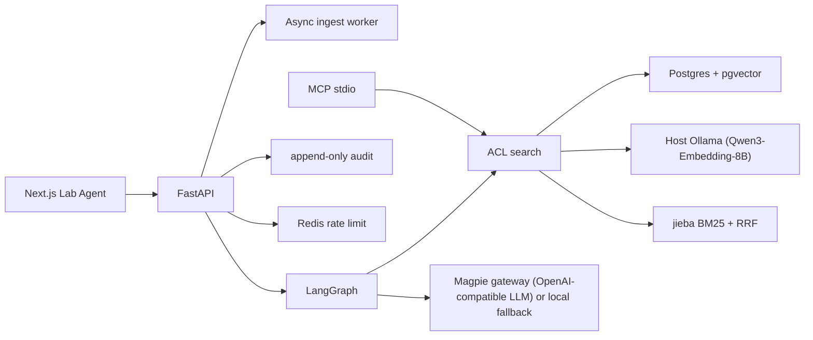

# Lab Agent

Lab Agent 是清衡实验室的知识助手。它只根据当前用户有权阅读的文档回答，引用具体小节，证据不够就拒绝，并留下不含原文的审计记录。

这是一次从零开始的重写，面向检索、权限和可复现评测。旧系统里的业务 CRUD 没有搬过来。

## 中文说明

Lab Agent 回答实验室已经写下来的事实：集群约定、组会、项目笔记、论文笔记。上传的 Markdown 按 `##` 标题切成块，检索在数据库里就带上访问控制，模型只有在余弦相似度（或显式开启的重排分数）超过开发集上调好的阈值时才会被调用。

下面的账号和密码只属于本地合成演示。`APP_ENV=prod` 时种子脚本会直接退出，不会写入这些账号。登录框只有在 `NEXT_PUBLIC_DEMO_HINTS=true` 时才预填密码；镜像构建默认是关闭的，`docker compose` 的本地演示才会打开。

| 姓名 | 邮箱 | 角色 | 密码 |
| --- | --- | --- | --- |
| 沈昭 | admin@lab.local | 管理员 | `LabAgent-Demo-2026-Admin` |
| 林可 | member@lab.local | 成员，可读项目赫利俄斯 | `LabAgent-Demo-2026-Member` |
| 周宁 | zhou@lab.local | 成员，可读采购笔记，不能读赫利俄斯 | `LabAgent-Demo-2026-Zhou` |
| 王敏 | viewer@lab.local | 查看者，不能上传 | `LabAgent-Demo-2026-Viewer` |

界面默认中文，右上角可以切到英文。

### 本地运行

推荐使用仓库自带的 `./scripts/demo.sh` 一键启动并完成端到端冒烟验证（演示操作步骤见 [`docs/demo.md`](docs/demo.md)）。支持**真实模式**与**离线模式**两种运行方式：

#### 1. 真实模式（Magpie 网关 + 宿主机 Ollama 运行 Qwen3-Embedding-8B）

**环境与资源要求**：
- Apple Silicon Mac（建议 ≥16 GB 统一内存；预留至少 6 GB 可用磁盘空间用于存放 8B 嵌入模型权重与校准产物）；
- Docker（Compose v2）；
- 本机运行 Magpie 网关（OpenAI 兼容）；
- 宿主机通过 Homebrew 安装并运行 `ollama`。

**步骤 1：创建独立的 Magpie 密钥文件**
每个客户端应使用独立的 Magpie 网关密钥，以便在 Magpie 中单独统计用量并在需要时独立吊销。将 Lab Agent 专用密钥写入 `~/.config/lab-agent/magpie.key`（权限设为 `600`，**不要**写进 `.env` 或命令行参数）：

```bash
mkdir -p ~/.config/lab-agent && chmod 700 ~/.config/lab-agent
pbpaste > ~/.config/lab-agent/magpie.key && chmod 600 ~/.config/lab-agent/magpie.key
```

**步骤 2：启动宿主机 Ollama 并拉取 `qwen3-embedding:8b`**

```bash
brew services start ollama          # 或者在前台运行 `ollama serve`
ollama pull qwen3-embedding:8b      # Q4_K_M 量化约 5 GB，首次拉取需联网
```

- **为什么 Ollama 不放进 Docker 容器**：macOS 上的 Docker 容器无法调用 Apple Silicon 的 Metal GPU；若将 8B 嵌入模型放进容器内只能退回 CPU 推理，吞吐会慢一个数量级。
- **安全要求**：Ollama 本身没有鉴权机制，必须保持默认仅监听本机回环地址 `127.0.0.1:11434`（容器通过 `host.docker.internal:11434` 访问），**不要**设置 `OLLAMA_HOST=0.0.0.0` 或将其暴露到局域网。

**步骤 3：一键启动与自动冒烟**

```bash
export LLM_MODEL=claude-sonnet-5-5  # 任选一个 Magpie 上可用的对话模型
./scripts/demo.sh
```

- 容器内默认通过 `http://host.docker.internal:3425/v1` 访问本机 Magpie 网关（宿主机直连为 `http://127.0.0.1:3425/v1`）。如果容器连不上默认地址，请在本地 `.env` 里设置 `LLM_BASE_URL`，改成你的网关所在主机的地址。
- `demo.sh` 会依次预检 Magpie 与 Ollama、构建并启动容器、执行 `python -m app.llm_check` 与 `python -m app.embed_check`、在当前嵌入指纹未校准时自动在 dev 集上完成阈值校准，最后跑通 `python -m app.smoke` 端到端冒烟检查。

#### 2. 离线模式（无需密钥与模型权重，CI 默认模式）

只需要 Docker，不依赖 Magpie 或 Ollama：

```bash
./scripts/demo.sh --offline
```

离线模式使用 `EMBEDDER=hashing`（512 维特征哈希）+ `LLM_PROVIDER=fake`（抽取式回退）跑通同一套迁移、种子、阈值检查与端到端冒烟流程，CI 每次 PR 均执行该模式。

> **升级提示（命名统一后的破坏性变化）**：
> - 数据库用户名和库名已改为 `labagent`，旧的本地数据卷与 `.env` 不能继续使用。请执行 `docker compose down -v`，删除旧的 `.env`（或执行 `./scripts/init-env.sh --force`）后再重新启动。
> - 会话与语言 Cookie 已改名为 `la_session`、`la_locale`，已登录的用户需要重新登录一次。

浏览器打开 [http://127.0.0.1:43123](http://127.0.0.1:43123)。API 在 `43124`，Postgres 在 `55432`，Redis 在 `56379`。所有容器端口默认只绑定宿主机回环地址 `127.0.0.1`；需要局域网访问时，自行修改 `docker-compose.yml` 中 `web` 服务的 `ports` 映射（例如改为 `"43123:3000"`）。

不使用 `demo.sh` 或 Docker 时，先起 Postgres（带 pgvector）和 Redis，再：

```bash
cd backend && uv sync && uv run alembic upgrade head && uv run python -m app.reindex --apply --if-needed && uv run python -m app.seed
uv run uvicorn app.main:app --host 127.0.0.1 --port 43124
```

另一个终端：

```bash
cd frontend && npm ci && API_INTERNAL_URL=http://127.0.0.1:43124 npm run dev -- --port 43123
```

默认嵌入器是本地哈希嵌入（`EMBEDDER=hashing`），不下载模型，API 镜像也不打包 `torch` 或本地模型权重。真实模式下使用宿主机 Ollama 提供 OpenAI 兼容嵌入接口（`EMBEDDER=openai_compatible`，运行 `qwen3-embedding:8b`，4096 维 `halfvec` 精确余弦检索）。
- 如果要在宿主机上直接运行 API（不经过 Docker）并使用 Hugging Face `sentence-transformers` 加载本地 BGE 模型（如 `BAAI/bge-small-zh-v1.5`），需要先执行 `cd backend && uv sync --extra bge`，再设置 `EMBEDDER=bge`（可通过 `EMBEDDING_MODEL_VERSION` 固定 HF commit revision，通过 `EMBEDDING_QUERY_TEMPLATE` / `EMBEDDING_QUERY_INSTRUCTION` 和 `EMBEDDING_DOCUMENT_PREFIX` 配置查询指令模板与文档前缀）。
- 用 Ollama 运行 bge 类模型（例如 `bge-m3`）**不需要**启用 `EMBEDDER=bge` 或安装 `bge` 额外依赖，直接设置 `EMBEDDER=openai_compatible` 并指向 Ollama 的 `/v1` 端点即可。

默认回答器是抽取式本地回退。真实模式设置 `LLM_PROVIDER=openai_compatible`、通过 `LLM_API_KEY_FILE`（或 `LLM_API_KEY`）提供网关密钥并指定 `LLM_BASE_URL` 与 `LLM_MODEL` 后，拒绝门槛仍然在模型调用之前。

评测与阈值校准（按嵌入指纹 `embedding_fingerprint` 绑定）：

```bash
# 在开发集 (dev) 上拟合阈值，写入运行时目录 ${CALIBRATION_DIR}/<slug>.json
cd backend && uv run python -m evals.run_eval --tune

# 容器内校准当前嵌入模型（只调用嵌入服务，不调用 LLM），校准后重启 api 生效
docker compose exec api python -m evals.run_eval --tune && docker compose restart api

# 将校准文件与评测报告写入仓库 evals/calibrations/<slug>.json 与 evals/results/v1/<slug>.json（供提交）
cd backend && uv run python -m evals.run_eval --tune --commit

# 对照仓库内当前指纹对应的已提交基线（无基线时退出码为 3）
cd backend && uv run python -m evals.run_eval --check
```

若当前嵌入指纹尚未校准（`${CALIBRATION_DIR}/<slug>.json` 与 `evals/calibrations/<slug>.json` 均不存在或指纹不匹配，且未显式设置 `EVIDENCE_SCORE_MIN`），系统会失败关闭（拒答阈值回退为 `0.99`），`/api/v1/health` 返回 `calibrated: false`，前端顶部显示黄色未校准提示横幅。

## Architecture



登录后的浏览器只拿一个 httpOnly cookie（`la_session`）。Next.js 路由把 cookie 换成 Authorization 并附带可信代理签名的 `X-Client-IP` 再转给 API。检索、文档读取和 MCP 工具共用同一条 ACL。审计与对话正文分开存放。

## What the baseline actually measured

**Embedder fingerprint**: `hashing|hashing-cjk-v1|512|redact=0|qp=e3b0c442|dp=e3b0c442` (slug: `hashing-hashing-cjk-v1-512-redact-0-qp-e3b0c442-dp-e3b0c442`, dataset `v1`).

The committed files `evals/calibrations/hashing-hashing-cjk-v1-512-redact-0-qp-e3b0c442-dp-e3b0c442.json` and `evals/results/v1/hashing-hashing-cjk-v1-512-redact-0-qp-e3b0c442-dp-e3b0c442.json` are for the **offline hashing embedder** (`hashing|hashing-cjk-v1|512|redact=0|qp=e3b0c442|dp=e3b0c442`), not `qwen3-embedding:8b` or `bge`. Thresholds, citation margin, and RRF `k` were chosen on the dev split only (51 questions). The test split (27 questions) was scored once. Refusal uses cosine similarity. Fusion is reciprocal rank fusion, not a weighted sum of min-max scores.

| Mode | Split | Recall@5 | MRR | Citation F1 | Refusal | False refusal | False answer |
| --- | --- | ---: | ---: | ---: | ---: | ---: | ---: |
| dense (selected) | dev | 0.949 | 0.926 | 0.795 | 0.804 | 0.103 | 0.500 |
| dense (selected) | test | 0.952 | 0.888 | 0.667 | 0.704 | 0.191 | 0.667 |
| hybrid RRF | dev | 0.949 | 0.926 | 0.795 | 0.804 | 0.103 | 0.500 |
| hybrid RRF | test | 1.000 | 0.921 | 0.667 | 0.704 | 0.191 | 0.667 |
| lexical rerank, pool 40 | test | 1.000 | 0.917 | 0.571 | 0.630 | 0.333 | 0.500 |
| lexical rerank, pool 15 | test | 1.000 | 0.917 | 0.571 | 0.630 | 0.333 | 0.500 |

Mode choice is the best dev Recall@5, then MRR, so dense stays selected when hybrid ties it on dev. Hybrid RRF does not show the collapse that a naive BM25-weighted fusion produced on an earlier paraphrase set. The lexical reranker is not a cross-encoder. Multi-chunk Recall@5 is 1.0 on this set; citation F1 is lower because the tuned policy cites a single section. The hashing embedder still answers two thirds of the unanswerable test questions that share vocabulary with the corpus. That gap is why a calibrated neural embedder (`qwen3-embedding:8b`) is evaluated separately per fingerprint, not a claim this table already makes.

Query latency for this embedder is about 2 ms on CPU inside the eval harness. That number is not comparable to a neural embedder or cross-encoder.

## Known gaps

- **Offline hashing baseline in CI**: The table above is the `hashing|hashing-cjk-v1|512|redact=0|qp=e3b0c442|dp=e3b0c442` baseline. CI runs offline mode (`--offline`) and never downloads model weights. On the test split the hashing embedder still answers about two thirds of unanswerable questions that share vocabulary with the corpus (false-answer rate 0.667), and citation F1 lags Recall@5 because `cite_k = 1`.
- **Real mode depends on the author's Mac Studio**: Real-mode LLM calls go through the local Magpie gateway (`LLM_PROVIDER=openai_compatible`) and embeddings run on host Ollama (`qwen3-embedding:8b` with Apple Silicon Metal acceleration). If the host is asleep or Magpie/Ollama is stopped, real mode is unavailable.
- **4096-dim vectors do not build an ANN index in MVP**: pgvector caps HNSW indexes at 2000 dims for `vector` and 4000 dims for `halfvec`. Real-mode 4096-dimensional `qwen3-embedding:8b` embeddings are stored as `halfvec(4096)` with `EMBEDDING_INDEX=auto` resolving to `none` (exact cosine scan with SQL ACL filtering). Two-stage prefix HNSW indexing is deferred to the scale-out phase.
- **Model reranker is not enabled (`RERANKER=off`)**: No cross-encoder or remote `/v1/rerank` model reranker is active in the MVP. The lexical rerank modes in `evals/` are IDF coverage ablations over a candidate pool, not `bge-reranker`.
- **Unconfigured external integrations**: `search_papers` returns `not_configured`. OIDC verification fails closed until issuer, audience, and JWKS are set; it is not wired to a live IdP. Scanned (image-only) PDFs without extractable text are rejected with 422 `pdf_no_text` (no OCR).
- This repository has no license file.

## Layout

- `backend/app` — API, ACL, audit, async ingestion worker, retrieval, agent, MCP
- `evals/data/v1` — synthetic Chinese corpus and questions
- `evals/calibrations` & `evals/results/v1` — per-fingerprint calibration thresholds and evaluation reports
- `frontend` — login, streaming chat, documents, audit
- `docs/demo.md` — 10-minute end-to-end walkthrough script
- `docs/adr` — architecture decision records (0001–0006)
- `SECURITY.md` — data flow, secrets, retention, redaction

## Tests

```bash
cd backend && uv run pytest && uv run ruff check app evals tests && uv run mypy app evals
cd frontend && npm run lint && npx tsc --noEmit
```

Pytest uses the compose database `labagent_test` on port 55432 unless `TEST_DATABASE_URL` is set.
