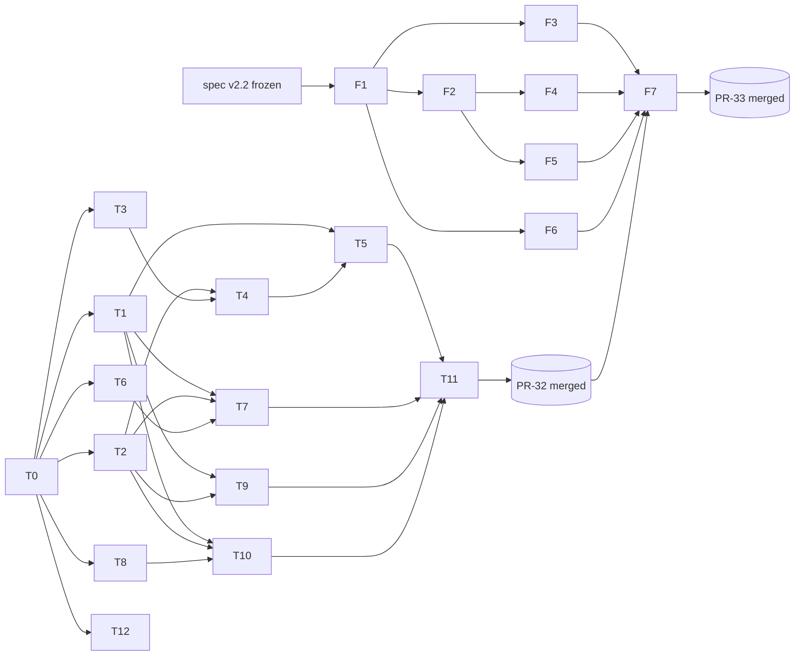

# Proposal Cold-Start Spec v2.2：电子签名抽取 · 个人全息档案袋 · 写本子素材篮

| 项 | 值 |
|---|---|
| 状态 | Approved for implementation |
| 基线 | `proposal-coldstart-spec-v2.md`，PR-31 合入后 `c07434f` |
| 交付 | PR-32（后端），PR-33（前端） |
| 原则 | **Zero-LLM**：本规范所有路径均为确定性逻辑，不调用任何 LLM/OCR/外部网络 |
| 作者 | Principal Architect, LabAgent |

---

## 0. 基线核对（PR-32 开工前必须完成，结果写入 PR 描述）

本规范依赖 v2 中的下列对象。若名称与 `c07434f` 不一致，**以仓库实际为准，语义不变**，并在 PR 描述中列出映射。

| # | 依赖 | 核对命令 / 处理 |
|---|---|---|
| P1 | `lab_people` 表、`LabPerson` 模型（含 `copy_text`、`bio_text`） | `grep -n "class LabPerson" backend/app/**/models.py` |
| P2 | `lab_people.user_id`（关联登录用户，用于"本人"判定） | 若**不存在**：PR-32 迁移中新增 `user_id NULL UNIQUE REFERENCES users(id) ON DELETE SET NULL` |
| P3 | 项目字段 `pi_or_role_name`、参与人字段（下文记为 `participants_raw`） | 核对实际列名 |
| P4 | 成果字段 `authors_raw`、`first_author`、`year` | 同上 |
| P5 | v2 单条格式化逻辑（`copy_text` 模板、`with_support` / `with_relation` 语义） | 批量接口**必须复用**，禁止复制模板 |
| P6 | `/lab` 读权限依赖、admin 判定依赖 | 复用，不新增权限模型 |
| P7 | Alembic 当前 head | `alembic heads` 必须只有 1 个，作为 `down_revision` |
| P8 | 导入流水线：`reader.py` → `parser.py` → `preview_json` → `confirm_proposal_import` | 确认 preview 在服务端持久化（import session），而非仅回传客户端 |

---

## 1. 目标与非目标

### 1.1 目标

- **G1**：冷启动导入申请书 `.docx` 时，确定性抽取成员与 PI 的内嵌签名图片，校验后绑定到成员，并在 confirm 时写入 `lab_people`。
- **G2**：在 `/lab` 页面点击任一成员，打开"个人全息档案袋"。档案袋包含签名（预览、下载、上传、删除）、简介复制，以及自动关联的项目和成果。
- **G3**：在 4 个 Tab 和档案袋内支持多选，统一进入"写本子素材篮"。素材篮提供三个动作：批量复制、签名 ZIP 打包、导出 Word。

### 1.2 非目标

- 不做签名生成、美化、抠图、OCR 或手写识别。
- 不对签名图片做转码或去 EXIF，**原字节存储**。v2.3 再评估去元数据。
- 不支持 GIF / BMP / EMF / WMF / SVG / TIFF 签名。
- 不做跨课题组的人员合并，也不做同名消歧 UI。同名只标记 `ambiguous`。

---

## 2. 数据模型与迁移（PR-32，热资源）

### 2.1 `lab_people` 新增列

| 列 | 类型 | 约束 |
|---|---|---|
| `signature_data` | `BYTEA NULL` | `octet_length(signature_data) <= 2097152` |
| `signature_mime` | `VARCHAR(32) NULL` | `IN ('image/png','image/jpeg','image/webp')` |
| `signature_sha256` | `VARCHAR(64) NULL` | 小写 hex，`~ '^[0-9a-f]{64}$'` |
| `signature_updated_at` | `TIMESTAMPTZ NULL` | — |
| `signature_source` | `VARCHAR(16) NULL` | `IN ('docx_import','upload')`。本规范新增，用于覆盖策略与审计 |

一致性约束 `ck_lab_people_signature_all_or_none`：上述 5 列要么全为 NULL，要么全非 NULL。

### 2.2 ORM 要求

- `signature_data` 必须声明为 `deferred()`。人员列表、档案袋、批量格式化等查询**禁止**加载签名字节。只有签名下载、ZIP 打包、Word 导出这三类查询可以显式 `undefer`。
- 人员列表与详情的 Schema 新增只读字段：`has_signature: bool`、`signature_sha256`、`signature_mime`、`signature_updated_at`。**任何 JSON 响应中都不得出现 `signature_data`。**

### 2.3 Alembic

- 新建 revision：`backend/alembic/versions/<rev>_v22_lab_people_signature.py`，`down_revision` 取 P7 中的 head。
- `downgrade()` 依次删除约束和列。P2 若在本迁移中新增了 `user_id`，也一并删除。
- 验收命令：`alembic upgrade head && alembic downgrade -1 && alembic upgrade head` 全部通过，且执行后仍只有单一 head。

---

## 3. 冷启动签名抽取

### 3.1 实证（样本：`教育考试专属大模型构建与安全应用研究_申请书.docx`）

- 成员表（样本中为 Table 1）第 12–20 行的最后一列"本人签字"，各含 1 张内嵌图片：`word/media/image2.jpeg`…`image10.jpeg`，共 9 张。图片通过 `<a:blip r:embed="rIdN"/>` 引用。
- PI `郭建民` 的签名为 `word/media/image1.jpeg`（`rId9`），位于承诺 / 签章区 `申请人（签章）` 之前。
- **期望结果：共 10 个签名，全部绑定成功，0 告警。**
- 表与行的索引口径以 `reader.py` 现有约定为准。**算法本身不依赖索引**，索引只用于黄金测试断言。

### 3.2 `reader.py`：底层图片抽取（纯 OOXML，无渲染）

1. 构建 `document.xml.rels` 映射：`rId → (target_part, TargetMode)`。
   - `TargetMode="External"` 或 `r:link` 引用一律忽略，**绝不发起网络请求**。
2. 遍历 body 中的块级元素（段落和表格），按**文档顺序**为每个元素分配 `block_index`。
3. 对每个表格单元格（按底层 `w:tc` 去重，避免合并单元格重复）和每个段落，收集两类引用：
   - `.//a:blip/@r:embed`
   - 兼容旧版 VML 的 `.//v:imagedata/@r:id`
4. 读取 media part 前，先检查 `ZipInfo.file_size <= 2 MiB`。超限则不读入内存，直接产出 `TOO_LARGE` 结果。
5. 输出结构 `EmbeddedImage`：

```python
@dataclass(frozen=True)
class EmbeddedImage:
    part_name: str        # "word/media/image2.jpeg"
    rid: str              # "rId12"
    block_index: int      # body 内文档顺序
    table_index: int | None
    row_index: int | None
    cell_index: int | None  # 去重后的 tc 序号
    data: bytes | None    # 超限或缺失时为 None
    declared_size: int
```

### 3.3 图片校验 `validate_signature_image(data) -> SignatureCheck`

校验按以下顺序进行，任一步失败即拒绝。实现位置：`backend/app/lab/signature.py`。上传接口与导入流程**共用这一个函数**。

1. **大小**：`0 < len <= 2_097_152`。否则返回 `SIGNATURE_TOO_LARGE`。
2. **魔数**：MIME **只由魔数决定**，忽略扩展名和 rels 中声明的 ContentType。

   | MIME | 判定 |
   |---|---|
   | `image/png` | `data[:8] == b"\x89PNG\r\n\x1a\n"` |
   | `image/jpeg` | `data[:3] == b"\xff\xd8\xff"` |
   | `image/webp` | `data[:4] == b"RIFF" and data[8:12] == b"WEBP"` |

   本、宏文档、GIF、BMP、TIFF、EMF / WMF、ICO、HEIC / AVIF、空字节流，以及任何无法识别的字节。只要魔数命中了上表某一项，即使扩展名写成 `.svg` 也按魔数结果处理；反过来，扩展名写成 `.png` 但魔数不符，同样拒绝。

3. **结构与尺寸**：用纯 Python 解析文件头，**不引入新依赖**，不做完整解码。

   | MIME | 解析要求 | 失败码 |
   |---|---|---|
   | PNG | 第一个 chunk 必须是 `IHDR`，宽高取自 offset 16–24（大端）；尾部 12 字节内必须出现 `IEND` | `SIGNATURE_CORRUPT` |
   | JPEG | 从 offset 2 开始逐段扫描 marker，取第一个 SOF（`0xC0–0xCF`，排除 `C4`/`C8`/`CC`）中的宽高；SOF 之后必须出现 SOS（`0xFFDA`）；段长度越界即判为截断 | `SIGNATURE_CORRUPT` |
   | WebP | 先校验 RIFF size：`riff_size + 8 <= len`。再按 chunk 解析：`VP8 ` 取 14-bit 宽高；`VP8L` 取 bit-packed 宽高；`VP8X` 取 24-bit canvas 宽高并各加 1 | `SIGNATURE_CORRUPT` |

4. **尺寸范围**：要求 `8 <= width, height <= 6000`，且 `width * height <= 20_000_000`，用于防御解压炸弹。不满足则返回 `SIGNATURE_BAD_DIMENSIONS`。**不按宽高比拒绝**，签名可以很扁。
5. **摘要**：`sha256 = hashlib.sha256(data).hexdigest()`，结果为小写 hex。

```python
@dataclass(frozen=True)
class SignatureCheck:
    ok: bool
    error_code: str | None   # 见下表；ok=True 时为 None
    mime: str | None
    width: int | None
    height: int | None
    size: int
    sha256: str | None       # 仅 ok=True 时计算
```

| 错误码 | HTTP（上传接口） | 含义 |
|---|---|---|
| `SIGNATURE_TOO_LARGE` | 413 | 为空，或超过 2 MiB |
| `SIGNATURE_REJECTED_FORMAT` | 400 | 魔数不在白名单内 |
| `SIGNATURE_CORRUPT` | 400 | 头部结构非法或已截断 |
| `SIGNATURE_BAD_DIMENSIONS` | 400 | 宽高或像素总数越界 |

> 函数必须是**纯函数**：不读写文件，不打日志，不访问 DB。这样黄金测试可以穷举覆盖。

### 3.4 成员签名绑定与 preview_json / confirm 落库

实现位置：绑定逻辑放在 `backend/app/lab/import_signatures.py`，由 `parser.py` 调用；落库逻辑放在 `confirm_proposal_import` 内部。所有规则均为**确定性规则**：同一份输入字节，必须产出逐字节相同的 `preview_json.signatures`。

#### 3.4.1 成员表签名列定位

1. 成员表沿用 `parser.py` 现有的识别结果（P8）。parser 输出的每条成员记录**必须**带有 `source = {table_index, row_index}`。若现有实现没有这个字段，PR-32 需要补上，这属于纯增量改动。
2. 在成员表的前 3 行中查找表头单元格。先对文本做归一化：NFKC，去掉所有空白（含全角空格），再判断是否包含 `签字` 或 `签名`。命中的单元格对应的去重 `cell_index` 即为签名列。
3. 若找不到表头，则退化为"去重后的最后一列"，同时产出告警 `SIG_COLUMN_FALLBACK`。

#### 3.4.2 成员行绑定规则

对每条成员记录，筛选满足 `table_index == 成员表 && row_index == 该行 && cell_index == 签名列` 的 `EmbeddedImage`，然后按下表处理：

| 命中数 | 处理 | status | 告警 |
|---|---|---|---|
| 0 | 不绑定 | — | 无（成员没签字不算异常） |
| 1，校验通过 | 绑定 | `bound` | — |
| 1，校验失败 | 不绑定 | `rejected` | `SIG_INVALID_IMAGE`（附 `error_code`） |
| ≥2 | 不绑定，**不猜测** | `ambiguous` | `SIG_MULTIPLE_IN_CELL` |

其他情况：

- 签名列中有图片，但该行没有解析出成员姓名：产出告警 `SIG_ORPHAN`，不绑定。
- 成员表内、签名列以外的图片：直接忽略，不告警。
- 正文中的其他图片（logo、架构图等）：一律忽略，不告警。

#### 3.4.3 PI 签名定位

1. **锚点**：匹配不在成员表内的段落或单元格文本（归一化后），正则为 `^(项目)?(申请人|负责人)[（(](签章|签字|签名)[)）]`。样本中的锚点是 `申请人（签章）`。
2. **候选图片**：从未被 3.4.2 绑定、且不在成员表内的图片中选取。
   - 锚点位于段落中：取 `block_index ∈ [anchor-3, anchor+1]` 的图片，`distance = block_index - anchor`。
   - 锚点位于其他表格的单元格中：同一单元格内的图片 `distance = 0`，其余图片按所在表格的 `block_index` 计算。
3. **选择**：对每个锚点，取 `|distance|` 最小的候选；距离相同时，优先选**前置**的（`distance < 0`）。如果同一个 block 内有多张图片无法区分，则该锚点结果作废，并产出告警 `SIG_PI_AMBIGUOUS`。
4. **多锚点合并**：收集所有锚点的选中结果。若这些结果的 `sha256` 全部相同，则绑定；若不同，则不绑定，并产出告警 `SIG_PI_AMBIGUOUS`。
5. **绑定对象**：PI 签名绑定到 preview 中的 PI 人员，即基本信息里的申请人或负责人（P3 中的 `pi_or_role_name`）。如果 PI 同时出现在成员表中，并且成员行已经绑定了签名：
   - sha 相同：合并为一条记录；
   - sha 不同：保留成员行的签名，并产出告警 `SIG_PI_CONFLICT`。

#### 3.4.4 告警码

| 码 | 级别 | 说明 |
|---|---|---|
| `SIG_COLUMN_FALLBACK` | warning | 未找到"签字"表头，退化为最后一列 |
| `SIG_INVALID_IMAGE` | warning | 校验失败，`detail.error_code` 取自 3.3 |
| `SIG_TOO_LARGE` | warning | `declared_size > 2 MiB`，未读入内存（对应 3.2 第 4 步） |
| `SIG_MULTIPLE_IN_CELL` | warning | 签名格内有多张图片 |
| `SIG_ORPHAN` | warning | 签名列有图片，但该行无姓名 |
| `SIG_PI_AMBIGUOUS` | warning | PI 签名无法唯一确定 |
| `SIG_PI_CONFLICT` | warning | PI 的成员行签名与签章区签名不同 |
| `SIG_DUPLICATE_HASH` | warning | 同一个 sha256 被绑定到 ≥2 个不同的人。**仍然绑定**，交给人工确认 |
| `SIG_MISSING_PART` | warning | rels 指向的 media part 在压缩包中不存在 |
| `SIG_IMPORT_QUOTA` | warning | 超出单次导入配额（见 3.4.5），后续图片不再处理 |

样本黄金断言：`bound == 10`，`warnings == []`。

#### 3.4.5 preview_json 结构与私有字节存储

`preview_json` 新增顶层键 `signatures`，**其中只包含元数据**：

```json
{
  "signatures": {
    "summary": { "found_images": 10, "bound": 10, "rejected": 0, "ambiguous": 0, "warnings": 0 },
    "items": [
      {
        "sig_id": "sig-0001",
        "role": "pi",
        "person_ref": "person-0000",
        "person_name": "郭建民",
        "status": "bound",
        "sha256": "3f1c…",
        "mime": "image/jpeg",
        "width": 412,
        "height": 160,
        "size": 18233,
        "source": { "part_name": "word/media/image1.jpeg", "rid": "rId9",
                    "block_index": 87, "table_index": null, "row_index": null, "cell_index": null },
        "warnings": []
      }
    ],
    "warnings": []
  }
}
```

- `sig_id` 按 `(block_index, table_index, row_index, cell_index, rid)` 排序后顺序编号，保证结果确定。`person_ref` 沿用 v2 preview 中的人员引用键。
- **签名字节不进入 `preview_json`。** 字节存放在 import session 的服务端私有区，键名为 `_signature_blobs: {sha256: base64}`。同一个 sha 只存一份。
- 所有返回 preview 的接口，序列化时必须剔除所有以 `_` 开头的顶层键。测试会断言响应体中不含 `_signature_blobs`，也不含任何长度大于 512 的 base64 串。
- **单次导入配额**：最多处理 64 张图片，去重后总字节数不超过 32 MiB。超出部分产出告警 `SIG_IMPORT_QUOTA`。私有区随 session 的既有 TTL 一起清理，本规范不新增清理任务。
- P8 核对时，如果发现 session 的 JSON 列有大小上限，导致无法容纳 32 MiB：把配额下调到该上限的 80%，并在 PR 描述中说明。**不允许**为此新建表。

#### 3.4.6 confirm 落库与覆盖策略

confirm 请求体新增可选字段 `skip_signature_ids: string[]`，前端预览时取消勾选的签名放在这里。落库与 v2 的人员 upsert 在**同一事务**内完成，处理步骤如下：

1. 把 `person_ref` 映射为 confirm 后实际得到的 `lab_people.id`（新建或匹配均可）。如果该人员在预览中被取消导入，签名结果记为 `person_not_imported`。
2. 从私有区取出字节，**重新调用** `validate_signature_image`，并比对 sha256，作为纵深防御。失败的记为 `rejected`，跳过，不影响其他条目。
3. 按下表决定写入行为：

| 现有状态 | 导入 sha 与现有 sha | 行为 | 结果计数 |
|---|---|---|---|
| 无签名 | — | 写入，`signature_source='docx_import'` | `written` |
| `docx_import` | 相同 | 不写，`updated_at` 不变 | `unchanged` |
| `docx_import` | 不同 | 覆盖 | `written` |
| `upload` | 任意 | **不覆盖**，以手动上传为准 | `kept_upload` |
| 人员匹配为同名 `ambiguous` | — | 跳过 | `skipped`（告警 `SIG_PERSON_AMBIGUOUS`） |
| 在 `skip_signature_ids` 中 | — | 跳过 | `skipped` |

4. 发生 DB 异常时整个 confirm 回滚，保持 v2 的原子语义。签名校验失败**不会**导致回滚。
5. confirm 响应新增字段：

```json
"signature_result": {
  "written": 10, "unchanged": 0, "kept_upload": 0, "skipped": 0, "rejected": 0,
  "items": [ { "sig_id": "sig-0001", "person_id": 12, "outcome": "written" } ]
}
```

6. 写入成功后，清除该 session 的 `_signature_blobs`。

---

## 4. 功能一：个人全息档案袋（Person Dossier Card）与电子签名 API

所有接口都挂在 v2 的 `/api/v1/lab` 路由下，复用 P6 中的读权限依赖。错误体沿用 v2 的错误信封 `{"detail": {"code": "...", "message": "..."}}`。

### 4.1 `GET /api/v1/lab/people/{id}/dossier`

- **权限**：`/lab` 读权限。
- **性能约束**：整个请求**不得加载 `signature_data`**，测试会监听 SQL 并断言列名不出现。数据库查询次数不超过 4 次（person、projects、outputs、同名计数），不允许 N+1。

**响应 200**：

```json
{
  "person": {
    "id": 12, "name": "郭建民", "title": "研究员", "org": "…",
    "copy_text": "…", "bio_text": "…",
    "has_signature": true,
    "signature_sha256": "3f1c…", "signature_mime": "image/jpeg",
    "signature_updated_at": "2025-03-01T08:00:00Z", "signature_source": "docx_import",
    "name_ambiguous": false
  },
  "signature": {
    "can_edit": true,
    "url": "/api/v1/lab/people/12/signature"
  },
  "projects": [
    { "id": 7, "title": "…", "year": 2024, "relation": "pi", "match": "exact", "copy_text": "…" }
  ],
  "outputs": [
    { "id": 31, "title": "…", "year": 2023, "relation": "first_author", "author_position": 1,
      "match": "exact", "copy_text": "…" }
  ],
  "counts":   { "projects": 5, "outputs": 18 },
  "truncated": { "projects": false, "outputs": false }
}
```

**字段说明**：

- `can_edit` 为 true 的条件：当前用户是 admin，或者 `lab_people.user_id == current_user.id`（P2）。
- `copy_text` 由 v2 的单条格式化逻辑生成（P5），使用默认选项。

**关联算法**：实现于 `backend/app/lab/matching.py`，确定性，不做模糊匹配。

1. `normalize_person_name(s)` 依次执行：NFKC → 去除所有空白 → 去除尾部标记（`*`、`#`、`†`、`（通讯作者）`、`(corresponding author)` 等，取闭集常量）→ ASCII 部分转小写。
2. `split_names(raw)` 的分隔符为 `[,，、;；/\n]`，以及独立出现的 ` and `、`&`。切分后丢弃空项，**保留原始顺序**。
3. **项目关联**：
   - `normalize(pi_or_role_name) == name` 时，`relation = "pi"`；
   - 姓名出现在 `split_names(participants_raw)` 中时，`relation = "participant"`；
   - 两者都满足时取 `pi`。
4. **成果关联**：在 `split_names(authors_raw)` 中的位置记为 `author_position`（从 1 开始）。
   - `position == 1`，或 `normalize(first_author) == name` 时，`relation = "first_author"`；
   - 其余情况 `relation = "coauthor"`。
5. **同名处理**：如果归一化后的姓名对应 ≥2 个 `lab_people`，则所有关联项都标记 `match = "ambiguous"`，`person.name_ambiguous = true`。仍然返回这些关联项，不消歧，与非目标一致。
6. **SQL 预筛**：先用 `ILIKE '%' || :name || '%'` 在原始列上预筛（`name` 需转义 `%` 和 `_`），再在 Python 中做精确匹配。预筛只用于缩小范围，**不作为判定依据**。
7. **排序**：projects 按 `(year DESC NULLS LAST, id DESC)`，outputs 按 `(year DESC NULLS LAST, author_position ASC, id DESC)`。
8. **截断**：每类最多返回 200 条，超出时 `truncated.* = true`，`counts` 仍为真实总数。

**错误**：`404 PERSON_NOT_FOUND`。

### 4.2 `GET /api/v1/lab/people/{id}/signature`

- **权限**：`/lab` 读权限。这是唯一显式执行 `undefer(signature_data)` 的单人查询。
- **查询参数**：`disposition=attachment|inline`，默认 `attachment`。
- **响应 200**：响应体为原始字节，响应头如下：

| Header | 值 |
|---|---|
| `Content-Type` | `signature_mime` |
| `Content-Disposition` | `attachment; filename="signature_12.jpg"; filename*=UTF-8''%E9%83%AD%E5%BB%BA%E6%B0%91_%E7%AD%BE%E5%90%8D.jpg`（inline 时 disposition 为 `inline`） |
| `ETag` | `"<sha256>"` |
| `Cache-Control` | `private, max-age=0, must-revalidate` |
| `X-Content-Type-Options` | `nosniff` |
| `Content-Security-Policy` | `default-src 'none'; sandbox` |

- 请求头 `If-None-Match` 命中当前 ETag 时返回 **304**。
- 扩展名映射：`image/png → png`，`image/jpeg → jpg`，`image/webp → webp`。
- **审计**：每次成功读取都写一条结构化日志 `lab.signature.read`，字段为 `{person_id, actor_id, sha256, via: "single"}`。**日志中不得出现字节内容。**
- **错误**：`404 PERSON_NOT_FOUND`，`404 SIGNATURE_NOT_FOUND`。

### 4.3 `PUT /api/v1/lab/people/{id}/signature`

- **权限**：admin 或本人（判定方式同 `can_edit`）。其他用户返回 `403 FORBIDDEN_SIGNATURE_EDIT`。
- **请求**：`multipart/form-data`，字段名 `file`。客户端提供的文件名和 Content-Type **一律忽略**。
- **前置拦截**：`Content-Length > 2.5 MiB` 时直接返回 `413 SIGNATURE_TOO_LARGE`，不读取请求体。读取时设置上限 `2 MiB + 1` 字节，超出即中止。
- **并发控制**（可选）：请求头 `If-Match: "<sha256>"` 与当前签名不一致时，返回 `412 SIGNATURE_PRECONDITION_FAILED`。当前没有签名时，`If-Match: "*"` 返回 412。
- **处理**：调用 `validate_signature_image`。通过后写入全部 5 列，`signature_source='upload'`，`updated_at=now()`。如果 sha 与现有签名相同，不更新 `updated_at`，并返回 `unchanged: true`。
- **响应 200**：

```json
{ "person_id": 12, "has_signature": true, "signature_sha256": "…", "signature_mime": "image/png",
  "signature_updated_at": "…", "signature_source": "upload", "width": 600, "height": 200, "unchanged": false }
```

- **审计日志**：`lab.signature.write`，字段 `{person_id, actor_id, sha256, previous_sha256, source}`。

### 4.4 `DELETE /api/v1/lab/people/{id}/signature`

- **权限**：同 PUT。
- **行为**：5 列全部置为 NULL。**幂等**：没有签名时也返回 204。支持 `If-Match`，语义同 PUT。
- **审计日志**：`lab.signature.delete`。
- **响应**：`204 No Content`。

### 4.5 错误码汇总（第 4 节）

| HTTP | code |
|---|---|
| 400 | `SIGNATURE_REJECTED_FORMAT` / `SIGNATURE_CORRUPT` / `SIGNATURE_BAD_DIMENSIONS` |
| 403 | `FORBIDDEN_SIGNATURE_EDIT` |
| 404 | `PERSON_NOT_FOUND` / `SIGNATURE_NOT_FOUND` |
| 412 | `SIGNATURE_PRECONDITION_FAILED` |
| 413 | `SIGNATURE_TOO_LARGE` |
| 422 | `SIGNATURE_FILE_MISSING`（multipart 中缺少 `file`） |

---

## 5. 功能二：跨 Tab 写本子素材篮（Proposal Reuse Basket）— 批量复制、签名 ZIP 打包与所选导出

素材篮的状态**只保存在前端**（见 §6.4），后端不建表，也不保存会话。三个接口都是无状态的纯函数式接口：同样的输入加同样的 DB 快照，输出逐字节相同（ZIP 和 docx 的时间戳规则见下文）。

### 5.0 公共约定

- **条目引用**：`{"kind": "<kind>", "id": <int>}`。`kind` 的白名单**等于 v2 单条格式化注册表中的实体键**（P5），与 `/lab` 的 4 个 Tab 一一对应，例如 `person`、`project`、`output` 以及第四类。后端直接以注册表为准，不在本规范中硬编码。未知 kind 返回 `400 FORMAT_KIND_UNSUPPORTED`。
- **去重**：按 `(kind, id)` 去重，保留首次出现的位置。
- **数量上限**：去重后，`items` 为 1–200 条，`person_ids` 为 1–100 个。为空返回 `422 BASKET_EMPTY`，超出上限返回 `422 BASKET_TOO_LARGE`。
- **排序**：
  - `group_by_kind=false`：保持请求顺序；
  - `group_by_kind=true`：先按注册表顺序分组，组内保持请求顺序。
- **数据加载**：每个 kind 用一次 `IN (...)` 查询，禁止 N+1。
- **控制字符**：文本输出统一剔除 XML 非法控制字符 `[\x00-\x08\x0b\x0c\x0e-\x1f]`，保证剪贴板和 docx 的输出一致。

### 5.1 `POST /api/v1/lab/format/batch`

- **权限**：`/lab` 读权限。

**请求**：

```json
{
  "items": [ { "kind": "person", "id": 12 }, { "kind": "project", "id": 7 } ],
  "options": {
    "with_support": true,
    "with_relation": false,
    "numbering": "none",
    "separator": "blank_line",
    "group_by_kind": false
  }
}
```

| 选项 | 取值 | 默认 |
|---|---|---|
| `with_support` / `with_relation` | bool，语义**完全沿用 v2** | 与 v2 单条接口默认值一致 |
| `numbering` | `none` / `arabic`（`1. `）/ `bracket`（`[1] `） | `none` |
| `separator` | `blank_line`（`\n\n`）/ `newline`（`\n`） | `blank_line` |
| `group_by_kind` | bool。为 true 时，每组前插入一行组标题（如 `【人员】`），组标题不参与编号 | `false` |

**处理**：

- 每条文本**必须调用 v2 的单条格式化函数**生成。合规性检查：对任意条目，`items[i].text` 必须与 v2 单条接口的输出逐字节相同，测试会强制比对。
- 编号按成功的条目连续计数，缺失的条目不占号。

**响应 200**：部分缺失也返回 200。

```json
{
  "text": "1. 郭建民，研究员，……\n\n2. 教育考试专属大模型……",
  "items": [
    { "kind": "person", "id": 12, "ok": true, "text": "郭建民，研究员，……" },
    { "kind": "output", "id": 99, "ok": false, "error": "NOT_FOUND" }
  ],
  "stats": { "requested": 3, "deduplicated": 2, "ok": 1, "missing": 1 }
}
```

### 5.2 `POST /api/v1/lab/people/signatures:zip`

- **权限**：`/lab` 读权限。查询需显式 `undefer(signature_data)`，并按 `person_ids` 分批读取，每批 20 个，避免一次性把全部字节载入内存。

**请求**：

```json
{ "person_ids": [12, 15, 18], "naming": "seq_name", "include_manifest": true }
```

| 选项 | 取值 | 默认 |
|---|---|---|
| `naming` | `seq_name`（`01_郭建民.jpg`）/ `name`（`郭建民.jpg`）/ `name_id`（`郭建民_12.jpg`） | `seq_name` |
| `include_manifest` | bool | `true` |

**文件名规则**：

1. 姓名先做 NFC 归一化，再去除 `\ / : * ? " < > |` 和控制字符，并去除首尾的点和空格；处理后为空时用 `person_{id}`。主干部分截断至 64 个字符。
2. 序号为去重后的请求顺序，位数为 `max(2, len(str(n)))`。
3. 重名冲突时，后出现的文件追加 `_{id}`。
4. 全部为平铺条目，**不生成目录**，也不出现 `..`。

**打包规则**：

- 使用 `ZIP_STORED`。图片本身已压缩，存储模式可以保证结果确定、速度快。
- 每个条目的 `date_time` 取自 `signature_updated_at` 换算的 UTC 时间。
- 打包写入 `SpooledTemporaryFile(max_size=8 MiB)`，完成后流式返回。
- 写入每个条目前，再次校验魔数。不通过的不放入压缩包，在 manifest 中标记为 `corrupt`。

**manifest.csv**：UTF-8 BOM 编码，CRLF 换行。列为 `序号,person_id,姓名,文件名,mime,sha256,status`，其中 `status ∈ {included, no_signature, not_found, corrupt}`。所有请求的 id 都会出现在 manifest 中。

**响应**：

- 至少包含 1 个签名时返回 200，响应头如下：

| Header | 值 |
|---|---|
| `Content-Type` | `application/zip` |
| `Content-Disposition` | `attachment; filename="signatures.zip"; filename*=UTF-8''%E8%AF%BE%E9%A2%98%E7%BB%84%E7%AD%BE%E5%90%8D_20250301.zip` |
| `X-Signatures-Included` | 包含的签名数 |
| `X-Signatures-Missing` | `no_signature + not_found + corrupt` 的数量 |
| `Access-Control-Expose-Headers` | 上述两个计数头。v2 已有 CORS 配置时，追加到配置中 |

- 一个签名都没有时返回 `422 NO_SIGNATURES_SELECTED`，错误体中附带 manifest 的 JSON 形式。

**审计**：每个打包进去的签名记录一条 `lab.signature.read`，`via: "zip"`。

### 5.3 `POST /api/v1/lab/export:selected`

- **权限**：`/lab` 读权限。
- **依赖**：优先复用 v2 已有的 docx 写出工具。如果没有，使用 `python-docx`：它必须已在 `backend/requirements*.txt` 中锁定版本；如果尚未锁定，PR-32 以热资源方式新增，并在 PR 描述中注明。

**请求**：

```json
{
  "items": [ { "kind": "person", "id": 12 }, { "kind": "output", "id": 31 } ],
  "options": {
    "with_support": true, "with_relation": false,
    "group_by_kind": true,
    "include_signatures": true,
    "signature_width_cm": 3.0,
    "title": "写本子素材汇总"
  }
}
```

**文档结构**：

1. 标题（Heading 1）：取 `options.title`，默认 `写本子素材汇总`，最长 100 个字符。
2. 说明行：`生成于 YYYY-MM-DD，共 N 条`。日期取服务端当日日期（Asia/Shanghai）。
3. 正文：
   - `group_by_kind=true` 时，每组用 Heading 2 作组标题，组内为编号段落；
   - 否则为单一编号列表。
   - **段落文本与 §5.1 中 `items[i].text` 逐字节一致**，复用同一条代码路径。
4. 签名附录：仅当 `include_signatures=true`，且 items 中存在 `kind=person` 时生成。
   - 标题为 Heading 2 `附：成员签名`；
   - 内容为一个两列表格 `姓名 | 签名`，行顺序与 person 条目的顺序一致；
   - 图片宽度取 `signature_width_cm`，限定在 `[1.5, 6.0]`，越界时取边界值，高度按比例缩放。
5. 签名附录中的特殊情况：

| 情况 | 单元格内容 | 告警 |
|---|---|---|
| 无签名 | `（未上传）` | `SIG_NOT_UPLOADED` |
| WebP | `（WebP 格式未嵌入，请使用签名 ZIP）`。**不转码**，与非目标一致 | `SIG_WEBP_NOT_EMBEDDED` |
| 再次校验失败 | `（签名文件损坏）` | `SIG_CORRUPT` |

6. **确定性**：core properties 中 `author = "LabAgent"`，`created` 和 `modified` 固定为当日 `00:00:00+08:00`，不写入当前用户信息。
7. **体积上限**：嵌入的签名总字节数不超过 50 MiB。超出部分按"未嵌入"处理，告警为 `SIG_EXPORT_QUOTA`。

**响应 200**：

- `Content-Type: application/vnd.openxmlformats-officedocument.wordprocessingml.document`
- `Content-Disposition`：`filename*` 为 `写本子素材_YYYYMMDD.docx`
- `X-Export-Warnings`：告警码去重后用逗号拼接，无告警时省略。同样需要加入 `Access-Control-Expose-Headers`。
- 缺失的条目（`NOT_FOUND`）不写入文档，计入告警 `ITEM_NOT_FOUND`。如果全部缺失，返回 `422 BASKET_ALL_MISSING`。

**审计**：每个嵌入的签名记录一条 `lab.signature.read`，`via: "export"`。

### 5.4 错误码汇总（第 5 节）

| HTTP | code | 接口 |
|---|---|---|
| 400 | `FORMAT_KIND_UNSUPPORTED` | batch / export |
| 422 | `BASKET_EMPTY` / `BASKET_TOO_LARGE` | 全部 |
| 422 | `NO_SIGNATURES_SELECTED` | zip |
| 422 | `BASKET_ALL_MISSING` | export |

---

## 6. 前端 `/lab` 交互规范（个人全息档案袋抽屉 + 悬浮素材篮）

**目录约定**：本节以 `frontend/src/features/lab/` 为根目录，**以仓库实际的 `/lab` 页面目录为准**，映射关系写入 PR-33 描述。组件扩展名随技术栈而定（`.tsx` 或 `.vue`）。新增文件如下：

| 文件 | 职责 |
|---|---|
| `api/dossier.ts` | dossier、signature 的 GET/PUT/DELETE 封装及类型 |
| `api/basket.ts` | batch、zip、export 封装；Blob 下载；从 `Content-Disposition` 解析 `filename*` |
| `store/reuseBasket.ts` | 素材篮状态、持久化、跨标签页同步 |
| `components/PersonDossierDrawer.*` | 档案袋抽屉 |
| `components/SignatureCard.*` | 签名预览、下载、上传、删除 |
| `components/ReuseBasketFab.*`、`components/ReuseBasketPanel.*` | 悬浮按钮与面板 |
| `components/SelectableTableColumn.*` | 4 个 Tab 共用的多选列 |
| `errors.ts` | 错误码到中文文案的映射（§6.6） |

### 6.1 入口与路由

- **打开抽屉的入口**：
  - 人员 Tab 中的行；
  - 项目 Tab 的负责人 / 参与人 chip；
  - 成果 Tab 的作者 chip（只有能映射到 `lab_people.id` 的姓名才渲染为可点击 chip）；
  - 档案袋内部的成员链接。
- **URL 同步**：打开抽屉时 query 中写入 `?person={id}`，刷新或分享链接后可直接打开。关闭抽屉时移除该参数，使用 `replace`，不产生新的历史记录。
- **键盘**：Esc 关闭抽屉。抽屉内焦点陷阱生效，关闭后焦点回到触发元素。
- **切换人员**：抽屉打开状态下点击另一个成员，直接切换内容，不先关闭再打开。如果上一个请求还在进行，需要 abort。

### 6.2 档案袋抽屉布局

从上到下依次为：

1. **头部**：姓名、职称、单位。`name_ambiguous=true` 时显示黄色徽标"存在同名成员"，hover 时提示"关联结果可能包含同名者"。
2. **签名卡片**（`SignatureCard`）：
   - **有签名**：缩略图的 `src` 为 `{url}?disposition=inline&v={sha256}`，用 sha 作为缓存键，更新后自动刷新。同时显示来源徽标（`导入` / `上传`）和更新时间，并提供"下载"按钮（使用 attachment）。
   - **无签名**：显示占位图和"暂无签名"。
   - `can_edit=true` 时显示"上传 / 替换"和"删除"按钮：
     - **上传前的客户端预检**：`accept="image/png,image/jpeg,image/webp"`，大小不超过 2 MiB。预检只为提升体验，**以服务端校验为准**。
     - **替换**：携带 `If-Match: "<当前 sha>"`。收到 412 时提示"签名已被他人更新"，并重新拉取 dossier。
     - **删除**：弹出二次确认，文案为"删除后无法恢复，导入的签名需重新导入才能找回"。
   - `can_edit=false` 时不渲染编辑按钮。**不允许**只做禁用而保留按钮的 DOM。
3. **简介**：分别为 `copy_text` 和 `bio_text` 提供"复制"按钮。复制成功显示 toast "已复制"。
4. **关联项目**：每行包含复选框、标题、年份和关系徽标（`负责人` / `参与`）。`match="ambiguous"` 的行显示同名徽标。列表头部提供"全选"和"加入素材篮（n）"按钮。`truncated=true` 时，列表底部提示"仅显示最近 200 条，共 {counts} 条"。
5. **关联成果**：同上，关系徽标为 `第一作者` / `第 n 作者`。
6. **底部操作栏**：
   - "将此人加入素材篮"，加入 `kind=person`；
   - "全部加入"，加入此人以及当前勾选的项目和成果。
   - **同名行默认不勾选**，"全选"按钮也会跳过同名行。用户手动勾选时允许加入。
7. **状态展示**：加载时显示骨架屏。404 时显示"成员不存在或已删除"并提供关闭按钮。其他错误显示错误文案和"重试"按钮。

### 6.3 4 个 Tab 的多选

- 每个 Tab 的表格新增首列复选框（`SelectableTableColumn`）。表头复选框只作用于**当前页可见行**。
- **选择的保持**：切换分页、筛选或排序时保留选择，按 `(kind, id)` 记录；切换 Tab 时保留各 Tab 自己的选择；页面刷新后清空。素材篮的内容不会被清空。
- 支持 Shift+点击进行范围选择，范围按当前页的行序计算。
- 存在选择时，Tab 工具栏显示"已选 n 项 · 加入素材篮 · 取消选择"。加入后清空该 Tab 的选择，并显示 toast "已加入 n 项（m 项已存在）"。

### 6.4 悬浮素材篮

**状态与持久化**（`store/reuseBasket.ts`）：

```ts
type BasketItem = { kind: string; id: number; label: string; addedAt: number };
type BasketState = {
  version: 1;
  items: BasketItem[];              // 去重键 `${kind}:${id}`，保持加入顺序
  options: {
    with_support: boolean; with_relation: boolean;
    numbering: "none" | "arabic" | "bracket";
    group_by_kind: boolean;
    include_signatures: boolean;
  };
};
```

- **存储位置**：`localStorage` 键 `labagent.reuseBasket.v1:{userId}`，按用户隔离。退出登录时**不删除**数据，但下次以其他用户登录时不会读取。
- **版本校验**：`version` 不匹配或 JSON 解析失败时，丢弃数据并重置为空。
- **容量上限**：最多 200 条。如果一次加入后会超出上限，整批拒绝，提示"素材篮最多 200 项，当前 n 项"。
- **跨标签页同步**：监听 `storage` 事件，采用后写覆盖的策略。
- **`label` 的用途**：只用于在面板中展示，相当于快照。所有动作都只把 `(kind, id)` 发给服务端，**以服务端数据为准**。
- **安全约束**：**签名字节不得进入 store 或 localStorage。** 下载产生的 Blob URL 用完后立即 `revokeObjectURL`。

**悬浮按钮**：固定在右下角，显示计数徽标。素材篮为空时显示为灰色，但仍可点击查看说明。按钮层级高于表格，低于抽屉和对话框。抽屉打开时，按钮向左平移，避免遮挡。

**面板**（右侧弹层）：

- **列表**：按 kind 分组显示，组标题带计数。每项可移除，支持拖拽或上下按钮调整顺序。所选顺序就是导出顺序；`group_by_kind=true` 时，按组内顺序导出。
- **清空**：需要二次确认。
- **选项区**：对应 `options` 中的各项。`include_signatures` 只在篮中有 person 条目时显示。

**动作**：

| 按钮 | 调用 | 成功 | 部分失败 / 失败 |
|---|---|---|---|
| 批量复制 | `POST /format/batch` | `navigator.clipboard.writeText(text)`，toast "已复制 n 项" | `missing>0` 时提示"m 项已不存在"，并提供"从素材篮移除"；剪贴板 API 不可用时，弹出只读文本框并全选，提示用户 Ctrl/⌘+C |
| 签名 ZIP | `POST /people/signatures:zip`，`person_ids` 取篮中的 person 条目 | 下载文件，toast "已打包 n 个签名" | 读取 `X-Signatures-Missing`，提示"m 人无签名，详见 manifest.csv"；422 时提示"所选成员均无签名" |
| 导出 Word | `POST /export:selected` | 下载 docx | 解析 `X-Export-Warnings`，按 §6.6 的文案逐条提示 |

- 篮中没有 person 条目时，"签名 ZIP"按钮禁用，tooltip 为"素材篮中没有成员"。
- 每个动作执行期间按钮显示 loading 状态并防止重复点击。请求超时时间统一为 60 秒。

### 6.5 可访问性

- 抽屉使用 `role="dialog"`、`aria-modal="true"`，`aria-labelledby` 指向姓名。
- 悬浮按钮使用 `aria-label="写本子素材篮，n 项"`。
- 复选框关联行标题，作为可访问名称。
- toast 使用 `aria-live="polite"`。
- 所有按钮都能通过键盘操作。签名缩略图的 `alt` 为"{姓名}的签名"。

### 6.6 错误码文案映射（`errors.ts`）

| code | 文案 |
|---|---|
| `SIGNATURE_TOO_LARGE` | 签名图片需小于 2 MB |
| `SIGNATURE_REJECTED_FORMAT` | 仅支持 PNG / JPEG / WebP 格式 |
| `SIGNATURE_CORRUPT` | 图片文件已损坏 |
| `SIGNATURE_BAD_DIMENSIONS` | 图片尺寸不符合要求（8–6000 像素） |
| `FORBIDDEN_SIGNATURE_EDIT` | 仅本人或管理员可修改签名 |
| `SIGNATURE_PRECONDITION_FAILED` | 签名已被他人更新，请刷新 |
| `SIGNATURE_NOT_FOUND` | 该成员暂无签名 |
| `PERSON_NOT_FOUND` | 成员不存在或已删除 |
| `BASKET_EMPTY` / `BASKET_TOO_LARGE` | 素材篮为空 / 超出上限 |
| `NO_SIGNATURES_SELECTED` | 所选成员均无签名 |
| `BASKET_ALL_MISSING` | 所选条目均已不存在 |
| `SIG_WEBP_NOT_EMBEDDED` | 部分签名为 WebP 格式，未嵌入 Word，请使用签名 ZIP |
| `SIG_NOT_UPLOADED` | 部分成员未上传签名 |
| `SIG_CORRUPT` / `SIG_EXPORT_QUOTA` / `ITEM_NOT_FOUND` | 部分签名损坏 / 超出导出体积 / 部分条目已不存在 |
| 其他 | 操作失败（{code}），请稍后重试 |

导入预览页（v2 已有）同步新增"签名"区块：展示 `signatures.items` 的状态表（姓名、角色、状态、尺寸、告警），每行有复选框，取消勾选即加入 `skip_signature_ids`。**预览页不显示缩略图**，字节不出服务端，缩略图留到 v2.3 评估。告警码文案按 §3.4.4 的说明映射。

---

## 7. 并行开发执行计划与依赖图（Parallel Execution DAG, allowed_paths, hot_resources, PR-32 & PR-33）

### 7.1 任务分解

| ID | 任务 | 依赖 | PR | 所在泳道 |
|---|---|---|---|---|
| T0 | 基线核对 P1–P8，结果写入 PR 描述 | — | 32 | 串行起点 |
| T1 | 迁移与 ORM（§2） | T0 | 32 | **热资源** |
| T2 | `validate_signature_image`（§3.3） | T0 | 32 | Lane A |
| T3 | `reader.py` 图片抽取（§3.2） | T0 | 32 | Lane A |
| T4 | 签名绑定与 preview_json（§3.4.1–3.4.5） | T2, T3 | 32 | Lane A |
| T5 | confirm 落库（§3.4.6） | T1, T4 | 32 | Lane A |
| T6 | `matching.py` 姓名归一化与关联（§4.1 算法） | T0 | 32 | Lane B |
| T7 | dossier 与 signature API（§4） | T1, T2, T6 | 32 | Lane B |
| T8 | `format/batch`（§5.1） | T0 | 32 | Lane C |
| T9 | `signatures:zip`（§5.2） | T1, T2 | 32 | Lane C |
| T10 | `export:selected`（§5.3） | T1, T2, T8 | 32 | Lane C |
| T11 | 路由注册、OpenAPI 快照、CORS expose headers | T5, T7, T9, T10 | 32 | **热资源**，串行收尾 |
| T12 | 合成 docx 夹具生成器与样本测试开关（§8.1） | T0 | 32 | 夹具 |
| F1 | API client 与类型（按本规范契约编写，使用 mock） | 规范冻结 | 33 | Lane F |
| F2 | `reuseBasket` store | F1 | 33 | Lane F |
| F3 | 档案袋抽屉与签名卡片 | F1 | 33 | Lane F |
| F4 | 4 个 Tab 的多选 | F2 | 33 | Lane F |
| F5 | 素材篮面板与三个动作 | F2 | 33 | Lane F |
| F6 | 导入预览页签名区块 | F1 | 33 | Lane F |
| F7 | 联调与构建门禁（§8.3） | F3–F6，**PR-32 已合入** | 33 | 收尾 |

### 7.2 依赖图



**关键路径**：T0 → T3 → T4 → T5 → T11 → F7。T1 应在 T0 完成后的第一时间合入特性分支，以解除 T5、T7、T9、T10 的阻塞。

### 7.3 allowed_paths

每个任务只能修改下列路径。超出范围的改动必须拆成独立 commit，并在 PR 描述中说明理由。

| ID | allowed_paths |
|---|---|
| T1 | `backend/alembic/versions/<rev>_v22_lab_people_signature.py`，`backend/app/lab/models.py`（仅 `LabPerson` 新增列与 `deferred`），`backend/app/lab/schemas.py`（仅新增只读字段） |
| T2 | `backend/app/lab/signature.py`，`backend/tests/lab/test_signature_validate.py` |
| T3 | `backend/app/lab/import/reader.py`，`backend/tests/lab/test_reader_images.py` |
| T4 | `backend/app/lab/import_signatures.py`，`backend/app/lab/import/parser.py`（仅调用点与 `source` 字段），`backend/tests/lab/test_signature_binding.py` |
| T5 | `confirm_proposal_import` 所在模块（仅签名落库段），import session 序列化处（仅剔除 `_` 前缀键），`backend/tests/lab/test_import_confirm_signatures.py` |
| T6 | `backend/app/lab/matching.py`，`backend/tests/lab/test_matching.py` |
| T7 | `backend/app/lab/api/dossier.py`，`backend/app/lab/api/signature.py`，`backend/tests/lab/test_dossier_api.py`，`backend/tests/lab/test_signature_api.py` |
| T8 | `backend/app/lab/api/basket.py`（batch 段），`backend/app/lab/formatting.py`（仅导出 v2 已有的单条函数，**不改模板**），`backend/tests/lab/test_format_batch.py` |
| T9 | `backend/app/lab/api/basket.py`（zip 段），`backend/app/lab/zip_export.py`，`backend/tests/lab/test_signatures_zip.py` |
| T10 | `backend/app/lab/api/basket.py`（export 段），`backend/app/lab/docx_export.py`，`backend/tests/lab/test_export_selected.py` |
| T11 | 路由聚合文件（如 `backend/app/api/router.py`），CORS 配置处，`backend/tests/snapshots/openapi*.json`，`backend/tests/lab/test_zero_llm.py` |
| T12 | `backend/tests/lab/fixtures/**`，`backend/tests/conftest.py`（仅新增 `sample` marker），`pytest.ini` / `pyproject.toml`（仅 marker 注册） |
| F1–F6 | `frontend/src/features/lab/**`（映射后的实际目录），对应的单测目录 |
| F7 | 以上路径，加上 `/lab` 页面入口文件（挂载悬浮按钮和抽屉） |

模块路径中的 `import/` 子目录、`api/` 子目录等均以 P1/P8 核对的实际结构为准，映射关系写入 PR 描述。

### 7.4 hot_resources（同一时刻只允许一个任务持有）

| 资源 | 持有者 | 规则 |
|---|---|---|
| Alembic head / `versions/` | T1 | PR-32 期间**只允许一个**新 revision。rebase 时若 head 发生变化，只修改 `down_revision`，然后重新执行 §2.3 的验收命令 |
| `backend/app/lab/models.py`、`schemas.py` | T1 | 其他任务只读。需要新增字段时，回到 T1 修改 |
| `backend/app/lab/api/basket.py` | T8 → T9 → T10 | 按顺序串行，各自只修改自己的段；也可以先由 T8 建好三个空 handler 骨架 |
| 路由聚合文件、OpenAPI 快照、CORS 配置 | T11 | 只在 T11 中修改，避免合并冲突 |
| `backend/requirements*.txt` | T10（仅当需要锁定 `python-docx` 时） | 其他任务禁止修改 |
| `frontend/package.json` 及 lock 文件 | — | **PR-33 禁止新增依赖**。如确有需要，必须单独评审 |
| `/lab` 页面入口文件 | F7 | F3–F6 以独立组件形式交付，F7 统一挂载 |

### 7.5 PR 规则

**PR-32（后端）**：

- 描述中必须包含 P1–P8 的核对结果与名称映射、`alembic heads` 的输出，以及样本测试在本地运行的截图或日志（样本文件不入库，见 §8.1）。
- 合入条件：§8.2 全部通过；OpenAPI 快照的 diff 只包含本规范中的新增内容；`git diff c07434f -- <v2 单条格式化模板>` 为空。

**PR-33（前端）**：

- 可以与 PR-32 **并行开发**，F1 以本规范 §4、§5 的契约为准，使用 mock。
- 合入条件：PR-32 已合入；F7 联调完成；§8.3 全部通过。

**回滚方案**：PR-33 可以单独 revert。PR-32 revert 时需先执行 `alembic downgrade -1`。签名列为纯新增列，降级会丢失已录入的签名，回滚前需人工确认，并在发布说明中注明。

---

## 8. 验收测试清单（pytest & 前端构建门禁）

### 8.1 夹具与样本策略

- **真实样本不入库**：`教育考试专属大模型构建与安全应用研究_申请书.docx` 中含有真实的个人签名，**禁止提交到仓库**。
  - 对应测试标记为 `@pytest.mark.sample`，仅在环境变量 `LAB_SAMPLE_DOCX` 指向该文件时运行，否则 skip。
  - 期望值以常量形式入库：10 个 sha256 及其对应的姓名。这些值只是摘要，不包含图像内容。
- **合成夹具**：`backend/tests/lab/fixtures/build_docx.py` 用纯 `zipfile` 加 XML 模板，按需生成 docx。
  - 内嵌图片由代码生成，例如 16×16 的最小 PNG/JPEG/WebP 字节。
  - 合成夹具复刻样本的结构：成员表的"本人签字"列 9 张图，签章区 1 张图，PI 锚点为 `申请人（签章）`。
  - 另外提供各种异常变体。
  - 生成过程必须是确定性的：固定 `ZipInfo.date_time`。

### 8.2 pytest 门禁（PR-32）

运行命令：`pytest backend/tests/lab -q`，再加上 v2 原有的全量测试，以及仓库现有的 lint/type 检查（如 `ruff check`、`mypy`，以仓库配置为准）。

**`test_migration_v22.py`**

- [ ] `upgrade head → downgrade -1 → upgrade head` 全部通过，执行后 `alembic heads` 仍只有一个
- [ ] 5 列部分为 NULL 时，插入触发 `ck_lab_people_signature_all_or_none`
- [ ] 2 MiB + 1 字节的数据、非法 mime、大写 sha 都会被 CHECK 约束拒绝

**`test_signature_validate.py`**

- [ ] 合法的 PNG / JPEG / 三种 WebP（VP8、VP8L、VP8X）均返回 `ok`，宽高正确，sha256 为小写
- [ ] 空字节和 2 MiB + 1 字节 → `SIGNATURE_TOO_LARGE`
- [ ] SVG、`<?xml`、`<html>`、GIF、BMP、TIFF、EMF，以及扩展名为 `.png` 的 SVG → `SIGNATURE_REJECTED_FORMAT`
- [ ] 截断的 PNG（缺 IEND）、缺 SOS 的 JPEG、RIFF size 越界 → `SIGNATURE_CORRUPT`
- [ ] 7×100、6001×10、5000×5000 → `SIGNATURE_BAD_DIMENSIONS`
- [ ] 函数为纯函数：monkeypatch `open` 和 `logging` 使其抛错后，函数仍能正常执行

**`test_reader_images.py`**

- [ ] 合成样本抽取出 10 张图片，`(table_index, row_index, cell_index)` 正确
- [ ] 横向或纵向合并的单元格不产生重复条目
- [ ] VML `v:imagedata` 引用可以被识别
- [ ] `TargetMode="External"` 和 `r:link` 引用被忽略；用 monkeypatch 让 `socket.socket` 抛错，测试仍通过
- [ ] `ZipInfo.file_size > 2 MiB` 时 `data is None`，且不触发 `ZipFile.read`（用 spy 断言）
- [ ] rels 指向不存在的 part → 告警 `SIG_MISSING_PART`

**`test_signature_binding.py`**

- [ ] 合成样本的结果为 `bound == 10`、`warnings == []`，PI 对应签章区的那张图
- [ ] `@sample`：真实样本的结果为 10 个 bound、0 告警，sha 与姓名逐一匹配
- [ ] 同一输入运行两次，`preview_json.signatures` 序列化后逐字节相同
- [ ] 变体覆盖：无表头 → `SIG_COLUMN_FALLBACK`；格内 2 张图 → `SIG_MULTIPLE_IN_CELL`；无名行 → `SIG_ORPHAN`；锚点同 block 内 2 张图 → `SIG_PI_AMBIGUOUS`；多个锚点 sha 不同 → `SIG_PI_AMBIGUOUS`；PI 冲突 → `SIG_PI_CONFLICT`；重复 hash → `SIG_DUPLICATE_HASH`；签名格内为 SVG → `SIG_INVALID_IMAGE`；超过 64 张图 → `SIG_IMPORT_QUOTA`

**`test_import_confirm_signatures.py`**

- [ ] preview 接口响应中不含 `_signature_blobs`，也不含长度大于 512 的 base64 串
- [ ] confirm 后 10 人 `has_signature=true`，`signature_source='docx_import'`
- [ ] 覆盖策略表中每一行各有一个用例：`written`、`unchanged`（`updated_at` 不变）、`kept_upload`、`skipped`（同名 / skip 列表）、`person_not_imported`
- [ ] 私有区字节被篡改 → 记为 `rejected`，其余条目照常写入
- [ ] 注入 DB 异常 → 人员与签名全部回滚
- [ ] confirm 成功后，session 中不再含有 `_signature_blobs`

**`test_matching.py`**

- [ ] 归一化：全角空格、`郭建民*`、`郭建民（通讯作者）`、`Guo Jianmin` 与 `guo jianmin` 均能正确处理
- [ ] 分隔符：`、` `，` `;` `/` 换行 ` and ` `&` 均能正确切分，且保持顺序
- [ ] `郭建` 不匹配 `郭建民`（精确匹配，预筛命中也不算）；名字中含 `%` 或 `_` 时预筛已转义

**`test_dossier_api.py`**

- [ ] 关系判定正确：`pi` 优先于 `participant`；`first_author` 由 position 1 或 `first_author` 字段判定
- [ ] 同名时 `match="ambiguous"`，`name_ambiguous=true`
- [ ] 排序与 200 条截断，`counts` 为真实值
- [ ] 通过 SQLAlchemy `before_cursor_execute` 监听：所有 SQL 中都不出现 `signature_data`，查询次数不超过 4
- [ ] `can_edit` 的三种情况：admin、本人、他人
- [ ] 不存在的 id → `404 PERSON_NOT_FOUND`
- [ ] 所有人员相关的 JSON 响应（列表、详情、dossier）中都不含 `signature_data` 原始字节

**`test_signature_api.py` & `test_format_batch.py` & `test_signatures_zip.py` & `test_export_selected.py`**

- [ ] `GET /api/v1/lab/people/{id}/signature`：返回正确 MIME、`Content-Disposition`（attachment/inline）、`ETag`（命中 `If-None-Match` 返回 304）、`X-Content-Type-Options: nosniff`
- [ ] `PUT /api/v1/lab/people/{id}/signature`：admin 与本人可上传替换（`signature_source='upload'`），其他成员返回 `403 FORBIDDEN_SIGNATURE_EDIT`；非法格式/超大文件被 `validate_signature_image` 拦截
- [ ] `DELETE /api/v1/lab/people/{id}/signature`：幂等返回 204，清空 5 个签名列
- [ ] `POST /api/v1/lab/format/batch`：输出文本与单条 `formatters.py` 逐字节一致，支持 `none`/`arabic`/`bracket` 编号与 `group_by_kind`
- [ ] `POST /api/v1/lab/people/signatures:zip`：返回合法 ZIP（含 `manifest.csv` 与 `{seq}_{name}.{ext}`），全部无签名时返回 `422 NO_SIGNATURES_SELECTED`
- [ ] `POST /api/v1/lab/export:selected`：返回合法 `.docx`（包含所选人员/项目/成果/条件段落，以及 `include_signatures=true` 时的成员签名表格）

### 8.3 前端门禁（PR-33）

- [ ] `cd frontend && npm run lint && npx tsc --noEmit && npm test && npm run build` 全部 0 错误通过
- [ ] `/lab` 页面点击成员可打开个人全息档案袋抽屉（展示签名预览/下载/上传/删除、简介复制、自动关联项目与成果）
- [ ] 4 个 Tab 与档案袋内勾选条目可加入右下角悬浮「写本子素材篮」，支持批量复制、打包下载所选成员电子签名 ZIP、导出所选素材 `.docx`
