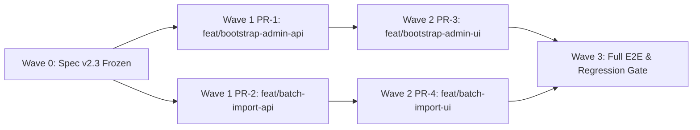

# Proposal Cold-Start Spec v2.3：首任管理员引导注册 · 多本子批量冷启动与时序合入

| 项 | 值 |
|---|---|
| 状态 | Approved for implementation |
| 基线 | `proposal-coldstart-spec-v2.md`、`proposal-coldstart-spec-v2.2-dossier-basket.md` |
| 交付 | PR-1（首任管理员引导后端）、PR-2（多本子批量冷启动后端）、PR-3（首任管理员引导前端）、PR-4（多本子批量导入向导前端） |
| 原则 | **Zero-LLM & Fail-Closed**：所有账号引导、跨本子身份对齐与时序合入均为确定性逻辑；首任管理员通道具备永久单向关闭与并发锁保护 |
| 作者 | Principal Architect, LabAgent |

---

## 1. 背景与目标

### 1.1 痛点与场景

1. **生产环境冷启动死锁（G10 延伸）**：`APP_ENV=prod` 或全新部署未执行演示种子（`seed.py`）时，`users` 表中没有任何 `role='admin'` 账号，导致首位课题组负责人（PI）或系统管理员打开登录页时无法通过 Web 界面完成初始化，只能进容器执行 CLI。
2. **多份历史申请书冷启动繁琐且易产生重复账号**：课题组在冷启动阶段往往同时拥有 3~10 份不同年份的国家自然科学基金、重点研发计划或省基金申请书 `.docx`。单份逐一上传、逐一预览、逐一开号不仅操作繁琐，还会遇到：
   - 同一名成员在 2022 年本子中未填学工号（降级为 T2 拼音 `zhangsan`），而在 2024 年本子中填了学工号（T1 `2431101262`），逐份独立预览时无法在开号前跨本子自动补齐学工号或邮箱；
   - 若管理员不慎先对 2024 年本子开号、后对 2021 年本子执行操作，或对多份本子重复生成多份零散的账号分发清单，会造成群发通知混乱与状态倒退风险。

### 1.2 目标

- **G1（首任管理员 Web 引导注册）**：当系统处于非 OIDC 模式且数据库中不存在任何 `role='admin'` 记录（无论 `is_active` 为何值）时，开放首任管理员初始化接口与登录页引导模式；一旦存在任意 `admin` 记录，通道永久关闭。生产环境（`APP_ENV=prod`）强制校验一次性初始化令牌（Setup Token）。
- **G2（多本子批量解析与跨本子身份预对齐）**：支持一次选择多份 `.docx` 申请书，并提供批量预对齐接口 `POST /api/v1/admin/imports/batch/resolve`，在尚未开号的 `parsed` 任务集合内跨本子补齐同人缺失的 `student_id`（T1 学工号）与 `email`，统一消解重名后缀与冲突。
- **G3（单事务时序批量开号与合并）**：提供 `POST /api/v1/admin/imports/batch/provision`，在单个数据库事务内按 `(as_of_time ASC, created_at ASC, id ASC)` 时间轴顺序自动完成「首份本子建基线 + 后续本子增补新成员并按 Spec v2 §10 规则做字段级时序合并 + 电子签名依序落库 + 单次 RAG 档案索引同步」，最终输出一份合并后的全组账号分发清单（纯文本 + CSV）。

### 1.3 非目标

- 不提供第二个管理员的自助注册通道（后续管理员只能由首任管理员在 `/admin/users` 创建或提权）。
- 不在 OIDC 模式下启用本地管理员引导注册。
- 不修改已落库 `users` 的 `login_name` 或 `email`（跨本子身份字段注入严格限定在开号前的 `parsed` 预览态，见 §3.2.1）。

---

## 2. 功能一：首任管理员引导注册（First-Admin Bootstrap）

### 2.1 安全不变式（P0 级强制要求）

1. **永久单向关闭（Permanent One-Way Closure）**：
   - 判定条件：`SELECT id FROM users WHERE role = 'admin' LIMIT 1`。
   - **严禁过滤 `is_active == True`**：即使系统中唯一的管理员被停用（`is_active = False`），初始化通道也必须保持关闭（`needs_bootstrap = False`，POST 返回 `409 bootstrap_closed`），防止攻击者在管理员账号被意外禁用时抢注新管理员。
2. **并发互斥（Advisory Lock）**：
   - `POST /api/v1/auth/bootstrap-admin` 在数据库事务最开始必须执行 `SELECT pg_advisory_xact_lock(2026110901)`，然后再次查询是否存在 `role = 'admin'`。并发请求下保证只有唯一请求返回 `200`，其余全部返回 `409 bootstrap_closed`。
3. **OIDC 模式互斥**：
   - 当配置了非空的 `settings.oidc_issuer` 时，`GET /api/v1/auth/bootstrap-status` 返回 `needs_bootstrap = False, oidc_mode = True`；`POST /api/v1/auth/bootstrap-admin` 直接返回 `403 bootstrap_disabled`。
4. **生产环境一次性初始化令牌（Prod Setup Token）**：
   - 新增配置项：
     - `bootstrap_token: SecretStr | None = None`（环境变量 `BOOTSTRAP_TOKEN`）
     - `bootstrap_token_file: str = "./data/bootstrap_admin.token"`（环境变量 `BOOTSTRAP_TOKEN_FILE`）
   - 解析规则 `_resolve_bootstrap_token(settings)`：优先取非空的 `settings.bootstrap_token`；否则若 `settings.bootstrap_token_file` 存在且非空，读取其去除首尾空白后的内容；否则返回 `None`。
   - 当 `settings.app_env == "prod"` 且非 OIDC 模式时，应用启动（`lifespan`）若检测到数据库中无任何 `role = 'admin'` 且 `_resolve_bootstrap_token(settings)` 为 `None`，则自动生成 `secrets.token_urlsafe(24)` 写入 `settings.bootstrap_token_file`（权限 `0600`），并记录结构化日志 `bootstrap_admin_token_ready`（仅含文件路径 `token_file`，**严禁在日志中打印令牌明文**）。
   - 当 `settings.app_env == "prod"` 或 `_resolve_bootstrap_token(settings) is not None` 时：`setup_token_required = True`，`POST /api/v1/auth/bootstrap-admin` 必须用 `secrets.compare_digest` 校验请求体中的 `setup_token`，不匹配或缺失一律返回 `403 setup_token_invalid`。
   - 注册事务提交成功后，若 `bootstrap_token_file` 存在，执行最佳努力删除（`unlink(missing_ok=True)`）。

### 2.2 接口契约

#### 2.2.1 `GET /api/v1/auth/bootstrap-status`

- **鉴权**：公开接口（无需登录）。
- **限流**：复用 `request.app.state.limiter.check_login(ip, "bootstrap-status")`，超限写 `login_rate_limited` 审计并返回 `429 rate_limited`。
- **响应 200**：
  ```json
  {
    "needs_bootstrap": true,
    "setup_token_required": false,
    "oidc_mode": false
  }
  ```

#### 2.2.2 `POST /api/v1/auth/bootstrap-admin`

- **鉴权**：公开接口（仅在 `needs_bootstrap == True` 时可用）。
- **限流**：复用 `request.app.state.limiter.check_login(ip, "bootstrap")`，超限写 `login_rate_limited` 审计并返回 `429 rate_limited`。
- **请求体**（`extra="forbid"`）：
  ```json
  {
    "display_name": "郭建民",
    "email": "guojianmin@example.edu.cn",
    "staff_no": "10982341",
    "password": "StrongPassword#2026",
    "setup_token": null
  }
  ```
- **字段校验规则**：
  1. `display_name`：经 `normalize_person_name` 清洗后非空，否则返回 `422 invalid_display_name`（`"请填写真实姓名"`）。
  2. `email`：经 `clean_email` 校验并转为小写，不合法返回 `422 invalid_email`（`"请输入有效的邮箱地址"`）。
  3. `staff_no`（可选，教工号/学工号，作为 `users.login_name`）：
     - 若传入非空字符串：经 NFKC 归一化并 strip；
     - 若命中 `is_pii_id_or_phone(raw_staff)`（18/15 位身份证号或手机号），返回 `422 staff_no_invalid`（`"工号不可填写身份证号或手机号"`）；
     - 转为小写后，若属于 `RESERVED_LOGIN_NAMES` 或不匹配 `T1_CERT_RE`（`^(?=.*\d)[a-z0-9]{6,12}$`），返回 `422 staff_no_invalid`（`"工号需为 6~12 位字母或数字（至少含 1 位数字），且不可为系统保留名"`）。
  4. `password`：调用 `validate_password(body.password, valid_email)`，不通过返回 `422 password_policy_violation`。
- **事务与唯一性检查**：
  - 获取事务级咨询锁 `pg_advisory_xact_lock(2026110901)`；
  - 检查 `SELECT id FROM users WHERE role = 'admin' LIMIT 1`，若存在返回 `409 bootstrap_closed`；
  - 校验 `setup_token`（若需要），不通过返回 `403 setup_token_invalid`；
  - 检查 `lower(users.email) == valid_email` 或（当 `staff_login` 非空时）`lower(users.login_name) == staff_login` 是否已被存量非管理员用户占用，若占用返回 `409 identity_taken`；
  - 插入 `User(email=valid_email, login_name=staff_login, display_name=clean_name, password_hash=hash_password(body.password), role="admin", is_active=True, must_change_password_by=None)`；
  - 调用 `issue_token(user, settings)` 签发 JWT，提交事务，清理一次性令牌文件；
  - 写入审计事件 `action="bootstrap_admin"`，`resource_type="user"`，`resource_id=str(user.id)`，`detail={"user_id": str(user.id)}`（严禁包含邮箱、姓名、工号或口令）。
- **响应 200**（与 `POST /api/v1/auth/login` 结构一致，前端可直接建立会话）：
  ```json
  {
    "access_token": "eyJhbG...",
    "token_type": "bearer",
    "expires_in": 28800,
    "user": {
      "id": "...",
      "display_name": "郭建民",
      "role": "admin",
      "email": "guojianmin@example.edu.cn",
      "login_name": "10982341",
      "must_change_password": false,
      "must_change_password_by": null
    }
  }
  ```

---

## 3. 功能二：多本子批量冷启动（Batch Cold-Start Resolve & Chronological Provision）

### 3.1 设计概览

多本子冷启动复用现有的单文件解析接口 `POST /api/v1/admin/imports`（每份 `.docx` 生成或复用一条 `status='parsed'` 的 `ImportJob`），在此基础上新增两个批量编排端点：

1. `POST /api/v1/admin/imports/batch/resolve`：对一组 `parsed` 状态的 `ImportJob` 执行跨本子身份对齐、基准时间校验与按时间序的实体变更预览，并将对齐后的 `preview.people` 持久化回各 `ImportJob.preview`。
2. `POST /api/v1/admin/imports/batch/provision`：在单个数据库事务内按时间轴从旧到新依次执行账号开通、资产入库与时序字段合并，输出合并后的统一账号分发清单。

### 3.2 跨本子身份预对齐（`POST /api/v1/admin/imports/batch/resolve`）

#### 3.2.1 与 Spec v2 §10.4 的边界关系说明（Bounded Exception）

Spec v2 §10.4 规定：对于**已经落库**的 `LabPerson` 与 `User` 记录，后续导入在合并（Phase 2 Merge）时不自动覆写姓名、学工号等身份类字段，亦不自动修改已创建用户的 `login_name` 与 `email`。

在多本子批量冷启动的**开号前预览阶段（Pre-Provision Batch Resolution）**，所有待处理的 `ImportJob` 均处于 `status='parsed'` 的临时预览态，尚未为这些本子中的新成员创建 `User` 或 `LabPerson`。此时同一名课题组成员在不同年份的申请书中往往存在信息互补（例如 A 本子有学工号无邮箱、B 本子有邮箱无学工号）。因此，本规范定义如下**有界例外（Bounded Exception to Spec v2 §10.4）**：

- **作用范围仅限同批次 `status='parsed'` 任务的 `preview.people`**：在调用 `batch/resolve`（及 `batch/provision` 内部重算）时，若多份待导入本子中的人员记录满足「规范化姓名 `normalize_person_name(name)` + 规范化单位 `norm(affiliation)` 完全一致」，且该 `(name, affiliation)` 在每份本子内部均无重名歧义（单本子内计数为 1），同时各本子之间非空的 T1 学工号彼此无冲突、非空的邮箱彼此无冲突，则允许将最新本子中已知的 `student_id`（T1 学工号）与 `email` 注入到同批次缺失该字段的兄弟 `ImportJob.preview.people` 条目中。
- **不触碰已落库账号**：一旦某人已匹配到数据库存量 `User`（`match.status == "existing"`），其存量 `User.login_name`、`User.email`、`User.role` 严格保持不变。

#### 3.2.2 统一身份分配算法

1. **输入校验**：
   - `job_ids` 去重后数量须为 `1..20`，为空返回 `422 batch_empty`，超限返回 `422 batch_too_large`。
   - 所有 `job_id` 必须存在且 `status == "parsed"`，否则返回 `404 not_found` 或 `409 import_not_parsed`。
2. **时序排序**：
   - 每份任务的生效基准时间 `effective_as_of = as_of_overrides.get(job.id) or job.as_of_time or parse_iso(job.preview.get("as_of_time"))`。
   - 按 `(effective_as_of is None, effective_as_of ASC, job.created_at ASC, str(job.id) ASC)` 排序（已确定日期的按从旧到新排在前面，缺失日期的排在末尾并标记 `AS_OF_TIME_MISSING`）。
3. **跨本子互补与联合分配**：
   - 按 §3.2.1 聚合無歧义同人信息，向缺失 `student_id` / `email` 的兄弟预览条目补充字段；
   - 按排序后的本子顺序，维护批次级共享的已占用集合與映射表，使同一人在批次内所有本子中获得**完全一致**的 `(tier, login_name, email, fingerprint, match)`；
   - 不同本子中的**不同人**（例如不同单位的同名者 `王磊`）在跨本子分配拼音登录名时共享 `used_logins` 集合，后出现的自动追加数字后缀（`wanglei` → `wanglei2`）并标记 `LOGIN_NAME_SUFFIXED`，杜绝跨本子开号时的唯一约束冲突。
4. **响应结构（200）**：
   - 返回排序后的 `jobs` 列表（含每份本子的 `job_id`、`original_filename`、`as_of_time`、`as_of_time_missing`、各实体计数、阻断项统计）、跨本子去重后的 `people_roster_preview`（展示每名成员来源于哪几份本子、最终拟用 `login_name`、`tier`、`match`、`warnings`）以及汇总 `summary`（`total_jobs`、`ready_to_provision`、`blocking_reasons`）。

### 3.3 单事务时序批量开号（`POST /api/v1/admin/imports/batch/provision`）

#### 3.3.1 请求体（`extra="forbid"`）

```json
{
  "job_ids": ["uuid-1", "uuid-2"],
  "as_of_overrides": {
    "uuid-1": "2022-03-15",
    "uuid-2": "2024-03-18"
  },
  "initial_password": null,
  "include_password": true,
  "people_overrides": [
    {
      "key": "p1",
      "job_id": null,
      "exclude": false,
      "login_name": "guojianmin",
      "link_user_id": null
    }
  ],
  "exclude_keys_by_job": {},
  "skip_signature_ids_by_job": {}
}
```

#### 3.3.2 单事务执行步骤

整个批量开号在**单个数据库事务**内完成，任一步骤失败全部回滚：

1. **加锁与校验**：
   - 执行 `SELECT pg_advisory_xact_lock(2026111008)`；
   - `SELECT ... FROM import_jobs WHERE id IN (...) FOR UPDATE`；
   - 确认所有任务均存在且 `status == "parsed"`，且每份任务的生效 `as_of_time` 均非空（任一缺失则返回 `422 as_of_time_required`）。
2. **跨本子预对齐与 Override 应用**：
   - 应用 `as_of_overrides`、`people_overrides`（当 `job_id` 为空时按 `key` 或统一身份作用于对应任务，指定 `job_id` 时仅作用于该任务）与 `exclude_keys_by_job`；
   - 执行 §3.2 的跨本子身份对齐，并对所有新建账号校验 `validate_password(initial_password, email)`。
3. **按时间轴从旧到新（`effective_as_of ASC, created_at ASC, id ASC`）依次执行**：
   - **第 1 份本子（最早基准时间）**：
     - 调用 `provision_import_job(..., sync_rag=False)`：创建新建成员的 `User(role='member')`，插入 `LabPerson`、`LabAchievement`、`LabProject`、`LabFacility` 基线记录，写入初始 `FieldProvenance`，并持久化该本子的电子签名。
   - **第 2..N 份本子（后续基准时间）**：
     - 首先为该本子中尚未在前面本子或存量库中创建账号的新成员创建 `User(role='member')`（已在前面本子创建或关联的成员自动命中 `existing` 并复用其 `user_id`）；
     - 将新建或关联的 `user_id` 绑定到人员预览后，调用 `execute_merge(..., sync_rag=False)`：
       - 新实体（人员、成果、项目、条件）直接插入并记录 `FieldProvenance`；
       - 已存在实体按 Spec v2 §10.4 的 `effective_value` 时序裁决规则更新状态类字段（因为按 `as_of_time` 升序执行，新本子的非空状态字段自然演进更新，空字段保留旧本子值，绝不会发生时间倒退）；
       - 为新插入的 `LabPerson` 补齐 `user_id` 关联；
       - 调用 `persist_import_signatures` 落库该本子抽取的电子签名；
       - 将该 `ImportJob.status` 标记为 `"provisioned"`，记录 `provisioned_at`、`provisioned_by` 与 `stats`。
4. **单次 RAG 同步与统一分发清单生成**：
   - 在所有任务处理完毕后，调用一次 `sync_lab_profile_rag(session, owner_id=actor_id, embedder=embedder)`；
   - 汇总全批次新建账号（去重保序）与已有账号，调用 `render_roster_text` 与 `render_roster_csv` 生成全批次统一的微信群分发文本与 CSV；
   - 提交事务，写入审计事件 `action="import_proposal_batch_provision"`。

---

## 4. 并行开发执行计划与依赖图（4-Wave Parallel Execution Plan & DAG）

### 4.1 波次划分与任务卡

| 波次 | PR / 任务 | 分支 / Worktree | 依赖 | 核心职责 |
|---|---|---|---|---|
| **Wave 0** | Spec v2.3 冻结 | `feat/bootstrap-admin-api`（同 PR-1 提交） | — | 编写本规范 `proposal-coldstart-spec-v2.3-bootstrap-batch.md` 并在 `mvp-and-roadmap.md` 注册索引 |
| **Wave 1** | **PR-1**：首任管理员引导后端 API | `feat/bootstrap-admin-api` (`/data/lab-agent/wt/bootstrap-admin-api`) | Wave 0 | 实现 `GET /api/v1/auth/bootstrap-status`、`POST /api/v1/auth/bootstrap-admin`、生产一次性令牌生成与完备单测 |
| **Wave 1** | **PR-2**：多本子批量冷启动后端 API | `feat/batch-import-api` (`/data/lab-agent/wt/batch-import-api`) | Wave 0 | 实现 `batch/resolve` 与 `batch/provision`、跨本子身份对齐、单事务时序开号合并与完备单测 |
| **Wave 2** | **PR-3**：登录页首任管理员引导前端 | `feat/bootstrap-admin-ui` (`/data/lab-agent/wt/bootstrap-admin-ui`) | PR-1 | `/login` 自动探测 `bootstrap-status`、切换首任管理员注册表单、支持工号与 Setup Token、自动登录跳转 |
| **Wave 2** | **PR-4**：多本子批量冷启动向导前端 | `feat/batch-import-ui` (`/data/lab-agent/wt/batch-import-ui`) | PR-2 | `ImportProposalWizard` 支持多选 `.docx` 上传、批量时序预览、跨本子人员清单与一键批量开号结果页 |
| **Wave 3** | 全量集成验收门禁 | 主线合入后验证 | PR-3, PR-4 | 运行后端全量 pytest、前端 `tsc --noEmit` & `npm run build`、端到端冒烟验证 |

### 4.2 依赖图（DAG）



### 4.3 `allowed_paths` 与 `hot_resources`

每个 PR 严格限制只允许修改其 `allowed_paths` 内的文件，确保同波次 PR 之间文件集合零交集（Zero File Overlap）：

| PR | `allowed_paths` | `hot_resources` |
|---|---|---|
| **Wave 0 + PR-1** (`feat/bootstrap-admin-api`) | `docs/specs/proposal-coldstart-spec-v2.3-bootstrap-batch.md`<br>`docs/specs/mvp-and-roadmap.md`<br>`backend/app/config.py`<br>`backend/app/main.py`<br>`backend/app/routes_auth_bootstrap.py`<br>`backend/tests/test_bootstrap_admin.py` | `backend/app/config.py`、`backend/app/main.py`（仅 PR-1 持有，PR-2 严禁触碰） |
| **PR-2** (`feat/batch-import-api`) | `backend/app/importer/batch.py`<br>`backend/app/importer/provision.py`<br>`backend/app/importer/provenance.py`<br>`backend/app/routes_lab_imports.py`<br>`backend/tests/test_batch_import.py` | `backend/app/routes_lab_imports.py`、`backend/app/importer/provision.py`、`backend/app/importer/provenance.py`（仅 PR-2 持有；路由已由 `routes_lab.py` 聚合挂载，无需修改 `main.py`） |
| **PR-3** (`feat/bootstrap-admin-ui`) | `frontend/lib/api.ts`<br>`frontend/lib/i18n.tsx`<br>`frontend/app/login/page.tsx` | `frontend/lib/api.ts`、`frontend/lib/i18n.tsx`（仅 PR-3 持有，PR-4 严禁触碰） |
| **PR-4** (`feat/batch-import-ui`) | `frontend/lib/lab-api.ts`<br>`frontend/app/lab/components/ImportProposalWizard.tsx`<br>`frontend/app/lab/components/BatchImportSteppers.tsx` | `frontend/lib/lab-api.ts`、`ImportProposalWizard.tsx`（仅 PR-4 持有） |

---

## 5. 验收测试清单

### 5.1 PR-1（`backend/tests/test_bootstrap_admin.py`）

- [ ] 默认已有活跃 `admin` 时：`GET /api/v1/auth/bootstrap-status` 返回 `needs_bootstrap=False`，`POST /api/v1/auth/bootstrap-admin` 返回 `409 bootstrap_closed`。
- [ ] 将所有 `admin` 设为 `is_active=False` 时：`needs_bootstrap` 仍为 `False`，`POST /api/v1/auth/bootstrap-admin` 仍返回 `409 bootstrap_closed`（P0 安全红线）。
- [ ] 删除全部 `role='admin'` 记录后：`needs_bootstrap=True`；提交合法的 `display_name`、`email`、`staff_no`、`password` 返回 `200`，签发 JWT 且 `user.role == "admin"`、`user.login_name == staff_no`；审计表记录 `bootstrap_admin` 且 `detail` 不含 PII；使用返回的 token 请求 `GET /api/v1/auth/me` 返回 `200`。
- [ ] 并发竞态测试：无管理员时并发发起两个 `POST /api/v1/auth/bootstrap-admin`，断言恰好一个返回 `200`、另一个返回 `409 bootstrap_closed`。
- [ ] 生产环境与 `bootstrap_token` 校验：`APP_ENV=prod` 或配置了 `bootstrap_token` 时，缺失或错误的 `setup_token` 返回 `403 setup_token_invalid`，正确令牌返回 `200`；`ensure_prod_bootstrap_token` 在无管理员时自动生成 `0600` 权限的令牌文件，并在注册成功后自动清理。
- [ ] OIDC 模式：设置 `oidc_issuer` 后，`GET /bootstrap-status` 返回 `needs_bootstrap=False, oidc_mode=True`，`POST /bootstrap-admin` 返回 `403 bootstrap_disabled`。
- [ ] 输入校验：身份证号/手机号作为 `staff_no` 返回 `422 staff_no_invalid`；保留字 `admin` 作为 `staff_no` 返回 `422 staff_no_invalid`；弱口令返回 `422 password_policy_violation`；多余未知字段返回 `422`。

### 5.2 PR-2（`backend/tests/test_batch_import.py`）

- [ ] 上传 3 份不同年份（如 2022、2023、2024）的申请书（乱序传入 `job_ids`），`POST /api/v1/admin/imports/batch/resolve` 自动按 `as_of_time` 升序排列。
- [ ] 跨本子身份互补：2022 年本子中某成员无学工号（T2），2024 年本子中同一姓名+单位的成员有 T1 学工号与邮箱，`batch/resolve` 后两份本子中该成员均升级为 T1 并共享同一 `login_name` 与 `fingerprint`。
- [ ] `POST /api/v1/admin/imports/batch/provision` 单事务时序执行：同一成员只创建一个 `User(role='member')` 与一条 `LabPerson`，其职称等状态字段取 2024 年最新本子的非空值，而 2024 年本子为空、2022 年本子非空的字段保留 2022 年的值（无时间倒退）。
- [ ] 统一生成的 `roster_text` 与 `roster_csv` 包含全批次所有新建成员且无重复行、无 PII 泄露。
- [ ] 事务原子性：若批次中任一任务缺少 `as_of_time` 或存在未消解的登录名冲突，整批回滚，没有任何 `ImportJob` 变为 `provisioned`，也不残留新建用户。
